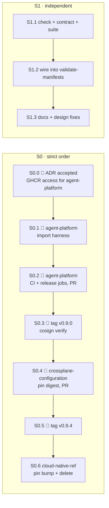

# AI platform split — S0 (harness image to agent-platform) and S1 (boundary check) Implementation Plan

> **For agentic workers:** REQUIRED SUB-SKILL: use superpowers:subagent-driven-development (recommended)
> or superpowers:executing-plans to implement this plan task by task. Steps use checkbox (`- [ ]`)
> syntax for tracking.

**Goal:** S0 (#2312): `agent-harness` is built, tested, signed and released by `Smana/agent-platform`,
`crossplane-configuration` pins that release by digest, and `cloud-native-ref` stops building it.
S1 (#2313): a CI check in `cloud-native-ref` fails on any reference across the host/AI boundary
that the host contract does not list.

**Architecture:** S0 is a four-repository relay where every hop is pinned before the previous
source is removed: agent-platform publishes `ghcr.io/smana/agent-harness:v0.9.0` (same image name,
signed, release-workflow identity) → crossplane-configuration `v0.9.4` pins its digest →
cloud-native-ref bumps the Configuration pin and only then deletes `container-images/agent-harness`.
S1 is one source-tree Python check (`check-ai-boundary.py`) driven by a data file
(`ai-boundary.yaml`: design §1's move list plus the §2 contract items a reference can cross), run
as a step of `validate-manifests.sh` (so `task check` and CI's required `kubernetes-validation` job
run it) and proven by a suite that plants crossings in a copy of the real tree.

**Tech Stack:** GitHub Actions, docker buildx, cosign keyless, GHCR, KCL (function-kcl), Crossplane
packages, Flux Kustomization/HelmRelease, Python 3 + PyYAML, Taskfile.

**Spec:** `docs/superpowers/specs/2026-10-12-ai-platform-split-design.md` (§1, §2 H1–H8, §6 S0/S1),
ADR `website/content/docs/decisions/0057-ai-platform-own-repository.md`. Acceptance: the "Done when"
lists of #2312 and #2313.

---

## Global Constraints

- **Worktree per repository, per task group.** cloud-native-ref: `EnterWorktree` (subagents:
  `isolation: "worktree"`), branched from a freshly fetched `origin/main` (`8c19b3af` at writing).
  agent-platform and crossplane-configuration: `git worktree add` from their `origin/main`
  (`44faad6`, `a425e4c` at writing). The local checkouts of both are stale or on dead branches.
- **One `git -C <repo> …` per command**; no loops or `$(…)` around git (the session guard refuses them).
- **Commits:** conventional, no `Co-Authored-By`, no generated-with lines. cloud-native-ref is
  emoji-prefixed (`✨ feat(scripts): …`); agent-platform and crossplane-configuration use plain
  conventional subjects, as their history does (`chore(agentrun): pin the released harness v0.3.0`).
- **Never unpinned:** no task deletes or repoints a harness source until the next hop pins a
  signed digest that exists. Task order S0.1 → S0.6 is strict; S1 is independent of all of it.
- **Heavy local runs** (`validate-manifests.sh`, `run.sh`, harness `docker build`) under
  `systemd-run --user --scope -q -p MemoryMax=6G -p MemorySwapMax=0`. Never two
  `validate-manifests.sh` in one checkout at once (they race on `.bundle/`).
- **Maintainer-only steps are marked 👤**: GHCR package settings, release tags, ADR acceptance,
  and every cloud-native-ref change to a `.policy.yml` gate path (`.policy.yml`,
  `scripts/ci/check-policy-gate-coverage.sh`, `container-images/agent-harness/`,
  `docs/superpowers/`, `website/content/docs/decisions/`). Those PRs must be authored by Smana
  (rule `human-authored`); an agent-authored PR touching them cannot merge.
- **Cross-repo steps are marked 🔀** with the repository they run in.

## Owner decisions

| # | Decision | Status |
|---|---|---|
| D0 | ADR-0057 accepted | **Pending.** If rejected, S0 is dropped (issue #2312); S1 still lands (it is useful without the split) |
| D1 | The harness source leaves cloud-native-ref's gate paths. What replaces `^container-images/agent-harness/`? | **Decided (owner, 2026-10-12).** The Configuration pin that selects the harness (and the AgentRun composition): `^infrastructure/base/crossplane/configuration-(aws\|gcp)/`, with the sentinel swapped accordingly. Today an agent PR can already repin the Configuration ungated; this closes that |
| D2 | Image name | **Decided (owner, 2026-10-12).** Unchanged, `ghcr.io/smana/agent-harness`: runbook 07 greps that name, and agent-platform's next version (`v0.9.0`) sorts after every harness tag (`v0.3.0` max). The design's "new image name" is not needed |
| D3 | Design §1/§2 corrections found by S1 (see Task S1.1 step 4) | Encode them in `ai-boundary.yaml` and amend the design in the same PR |

---

## File map

| Repo | File | Task | Change |
|---|---|---|---|
| agent-platform | `images/agent-harness/**` | S0.1 | Create (imported from cloud-native-ref) |
| agent-platform | `images/agent-harness/Dockerfile` | S0.1 | Drop `ARG AGENT_HARNESS_VERSION` block |
| agent-platform | `images/agent-harness/build.sh` | S0.1 | Delete (replaced by `task harness:test`) |
| agent-platform | `images/agent-harness/README.md` | S0.1 | Test/release line |
| agent-platform | `taskfile.yaml` | S0.1 | `harness:test` |
| agent-platform | `.github/dependabot.yml` | S0.1 | Ignore `ghcr.io/openhands/agent-server` |
| agent-platform | `README.md` | S0.1 | Images table row |
| agent-platform | `.github/workflows/ci.yaml` | S0.2 | `harness-test` job; harness in `prerelease` matrix |
| agent-platform | `.github/workflows/release.yaml` | S0.2 | Harness in matrix; test stage before push |
| crossplane-configuration | `apis/agentrun/kcl/main_test.k` | S0.4 | Expect `v0.9.0` |
| crossplane-configuration | `apis/agentrun/kcl/main.k`, `apis/agentrun/composition.yaml`, `tests/golden/agentrun-{basic,complete}.yaml` | S0.4 | New image ref |
| cloud-native-ref | `scripts/ci/check-policy-gate-coverage.sh` 👤 | S0.6 | Sentinel swap (D1) |
| cloud-native-ref | `.policy.yml` 👤 | S0.6 | Gate path swap ×3 (D1) |
| cloud-native-ref | `container-images/agent-harness/` 👤 | S0.6 | Delete |
| cloud-native-ref | `.github/renovate.json` | S0.6 | Drop the harness requirements rule |
| cloud-native-ref | `infrastructure/base/crossplane/configuration-{aws,gcp}/configuration-packages.yaml`, `apps/platform/app-wizard/app.yaml` | S0.6 | `v0.9.3` → `v0.9.4` |
| cloud-native-ref | ADR-0057, `decisions/_index.md`, design status line 👤 | S0.6 | Proposed → Accepted |
| cloud-native-ref | `scripts/ci/flux-schema/check-ai-boundary.py` | S1.1 | Create |
| cloud-native-ref | `scripts/ci/flux-schema/ai-boundary.yaml` | S1.1 | Create |
| cloud-native-ref | `scripts/ci/tests/flux-schema/test-check-ai-boundary.py` | S1.1 | Create |
| cloud-native-ref | `scripts/ci/validate-manifests.sh` | S1.2 | Run the check |
| cloud-native-ref | `scripts/AGENTS.md` | S1.3 | One paragraph |
| cloud-native-ref | `docs/superpowers/specs/2026-10-12-ai-platform-split-design.md` 👤 | S1.3 | §1/§2 corrections (D3) |



---

# Group S0 — harness image to agent-platform (#2312)

### Task S0.0 👤: preconditions (maintainer)

**Files:** none (GitHub settings).

- [ ] **Step 1: ADR decision (D0).** If ADR-0057 is rejected, stop S0 here.
- [ ] **Step 2: Grant agent-platform write access to the existing GHCR package.** The package
  `agent-harness` was created by cloud-native-ref's workflow, so only that repository's
  `GITHUB_TOKEN` can push to it. In
  `https://github.com/users/Smana/packages/container/agent-harness/settings` → *Manage Actions
  access* → *Add repository* `Smana/agent-platform`, role **Write**. Leave cloud-native-ref's
  access until S0.6 merges.
- [ ] **Step 3: Record the source commit to import.**

Run: `git -C /home/smana/Sources/cloud-native-ref fetch origin`
Run: `git -C /home/smana/Sources/cloud-native-ref log -1 --format=%h origin/main -- container-images/agent-harness`
Expected: one short sha (the last harness change; `v0.3.0`'s source). Write it down as `HARNESS_SRC`;
S0.6 step 1 checks that nothing changed after it.

### Task S0.1 🔀 agent-platform: import the harness

**Files:**
- Create: `images/agent-harness/` (all files of `container-images/agent-harness/`)
- Modify: `images/agent-harness/Dockerfile`, `images/agent-harness/README.md`, `taskfile.yaml`,
  `.github/dependabot.yml`, `README.md`
- Delete: `images/agent-harness/build.sh`

**Interfaces:** `task harness:test` → `docker build --target test images/agent-harness` (exit 0 when
every suite passes). The image's default target and entrypoint are unchanged.

- [ ] **Step 1: Worktree.**

Run: `git -C /home/smana/Sources/agent-platform fetch origin`
Run: `git -C /home/smana/Sources/agent-platform worktree add -b feat/agent-harness-image ../agent-platform-harness origin/main`

- [ ] **Step 2: Import the files at `HARNESS_SRC`** (tracked files only, modes kept).

Run: `git -C /home/smana/Sources/cloud-native-ref archive --prefix=images/ HARNESS_SRC:container-images agent-harness -o /tmp/claude-1000/harness.tar`
Run: `tar -xf /tmp/claude-1000/harness.tar -C /home/smana/Sources/agent-platform-harness`
Run: `ls /home/smana/Sources/agent-platform-harness/images/agent-harness`
Expected: `agent_run.py build.sh commit-msg Dockerfile gh gitconfig git_credential_agent.py pr_footer.py README.md requirements.in requirements.txt site tests upstream-constraints.txt`

- [ ] **Step 3: Write the failing test first: the task the CI job will call does not exist yet.**

Run: `cd /home/smana/Sources/agent-platform-harness && task harness:test`
Expected: `task: Task "harness:test" does not exist`, exit 200.

- [ ] **Step 4: Add the task** to `taskfile.yaml`, after `chart:check`:

```yaml
  harness:test:
    desc: The agent harness image's test stage (needs docker; kept out of check, which does not)
    cmds:
      - docker build --target test images/agent-harness
```

- [ ] **Step 5: Version comes from the release tag now.** In `images/agent-harness/Dockerfile`
  delete exactly these lines (release.yaml tags the image with the git tag; nothing reads the ARG):

```dockerfile
# `.github/workflows/build-container-images.yml` tags the image with this.
# H-1 (SP2 ruling P37): a new source version, so its merge never republishes SP1's v0.1.0 tag.
# O-1 (observability plan O21): after H-1's v0.1.1.
# H-S3 (SP2 ruling P32): the provenance footer, after O-1's v0.1.2.
# Disruption design §2: the SIGTERM sequence and the checkpoint trailer, on top of H-S3's footer.
# A pull request build is pushed by hand as v0.3.0-pr<N>.<sha8>; v0.3.0 itself is published when it
# merges, so it never republishes H-S3's v0.2.0.
ARG AGENT_HARNESS_VERSION=v0.3.0
```

and replace the next line `# renovate: datasource=github-releases depName=cli/cli` with
`# cli/cli release: Dependabot cannot bump an ARG; move GH_VERSION and both sums together by hand.`

- [ ] **Step 6: Delete `build.sh`** (`git rm images/agent-harness/build.sh`) and in
  `images/agent-harness/README.md` replace the last line
  ``Test with `docker build --target test .`; `./build.sh` tests then builds.`` with:

```markdown
Test with `task harness:test`. `release.yaml` builds, tests, signs and pushes it as
`ghcr.io/smana/agent-harness:<release tag>`; the AgentRun composition in crossplane-configuration
pins that digest. Versions up to `v0.3.0` were released from cloud-native-ref.
```

- [ ] **Step 7: Keep the OpenHands base in step with the `openhands-*` pins.** In
  `.github/dependabot.yml`, in the `docker` entry's `ignore:` list, add:

```yaml
      # The harness's base image moves with the openhands-* pins in images/agent-harness/requirements.in
      # and the lock compiled from them; a lone base bump departs from the tested set.
      - dependency-name: "ghcr.io/openhands/agent-server"
```

(No `pip` ecosystem is configured, so `requirements.txt` and `upstream-constraints.txt` stay
untouched by bots, as cloud-native-ref's Renovate rule kept them.)

- [ ] **Step 8: README images table.** In `README.md`, after the `agent-factory` row add:

```markdown
| `agent-harness` | Main container of every `AgentRun` pod: OpenHands agent-server plus `agent-run`, the git credential helper, `gh` with the PR footer and the trailer hook ([`images/agent-harness`](images/agent-harness/README.md)) | `ghcr.io/smana/agent-harness` |
```

and replace `Both images are multi-arch (`linux/amd64`, `linux/arm64`), static binaries on distroless `nonroot`.`
with `Every image is multi-arch (`linux/amd64`, `linux/arm64`). The Go ones are static binaries on distroless `nonroot`; the harness is OpenHands' Python image, run as uid 10001.`

- [ ] **Step 9: Run the test stage.**

Run: `cd /home/smana/Sources/agent-platform-harness && systemd-run --user --scope -q -p MemoryMax=6G -p MemorySwapMax=0 timeout 1800 task harness:test`
Expected: unittest output ending `OK`, exit 0.

- [ ] **Step 10: Source parity with what v0.3.0 was built from** (only the edited files differ).

Run: `git -C /home/smana/Sources/cloud-native-ref archive --prefix=parity/ HARNESS_SRC:container-images/agent-harness -o /tmp/claude-1000/parity.tar`
Run: `tar -xf /tmp/claude-1000/parity.tar -C /tmp/claude-1000`
Run: `diff -rq /tmp/claude-1000/parity /home/smana/Sources/agent-platform-harness/images/agent-harness`
Expected exactly: `Files … Dockerfile differ`, `Files … README.md differ`, `Only in /tmp/claude-1000/parity: build.sh`.

- [ ] **Step 11: `task check` still green** (Go gates; the harness adds no Go).

Run: `cd /home/smana/Sources/agent-platform-harness && task check`
Expected: exit 0.

- [ ] **Step 12: Commit.**

```bash
git -C /home/smana/Sources/agent-platform-harness add images/agent-harness taskfile.yaml .github/dependabot.yml README.md
git -C /home/smana/Sources/agent-platform-harness commit -m "feat(images): import the agent harness from cloud-native-ref" -m "Source: Smana/cloud-native-ref container-images/agent-harness at HARNESS_SRC (released there as v0.3.0). The version now comes from this repository's release tag; build.sh gives way to task harness:test. AI platform split S0 (cloud-native-ref#2312)."
```

### Task S0.2 🔀 agent-platform: test, publish and sign it in CI and on release

**Files:**
- Modify: `.github/workflows/ci.yaml`, `.github/workflows/release.yaml`

**Interfaces:** PR pushes publish `ghcr.io/smana/agent-harness:v<next-patch>-pr<N>.<sha8>`, signed by
`ci.yaml`; `v*` tags publish `ghcr.io/smana/agent-harness:<tag>`, signed by `release.yaml`
(`^https://github\.com/Smana/agent-platform/\.github/workflows/release\.yaml@refs/tags/v`).

- [ ] **Step 1: `ci.yaml`: a `harness-test` job**, after the `check` job:

```yaml
  # The harness's suites live in its Dockerfile's test stage; `task check` needs no docker.
  harness-test:
    runs-on: ubuntu-latest
    timeout-minutes: 30
    permissions:
      contents: read
    steps:
      - uses: actions/checkout@fbc6f3992d24b796d5a048ff273f7fcc4a7b6c09 # v5.1.0
        with:
          persist-credentials: false
      - uses: docker/setup-buildx-action@8d2750c68a42422c14e847fe6c8ac0403b4cbd6f # v3.12.0
      - uses: docker/build-push-action@10e90e3645eae34f1e60eeb005ba3a3d33f178e8 # v6.19.2
        with:
          context: images/agent-harness
          target: test
          push: false
```

- [ ] **Step 2: `ci.yaml` `prerelease` job:** `needs: check` → `needs: [check, harness-test]`;
  `image: [room-broker, room-bridge, agent-factory]` → `image: [room-broker, room-bridge, agent-factory, agent-harness]`;
  and in the `id: build` step replace `context: .` with:

```yaml
          # The Go images build from the module root; the harness from its own directory.
          context: ${{ matrix.image == 'agent-harness' && 'images/agent-harness' || '.' }}
```

- [ ] **Step 3: `release.yaml`:** same matrix line and same `context:` replacement in `id: build`;
  and insert before the `id: build` step:

```yaml
      # The harness's suites, before anything is pushed: a tag can point at an untested commit.
      - if: matrix.image == 'agent-harness'
        uses: docker/build-push-action@10e90e3645eae34f1e60eeb005ba3a3d33f178e8 # v6.19.2
        with:
          context: images/agent-harness
          target: test
          push: false
```

- [ ] **Step 4: Lint the workflows.**

Run: `cd /home/smana/Sources/agent-platform-harness && docker run --rm -v "$PWD:/repo" -w /repo rhysd/actionlint:1.7.7 -color=never`
Expected: no output, exit 0.

- [ ] **Step 5: Commit, push, open the PR.**

```bash
git -C /home/smana/Sources/agent-platform-harness add .github/workflows/ci.yaml .github/workflows/release.yaml
git -C /home/smana/Sources/agent-platform-harness commit -m "ci: test, publish and sign the agent harness image" -m "PR pushes publish a signed pre-release; v* tags a signed release, after the harness test stage."
git -C /home/smana/Sources/agent-platform-harness push -u origin feat/agent-harness-image
gh pr create -R Smana/agent-platform --head feat/agent-harness-image --title "feat: build and release the agent harness image" --body "Imports cloud-native-ref's container-images/agent-harness (AI platform split S0, Smana/cloud-native-ref#2312) and publishes ghcr.io/smana/agent-harness from this repository's release workflow, signed. Same image name: the next release tag sorts after the last harness tag (v0.3.0)."
```

- [ ] **Step 6: Prove the PR pre-release.** Poll with
  `gh pr view <N> -R Smana/agent-platform --json statusCheckRollup` until `harness-test`, `check` and
  all four `prerelease` legs are `SUCCESS`. A `permission_denied: write_package` on the harness leg
  means S0.0 step 2 was not done. Take the `ghcr.io/smana/agent-harness:…@sha256:…` line from the
  `prerelease (agent-harness)` job summary, then:

Run: `cosign verify ghcr.io/smana/agent-harness@sha256:<digest from the summary> --certificate-oidc-issuer https://token.actions.githubusercontent.com --certificate-identity-regexp '^https://github\.com/Smana/agent-platform/\.github/workflows/ci\.yaml@refs/pull/'`
Expected: `The cosign claims were validated`, exit 0.

- [ ] **Step 7 👤: Review and merge the PR.**

### Task S0.3 👤: release agent-platform v0.9.0

- [ ] **Step 1: Tag** (minor: a new image).

Run: `git -C /home/smana/Sources/agent-platform fetch origin`
Run: `git -C /home/smana/Sources/agent-platform tag -a v0.9.0 -m v0.9.0 origin/main`
Run: `git -C /home/smana/Sources/agent-platform push origin v0.9.0`

- [ ] **Step 2: Wait for `release`** (`gh run list -R Smana/agent-platform --workflow release.yaml --limit 1`
  until `completed success`; the arm64 legs build under QEMU, up to ~30 min).

- [ ] **Step 3: Record the digest and verify the signature (#2312 Done-when 1).**

Run: `docker buildx imagetools inspect ghcr.io/smana/agent-harness:v0.9.0 --format '{{.Manifest.Digest}}'`
Expected: `sha256:` + 64 hex. Record as `HARNESS_DIGEST`.

Run: `cosign verify ghcr.io/smana/agent-harness@HARNESS_DIGEST --certificate-oidc-issuer https://token.actions.githubusercontent.com --certificate-identity-regexp '^https://github\.com/Smana/agent-platform/\.github/workflows/release\.yaml@refs/tags/v'`
Expected: `The cosign claims were validated`, exit 0.

### Task S0.4 🔀 crossplane-configuration: pin the agent-platform harness

**Files:**
- Modify: `apis/agentrun/kcl/main_test.k:703`, `apis/agentrun/kcl/main.k:28-32`,
  `apis/agentrun/composition.yaml` (generated), `tests/golden/agentrun-basic.yaml:194`,
  `tests/golden/agentrun-complete.yaml:233`

**Interfaces:** `_HARNESS_PROFILES.openhands.image` =
`ghcr.io/smana/agent-harness:v0.9.0@HARNESS_DIGEST`. The claim API is unchanged.

- [ ] **Step 1: Worktree.**

Run: `git -C /home/smana/Sources/crossplane-configuration fetch origin`
Run: `git -C /home/smana/Sources/crossplane-configuration worktree add -b chore/agentrun-harness-agent-platform ../crossplane-configuration-harness origin/main`

- [ ] **Step 2: Failing test first.** In `apis/agentrun/kcl/main_test.k`, replace

```
    assert _image.startswith("ghcr.io/smana/agent-harness:v0.3.0@sha256:"), "the released disruption build (S5), which carries H-S3's PR footer (SP2 design §5)"
```

with

```
    assert _image.startswith("ghcr.io/smana/agent-harness:v0.9.0@sha256:"), "the disruption build (S5) with H-S3's PR footer, released by agent-platform v0.9.0 (AI split S0)"
```

Run: `cd /home/smana/Sources/crossplane-configuration-harness/apis/agentrun/kcl && kcl test . -Y settings-example.yaml`
Expected: FAIL on `test_the_harness_is_the_footer_build`, exit ≠ 0.

- [ ] **Step 3: Repin.** In `apis/agentrun/kcl/main.k` replace the two comment lines
  `# Released by cloud-native-ref CI on main (#2205, S5): H-S3's PR footer plus the disruption`
  `# sequence. On SIGTERM it pushes a checkpoint, then revokes the run's token, with no preStop.`
  with
  `# Released by agent-platform v0.9.0 (AI split S0) from the source cloud-native-ref released as`
  `# v0.3.0 (#2205, S5): H-S3's PR footer plus the disruption sequence. On SIGTERM it pushes a`
  `# checkpoint, then revokes the run's token, with no preStop.`
  then swap the reference in the KCL and both goldens (only the image line changes, as in #37):

Run: `cd /home/smana/Sources/crossplane-configuration-harness && sed -i 's|ghcr.io/smana/agent-harness:v0.3.0@sha256:30c692bed2aad8093f046fbbc7f2c9133a249a4bc962e813005928e2237f6c21|ghcr.io/smana/agent-harness:v0.9.0@HARNESS_DIGEST|' apis/agentrun/kcl/main.k tests/golden/agentrun-basic.yaml tests/golden/agentrun-complete.yaml`
Run: `task generate`
Run: `grep -rc 'agent-harness:v0.9.0@sha256:' apis/agentrun tests/golden`
Expected: `main.k:1`, `composition.yaml:1`, `main_test.k:0` (it matches the prefix only), each golden `:1`; and `grep -r 'agent-harness:v0.3.0' apis tests` prints nothing.

- [ ] **Step 4: Every gate.**

Run: `task check`
Expected: exit 0 (generate-sync, `kcl test` including `test_the_harness_is_the_footer_build`, schema, render equivalence 20/20).

- [ ] **Step 5: Commit, PR.**

```bash
git -C /home/smana/Sources/crossplane-configuration-harness add apis/agentrun tests/golden
git -C /home/smana/Sources/crossplane-configuration-harness commit -m "chore(agentrun): pin the harness released by agent-platform v0.9.0" -m "Same source as cloud-native-ref's v0.3.0; the image now ships from agent-platform's signed release workflow (AI platform split S0, Smana/cloud-native-ref#2312). The footer test expects v0.9.0; composition.yaml regenerated; the two agentrun goldens change on the image line only."
git -C /home/smana/Sources/crossplane-configuration-harness push -u origin chore/agentrun-harness-agent-platform
gh pr create -R Smana/crossplane-configuration --head chore/agentrun-harness-agent-platform --title "chore(agentrun): pin the harness released by agent-platform v0.9.0" --body "AI platform split S0 (Smana/cloud-native-ref#2312). Image ghcr.io/smana/agent-harness:v0.9.0, digest HARNESS_DIGEST, cosign-verified against agent-platform's release.yaml identity."
```

- [ ] **Step 6 👤: Merge once CI is green.**

### Task S0.5 👤: release crossplane-configuration v0.9.4

- [ ] **Step 1:**

Run: `git -C /home/smana/Sources/crossplane-configuration fetch origin`
Run: `git -C /home/smana/Sources/crossplane-configuration tag -a v0.9.4 -m v0.9.4 origin/main`
Run: `git -C /home/smana/Sources/crossplane-configuration push origin v0.9.4`

- [ ] **Step 2:** Wait for `Release`; then

Run: `gh release view v0.9.4 -R Smana/crossplane-configuration --json assets -q '.assets[].name'`
Expected: `xrd-crds.yaml`.

### Task S0.6 cloud-native-ref: bump the pin, remove the harness build (👤 author: gate paths)

**Files:**
- Modify: `scripts/ci/check-policy-gate-coverage.sh:8`, `.policy.yml:67,111,151`, `.github/renovate.json:262-269`,
  `infrastructure/base/crossplane/configuration-aws/configuration-packages.yaml:15`,
  `infrastructure/base/crossplane/configuration-gcp/configuration-packages.yaml:16`,
  `apps/platform/app-wizard/app.yaml:235`,
  `website/content/docs/decisions/0057-ai-platform-own-repository.md`,
  `website/content/docs/decisions/_index.md:98`,
  `docs/superpowers/specs/2026-10-12-ai-platform-split-design.md:3`
- Delete: `container-images/agent-harness/`

- [ ] **Step 1: Freeze check — no harness change since the import.** In the new worktree (`EnterWorktree`):

Run: `git fetch origin`
Run: `git log --oneline HARNESS_SRC..origin/main -- container-images/agent-harness`
Expected: no output. Any commit listed must first be ported to agent-platform (repeat S0.1–S0.5).

- [ ] **Step 2 (D1): Failing gate first — swap the sentinel.** In
  `scripts/ci/check-policy-gate-coverage.sh` line 8 replace `container-images/agent-harness/commit-msg`
  with `infrastructure/base/crossplane/configuration-aws/configuration-packages.yaml`.

Run: `./scripts/ci/check-policy-gate-coverage.sh; echo rc=$?`
Expected: `FAIL: sentinel infrastructure/base/crossplane/configuration-aws/configuration-packages.yaml is not a gate path`, `rc=1`.

- [ ] **Step 3: Swap the gate path in all three agent rules.** In `.policy.yml`, each of the three
  lines `          - '^container-images/agent-harness/'` becomes:

```yaml
          - '^infrastructure/base/crossplane/configuration-(aws|gcp)/'  # selects the AgentRun composition and the harness digest (AI split S0)
```

Run: `sed -i "s#^          - '\^container-images/agent-harness/'\$#          - '^infrastructure/base/crossplane/configuration-(aws|gcp)/'  \# selects the AgentRun composition and the harness digest (AI split S0)#" .policy.yml`
Run: `grep -c 'configuration-(aws|gcp)' .policy.yml; grep -c 'agent-harness' .policy.yml`
Expected: `3` then `0`.

Run: `./scripts/ci/check-policy-gate-coverage.sh; echo rc=$?`
Expected: `rc=0`.
Run: `bash scripts/ci/tests/test-policy-gate-coverage.sh; echo rc=$?`
Expected: `rc=0`.

- [ ] **Step 4: Remove the harness and its Renovate rule.**

Run: `git rm -r -q container-images/agent-harness`

In `.github/renovate.json` delete the whole object whose `description` begins
`"The agent harness installs a lock compiled by \`uv pip compile\`` (lines 262–269, from its `{` to
the `},` before the TypeScript rule).

Run: `python3 -c 'import json; json.load(open(".github/renovate.json"))' && grep -c agent-harness .github/renovate.json`
Expected: `0`.

- [ ] **Step 5: Bump the Configuration pin and the App Wizard clone together** (`apps/CLAUDE.md`).

Run: `sed -i 's|crossplane-configuration-aws:v0.9.3|crossplane-configuration-aws:v0.9.4|' infrastructure/base/crossplane/configuration-aws/configuration-packages.yaml`
Run: `sed -i 's|crossplane-configuration-gcp:v0.9.3|crossplane-configuration-gcp:v0.9.4|' infrastructure/base/crossplane/configuration-gcp/configuration-packages.yaml`
Run: `sed -i 's|--branch=v0.9.3|--branch=v0.9.4|' apps/platform/app-wizard/app.yaml`
Run: `grep -rn 'v0\.9\.3' infrastructure/base/crossplane apps/platform/app-wizard`
Expected: no output.

- [ ] **Step 6 👤 (D0): Accept ADR-0057.** In the ADR, `**Status**: Proposed` → `**Status**: Accepted`;
  in `decisions/_index.md` row 0057, `| Proposed |` → `| Accepted |`; in the design line 3,
  `**Status:** proposed, owner review pending` → `**Status:** accepted (ADR-0057)`.

- [ ] **Step 7: Gates.**

Run: `systemd-run --user --scope -q -p MemoryMax=6G -p MemorySwapMax=0 ./scripts/ci/validate-manifests.sh`
Expected: last line `==> All gates passed` (claims validated against v0.9.4's XRD schemas).
Run: `./scripts/ci/validate-links.sh && ./scripts/ci/verify-doc-paths.sh; echo rc=$?`
Expected: `rc=0`.
Run: `systemd-run --user --scope -q -p MemoryMax=6G -p MemorySwapMax=0 ./scripts/ci/tests/run.sh`
Expected: final line `N passed, M skipped, 0 failed`.

- [ ] **Step 8: Commit and ship** (`ship-it` skill; PR authored by Smana).

```bash
git add -A .policy.yml scripts/ci/check-policy-gate-coverage.sh .github/renovate.json infrastructure/base/crossplane apps/platform/app-wizard/app.yaml website/content/docs/decisions docs/superpowers/specs/2026-10-12-ai-platform-split-design.md
git commit -m "♻️ refactor(agent-factory): the harness image ships from agent-platform" -m "crossplane-configuration v0.9.4 pins ghcr.io/smana/agent-harness:v0.9.0, built, tested and signed by agent-platform's release workflow from the same source as v0.3.0. container-images/agent-harness and its Renovate rule go; its gate path becomes the Configuration pin that selects the harness (D1). ADR-0057 accepted. Closes #2312."
```

- [ ] **Step 9 👤 (after merge):** remove cloud-native-ref from the package's *Manage Actions access*
  (S0.0 step 2 page), so only agent-platform can publish the harness.

---

# Group S1 — host/AI boundary check (#2313)

Independent of S0; run it in its own cloud-native-ref worktree, in parallel.

### Task S1.1: the check, its contract file and its suite

**Files:**
- Create: `scripts/ci/tests/flux-schema/test-check-ai-boundary.py` (mode 0755)
- Create: `scripts/ci/flux-schema/check-ai-boundary.py`
- Create: `scripts/ci/flux-schema/ai-boundary.yaml`

**Interfaces:**
- `python3 scripts/ci/flux-schema/check-ai-boundary.py` → stdout
  `AI BOUNDARY: files=<n> ai=<n> crossings=<n>`; one `FAIL: <file>: <reason>` per crossing on stderr;
  exit 1 on any crossing. `REPO_ROOT` overrides the tree it reads.
- `Boundary(root, contract).run() -> list[str]` (the suite imports it); `AREAS` lists the scanned
  top-level directories.
- `ai-boundary.yaml` keys: `ai_paths` (regexes on repo-relative paths, directories end in `/`),
  `umbrellas` (H1), `host_kustomizations` (H2), `substitution_keys` (H3), `host_sources` (H1),
  `ai_objects_host_reads` (H8). S2's `git filter-repo` reads `ai_paths` too.

What counts as a crossing (a name defined on both sides, or on neither, never is):

| Reference | host → AI fails | AI → host fails unless |
|---|---|---|
| kustomize `resources`/`components`/`bases`/`patches`/`patchesStrategicMerge`/generator files | always | never allowed |
| Flux Kustomization `spec.path` | unless it is an umbrella `clusters/<c>/<u>.yaml` applying `clusters/<c>-<u>` (H1) | never allowed |
| Flux Kustomization `dependsOn` | always | the name is in H2 |
| `sourceRef` / `chart.spec.sourceRef` / `chartRef` | always | the source is in `host_sources` (H1) |
| `postBuild.substituteFrom` | — | it is the `<eks\|gke>-<cluster>-vars` ConfigMap (H3) |
| HelmRelease `valuesFrom` | unless listed in H8 | never allowed |
| `${var}` in an AI file | — | the key is in H3 |
| an `ai_paths` entry matching no file | fails (a typo, or a path that moved) | |

- [ ] **Step 1: Write the suite.** `scripts/ci/tests/flux-schema/test-check-ai-boundary.py`:

```python
#!/usr/bin/env python3
"""Tests for check-ai-boundary.py (AI platform split, S1).

Each case plants one crossing in a copy of this repository's manifest tree, so the
check is proven against the real layout, not a toy one: the copy must pass, and each
plant must fail with a message naming the crossing.

Run: python3 scripts/ci/tests/flux-schema/test-check-ai-boundary.py
"""
import importlib.util
import os
import pathlib
import shutil
import sys
import tempfile

import yaml

HERE = pathlib.Path(__file__).resolve().parent
SUBJECT_DIR = HERE.parent.parent / "flux-schema"
REPO = pathlib.Path(os.environ.get("REPO_ROOT", HERE.parents[3]))
spec = importlib.util.spec_from_file_location("check_ai_boundary", SUBJECT_DIR / "check-ai-boundary.py")
cab = importlib.util.module_from_spec(spec)
spec.loader.exec_module(cab)
CONTRACT = yaml.safe_load((SUBJECT_DIR / "ai-boundary.yaml").read_text())

FAILURES = []


def check(cond, msg):
    print(("ok   " if cond else "FAIL ") + msg)
    if not cond:
        FAILURES.append(msg)


def copy_tree(dst):
    for area in cab.AREAS:
        if (REPO / area).is_dir():
            shutil.copytree(REPO / area, dst / area)


def edit(root, rel, mutate):
    """Apply `mutate` to every document of one file; comments are lost, which a copy can afford."""
    path = root / rel
    docs = [d for d in yaml.safe_load_all(path.read_text()) if d]
    for d in docs:
        mutate(d)
    path.write_text(yaml.safe_dump_all(docs, sort_keys=False))


def errors_after(plant, contract=CONTRACT):
    with tempfile.TemporaryDirectory() as tmp:
        root = pathlib.Path(tmp)
        copy_tree(root)
        if plant:
            plant(root)
        return cab.Boundary(root, contract).run()


def has(errors, *needles):
    return any(all(n in e for n in needles) for e in errors)


clean = errors_after(None)
check(clean == [], f"this repository's tree has no crossing (got {clean[:3]})")

# host -> AI
errs = errors_after(lambda r: edit(r, "infrastructure/aws-0/kustomization.yaml",
                                   lambda d: d["resources"].append("../base/kueue")))
check(has(errs, "infrastructure/aws-0/kustomization.yaml", "../base/kueue", "host -> ai"),
      "a host kustomization that lists an AI directory fails")

errs = errors_after(lambda r: edit(r, "clusters/aws-0/apps.yaml",
                                   lambda d: d["spec"]["dependsOn"].append({"name": "agent-router"})))
check(has(errs, "clusters/aws-0/apps.yaml", "Kustomization/apps depends on the AI Kustomization agent-router"),
      "a host Kustomization that depends on an AI one fails")

# AI -> host
errs = errors_after(lambda r: edit(r, "infrastructure/base/kueue/kustomization.yaml",
                                   lambda d: d["resources"].append("../keda")))
check(has(errs, "infrastructure/base/kueue/kustomization.yaml", "../keda", "ai -> host"),
      "an AI kustomization that lists a host directory fails")

errs = errors_after(lambda r: edit(r, "clusters/aws-0-agent-platform/infrastructure-agent-router.yaml",
                                   lambda d: d["spec"]["dependsOn"].append({"name": "tooling"})))
check(has(errs, "depends on the host Kustomization tooling", "(H2)"),
      "an AI Kustomization that depends on a host name outside H2 fails")


def plant_var(root):
    path = root / "infrastructure/base/kueue/helm-values-configmap.yaml"
    path.write_text(path.read_text() + "# ${aws_account_id}\n")


errs = errors_after(plant_var)
check(has(errs, "${aws_account_id} is not an H3 substitution key"), "an AI file substituting a key outside H3 fails")

stale = dict(CONTRACT, ai_paths=CONTRACT["ai_paths"] + ["^infrastructure/[^/]+/no-such-component/"])
errs = errors_after(None, stale)
check(has(errs, "no-such-component", "matches no file"), "a move-list entry that matches nothing fails")

if FAILURES:
    sys.exit(f"{len(FAILURES)} failure(s)")
print("all passed")
```

Run: `chmod 0755 scripts/ci/tests/flux-schema/test-check-ai-boundary.py && python3 scripts/ci/tests/flux-schema/test-check-ai-boundary.py`
Expected: `FileNotFoundError: … scripts/ci/flux-schema/check-ai-boundary.py`, exit 1.

- [ ] **Step 2: Write the check.** `scripts/ci/flux-schema/check-ai-boundary.py`:

```python
#!/usr/bin/env python3
"""Fail on a reference across the host/AI boundary that the host contract does not list.

ADR-0057 moves the AI platform to its own repository. A host path that names an AI path
breaks the default deploy the day the AI paths leave; an AI path that names a host object
outside the contract (design §2) breaks at reconcile in the new repository, where no
render can see it. ai-boundary.yaml holds the AI paths (design §1) and the contract.

Reads the source tree, not the bundle: every reference checked here is a path or a name
that rendering resolves away. Both directions:
  * kustomize file references (resources, components, bases, patches, generators)
  * Flux Kustomization spec.path, dependsOn, sourceRef, postBuild.substituteFrom
  * HelmRelease chart sourceRef, chartRef and valuesFrom
  * ${var} in AI files, against H3's keys
A reference to a name defined on both sides, or on neither, is not a crossing.
"""
import os
import pathlib
import re
import sys

import yaml

sys.path.insert(0, str(pathlib.Path(__file__).resolve().parent))
from yamlcompat import YAML_LOADER  # noqa: E402

AREAS = ["clusters", "infrastructure", "security", "observability", "tooling", "apps", "flux", "namespaces", "crds"]
FLUX_KS = "kustomize.toolkit.fluxcd.io/"
SOURCE_KINDS = ("GitRepository", "OCIRepository", "HelmRepository", "Bucket")
VAR_RE = re.compile(r"(?<!\$)\$\{([a-zA-Z_][a-zA-Z0-9_]*)\}")
VARS_CM = re.compile(r"^(eks|gke)-[a-z0-9-]+-vars$")


def load_docs(path):
    try:
        return [d for d in yaml.load_all(path.read_text(), Loader=YAML_LOADER) if isinstance(d, dict)]
    except yaml.YAMLError:
        return []


class Boundary:
    def __init__(self, root, contract):
        self.root, self.c = pathlib.Path(root), contract
        self.ai_res = [re.compile(p) for p in contract["ai_paths"]]
        self.errors = []
        self.files = [
            (p.relative_to(self.root).as_posix(), load_docs(p))
            for area in AREAS if (self.root / area).is_dir()
            for p in sorted((self.root / area).rglob("*.yaml"))
        ]

    def side(self, rel, is_dir=False):
        rel = rel.rstrip("/") + ("/" if is_dir else "")
        return "ai" if any(r.search(rel) for r in self.ai_res) else "host"

    def fail(self, rel, msg):
        self.errors.append(f"{rel}: {msg}")

    def index(self):
        self.ks, self.sources, self.objects = {}, {}, {}
        for rel, docs in self.files:
            s = self.side(rel)
            for d in docs:
                kind, name = d.get("kind"), (d.get("metadata") or {}).get("name")
                spec = d.get("spec") or {}
                if not name:
                    continue
                if kind == "Kustomization" and str(d.get("apiVersion", "")).startswith(FLUX_KS):
                    self.ks.setdefault(name, set()).add(s)
                elif kind in SOURCE_KINDS:
                    self.sources.setdefault(f"{kind}/{name}", set()).add(s)
                elif kind == "ArtifactGenerator":
                    for a in spec.get("artifacts") or []:
                        self.sources.setdefault(f"ExternalArtifact/{a.get('name')}", set()).add(s)
                elif kind in ("ConfigMap", "Secret"):
                    self.objects.setdefault(f"{kind}/{name}", set()).add(s)
                elif kind == "ExternalSecret":
                    target = (spec.get("target") or {}).get("name") or name
                    self.objects.setdefault(f"Secret/{target}", set()).add(s)

    def check_kustomize_files(self, rel, doc):
        here = rel.rsplit("/", 1)[0]
        entries = [(f, e) for f in ("resources", "components", "bases", "patchesStrategicMerge")
                   for e in doc.get(f) or [] if isinstance(e, str)]
        entries += [("patches", p["path"]) for p in doc.get("patches") or [] if isinstance(p, dict) and p.get("path")]
        for gen in ("configMapGenerator", "secretGenerator"):
            for g in doc.get(gen) or []:
                for f in (g.get("files") or []) + (g.get("envs") or []) + ([g["env"]] if g.get("env") else []):
                    entries.append((gen, f.split("=", 1)[-1]))
        for field, entry in entries:
            if "://" in entry or entry.startswith("github.com/"):
                continue
            target = os.path.normpath(os.path.join(here, entry))
            to = self.side(target, (self.root / target).is_dir())
            if to != self.side(rel):
                self.fail(rel, f"{field} entry {entry} crosses {self.side(rel)} -> {to} ({target})")

    def check_source(self, rel, owner, ref):
        if not ref or not ref.get("name"):
            return
        key, s = f"{ref.get('kind')}/{ref['name']}", self.side(rel)
        sides = self.sources.get(key, set())
        if s == "host" and sides == {"ai"}:
            self.fail(rel, f"{owner} uses the AI source {key}")
        if s == "ai" and sides == {"host"} and key not in self.c["host_sources"]:
            self.fail(rel, f"{owner} uses the host source {key}, outside the contract (H1)")

    def check_flux_kustomization(self, rel, doc):
        name, spec, s = doc["metadata"]["name"], doc.get("spec") or {}, self.side(rel)
        owner = f"Kustomization/{name}"
        path = (spec.get("path") or "").removeprefix("./").rstrip("/")
        if path:
            to = self.side(path, True)
            umbrella = re.fullmatch(r"clusters/([^/]+)/([^/]+)\.yaml", rel)
            is_umbrella = (bool(umbrella) and name in self.c["umbrellas"] and umbrella.group(2) == name
                           and path == f"clusters/{umbrella.group(1)}-{name}")
            if s == "host" and to == "ai" and not is_umbrella:
                self.fail(rel, f"{owner} applies the AI path {path}")
            if s == "ai" and to == "host":
                self.fail(rel, f"{owner} applies the host path {path}")
        for dep in spec.get("dependsOn") or []:
            sides = self.ks.get(dep.get("name"), set())
            if s == "host" and sides == {"ai"}:
                self.fail(rel, f"{owner} depends on the AI Kustomization {dep['name']}")
            if s == "ai" and sides == {"host"} and dep["name"] not in self.c["host_kustomizations"]:
                self.fail(rel, f"{owner} depends on the host Kustomization {dep['name']}, outside the contract (H2)")
        self.check_source(rel, owner, spec.get("sourceRef"))
        if s == "ai":
            for ref in (spec.get("postBuild") or {}).get("substituteFrom") or []:
                if not (ref.get("kind") == "ConfigMap" and VARS_CM.match(ref.get("name", ""))):
                    self.fail(rel, f"{owner} substitutes from {ref.get('kind')}/{ref.get('name')}, outside the contract (H3)")

    def check_helmrelease(self, rel, doc):
        spec, s = doc.get("spec") or {}, self.side(rel)
        owner = f"HelmRelease/{(doc.get('metadata') or {}).get('name')}"
        self.check_source(rel, owner, ((spec.get("chart") or {}).get("spec") or {}).get("sourceRef"))
        self.check_source(rel, owner, spec.get("chartRef"))
        for ref in spec.get("valuesFrom") or []:
            key = f"{ref.get('kind')}/{ref.get('name')}"
            sides = self.objects.get(key, set())
            if s == "host" and sides == {"ai"} and key not in self.c["ai_objects_host_reads"]:
                self.fail(rel, f"{owner} reads {key}, which an AI path defines (H8 lists the only one allowed)")
            if s == "ai" and sides == {"host"}:
                self.fail(rel, f"{owner} reads {key}, which a host path defines")

    def check_vars(self, rel):
        for var in sorted(set(VAR_RE.findall((self.root / rel).read_text())) - set(self.c["substitution_keys"])):
            self.fail(rel, f"${{{var}}} is not an H3 substitution key")

    def run(self):
        # A move-list entry that matches nothing is a typo or a path that moved: either way the
        # boundary it draws is not the one the design names.
        for pattern in self.ai_res:
            if not any(pattern.search(rel) for rel, _ in self.files):
                self.fail("ai-boundary.yaml", f"ai_paths entry {pattern.pattern} matches no file")
        self.index()
        for rel, docs in self.files:
            for d in docs:
                kind, api = d.get("kind"), str(d.get("apiVersion", ""))
                if kind == "Kustomization" and api.startswith(FLUX_KS):
                    self.check_flux_kustomization(rel, d)
                elif kind == "Kustomization" and rel.endswith("/kustomization.yaml"):
                    self.check_kustomize_files(rel, d)
                elif kind == "HelmRelease":
                    self.check_helmrelease(rel, d)
            if self.side(rel) == "ai":
                self.check_vars(rel)
        return self.errors


def main():
    here = pathlib.Path(__file__).resolve().parent
    root = pathlib.Path(os.environ.get("REPO_ROOT", here.parents[2]))
    contract = yaml.safe_load((here / "ai-boundary.yaml").read_text())
    b = Boundary(root, contract)
    errors = b.run()
    for e in errors:
        print(f"FAIL: {e}", file=sys.stderr)
    ai = sum(1 for rel, _ in b.files if b.side(rel) == "ai")
    print(f"AI BOUNDARY: files={len(b.files)} ai={ai} crossings={len(errors)}")
    return 1 if errors else 0


if __name__ == "__main__":
    sys.exit(main())
```

- [ ] **Step 3: Write the contract exactly as the design states it.** `scripts/ci/flux-schema/ai-boundary.yaml`:

```yaml
# The host/AI boundary (AI platform split design §1 and §2, ADR-0057), read by
# check-ai-boundary.py. `ai_paths` is §1's move list: S2's `git filter-repo` takes the same
# list, so a path added here is a path that moves.
ai_paths:
  - '^clusters/[^/]+-(ai-gateway|llm-platform|agent-platform)/'
  - '^infrastructure/[^/]+/(agent-sandbox|agent-runtime|agent-router|agent-mcp|room-broker|kueue|kueue-queues|envoy-gateway|envoy-ai-gateway|llm-gateway|vllm-semantic-router|karpenter-nodepools-agents|karpenter-nodepools-gpu|runtimeclass-gvisor|runtimeclass-nvidia)/'
  - '^security/[^/]+/(agent-policies|agent-secrets|octo-sts|merge-gate-secrets|epis-llm|llm-models-preload)/'
  - '^tooling/[^/]+/(agent-factory|policy-bot|promptfoo)/'
  - '^observability/[^/]+/agent-platform/'
  - '^observability/base/runlore-factory/'
  - '^apps/llm/'
  - '^apps/base/(ai|openwebui)/'
  - '^apps/[^/]+/llm/'
  - '^flux/sources/(gitrepo-agent-sandbox|ocirepo-agent-factory|ocirepo-envoy-ai-gateway|ocirepo-envoy-ai-gateway-crds|ocirepo-envoy-gateway|ocirepo-kueue|ocirepo-vllm-semantic-router|ocirepo-inferencepool)\.yaml$'

# H1: the umbrellas are host objects whose spec.path is their cluster's child directory.
umbrellas: [ai-gateway, llm-platform, agent-platform]

# H2: host Kustomizations a child may name in dependsOn.
host_kustomizations:
  - crds
  - crossplane-configuration
  - security
  - security-openbao
  - eks-pod-identities
  - karpenter-nodepools
  - observability
  - apps

# H3: the keys a child may substitute, from `<eks|gke>-<cluster>-vars`.
substitution_keys:
  - cluster_name
  - environment
  - project_id
  - private_domain_name
  - public_domain_name
  - identity_provider_url
  - oidc_issuer_url
  - oidc_issuer_host
  - oidc_jwks_uri
  - oidc_jwks_host
  - region
  - storage_class
  - llm_hf_token_secret
  - ai_native_ref_tag

# H1: host sources a child may name. The ExternalArtifacts and flux-system are today's
# sources, until S3 retargets the children to the ai-native-ref OCIRepository.
host_sources:
  - GitRepository/flux-system
  - ExternalArtifact/infra-artifact
  - ExternalArtifact/security-artifact
  - ExternalArtifact/observability-artifact
  - ExternalArtifact/tooling-artifact
  - ExternalArtifact/apps-artifact

# H8: the one object an AI path defines that a host path reads.
ai_objects_host_reads:
  - ConfigMap/runlore-factory-values
```

- [ ] **Step 4: Run it — the design's own boundary is not the tree's.**

Run: `python3 scripts/ci/flux-schema/check-ai-boundary.py; echo rc=$?`
Expected (measured on `8c19b3af`), `rc=1` and exactly these six crossings:

```
clusters/aws-0-llm-platform/apps-llm.yaml: Kustomization/llm-platform-apps depends on the host Kustomization infrastructure, outside the contract (H2)
infrastructure/aws-0/envoy-gateway/kustomization.yaml: resources entry ../../base/envoy-gateway-ratelimit crosses ai -> host (infrastructure/base/envoy-gateway-ratelimit)
infrastructure/base/agent-mcp/flux-operator-mcp-helmrelease.yaml: HelmRelease/flux-operator-mcp uses the host source OCIRepository/flux-operator-mcp, outside the contract (H1)
infrastructure/base/envoy-gateway-ratelimit/kustomization.yaml: resources entry ../envoy-gateway crosses host -> ai (infrastructure/base/envoy-gateway)
infrastructure/gcp-0/envoy-gateway/kustomization.yaml: resources entry ../../base/envoy-gateway-ratelimit crosses ai -> host (infrastructure/base/envoy-gateway-ratelimit)
observability/base/agent-platform/agent-traces-collector.yaml: HelmRelease/agent-traces-collector uses the host source HelmRepository/open-telemetry, outside the contract (H1)
```

They are design gaps, not tree defects (D3):

| Crossing | Fix in the contract | Why |
|---|---|---|
| `envoy-gateway-ratelimit` ×3 | Add to `ai_paths` | AI-only: only the two `envoy-gateway` overlays include it, and it includes `../envoy-gateway`; §1 omits it |
| `flux-operator-mcp`, `open-telemetry` sources | Add both source files to `ai_paths` | §1 calls them shared; their only consumers are `agent-mcp` and `agent-traces-collector`. `ocirepo-flux-operator-mcp` even lives in `agent-system` |
| `llm-platform-apps` → `infrastructure` | Add `infrastructure` to H2 | KEDA and the Atlas operator come from the host `infrastructure` Kustomization |
| (latent) `oauth2-proxy` | Add `HelmRepository/oauth2-proxy` to `host_sources` | The one source truly shared (Headlamp on gcp-0, the rooms' proxy); without it S3's retarget would flag `rooms-oauth2-proxy` |

- [ ] **Step 5: Apply the four fixes.** In `ai-boundary.yaml`:
  - in the `infrastructure` regex, `envoy-gateway|envoy-ai-gateway` → `envoy-gateway|envoy-gateway-ratelimit|envoy-ai-gateway`;
  - in the `flux/sources` regex, `ocirepo-inferencepool)` → `ocirepo-inferencepool|ocirepo-flux-operator-mcp|helmrepo-open-telemetry)`;
  - under `host_kustomizations`, after `  - apps`, add `  - infrastructure`;
  - under `host_sources`, after `  - ExternalArtifact/apps-artifact`, add `  - HelmRepository/oauth2-proxy`.

Run: `python3 scripts/ci/flux-schema/check-ai-boundary.py; echo rc=$?`
Expected: `AI BOUNDARY: files=751 ai=274 crossings=0`, `rc=0` (counts as of `8c19b3af`).

Run: `python3 scripts/ci/tests/flux-schema/test-check-ai-boundary.py`
Expected: seven `ok   …` lines, then `all passed`, exit 0.

- [ ] **Step 6: Commit.**

```bash
git add scripts/ci/flux-schema/check-ai-boundary.py scripts/ci/flux-schema/ai-boundary.yaml scripts/ci/tests/flux-schema/test-check-ai-boundary.py
git commit -m "✨ feat(scripts): fail on references across the host/AI boundary" -m "check-ai-boundary.py reads the AI paths and the host contract from ai-boundary.yaml (AI split design §1, §2) and fails on a kustomize, dependsOn, source, valuesFrom or substitution reference across them that the contract does not list. The suite plants one crossing each way in a copy of the tree. Part of #2313."
```

### Task S1.2: run it wherever manifests are validated

**Files:**
- Modify: `scripts/ci/validate-manifests.sh` (header list and step 1)

**Interfaces:** none new. `task check` → `ci:validate` → `validate-manifests.sh`, and CI's
`kubernetes-validation` job (`task ci:validate`) now run the check; `ci:test` runs the suite by
`run.sh` discovery. No new required context, no ci.yaml change.

- [ ] **Step 1: Header.** Replace
  `#   1. check every Flux Kustomization that applies ${vars} declares postBuild` with

```bash
#   1. check every Flux Kustomization that applies ${vars} declares postBuild, and
#      that no reference crosses the host/AI boundary outside the host contract
```

- [ ] **Step 2: Step 1 of the script.** After `python3 scripts/ci/flux-schema/check-substitution.py` add:

```bash

# Source-tree check, like the one above: a dependsOn name or a sourceRef never reaches the
# bundle as something a schema could reject. ADR-0057 (AI split S1).
echo "==> [1/6] Checking the host/AI boundary"
python3 scripts/ci/flux-schema/check-ai-boundary.py
```

- [ ] **Step 3: Prove it gates.** Plant a crossing, run, revert:

Run: `printf '  - ../base/kueue\n' >> infrastructure/aws-0/kustomization.yaml && systemd-run --user --scope -q -p MemoryMax=6G -p MemorySwapMax=0 ./scripts/ci/validate-manifests.sh; echo rc=$?`
Expected: `FAIL: infrastructure/aws-0/kustomization.yaml: resources entry ../base/kueue crosses host -> ai (infrastructure/base/kueue)`, `rc=1`, stopping before `[2/6]`.
Run: `git checkout -- infrastructure/aws-0/kustomization.yaml`
Run: `systemd-run --user --scope -q -p MemoryMax=6G -p MemorySwapMax=0 ./scripts/ci/validate-manifests.sh`
Expected: `AI BOUNDARY: files=751 ai=274 crossings=0` in step 1, last line `==> All gates passed`.
Run: `systemd-run --user --scope -q -p MemoryMax=6G -p MemorySwapMax=0 ./scripts/ci/tests/run.sh`
Expected: a `PASS  flux-schema/test-check-ai-boundary` line; final line `… 0 failed`.

- [ ] **Step 4: Commit.**

```bash
git add scripts/ci/validate-manifests.sh
git commit -m "🔧 chore(scripts): run the host/AI boundary check in validate-manifests" -m "Step 1, beside check-substitution.py: task check and CI's kubernetes-validation job run it without a new required context. Part of #2313."
```

### Task S1.3: document it and correct the design (👤 author: `docs/superpowers/` is a gate path)

**Files:**
- Modify: `scripts/AGENTS.md` (after the `check-substitution.py` paragraphs, before `validate-vmrules.sh`)
- Modify: `docs/superpowers/specs/2026-10-12-ai-platform-split-design.md` (§1 table, §2 H1 and H2)

- [ ] **Step 1: `scripts/AGENTS.md`**, insert:

```markdown
**`flux-schema/check-ai-boundary.py`** fails on a reference across the host/AI boundary that the
host contract does not list (ADR-0057; design §1 and §2): kustomize file references, Flux
`spec.path`, `dependsOn`, `sourceRef` and `substituteFrom`, HelmRelease `valuesFrom`, and `${var}`
in AI files. Its data, `flux-schema/ai-boundary.yaml`, is the move list S2 hands to
`git filter-repo`: a path added there is a path that moves. A move-list entry matching no file
fails too. It runs in step 1 of `validate-manifests.sh`; its suite,
`tests/flux-schema/test-check-ai-boundary.py`, plants a crossing each way in a copy of the tree.
```

- [ ] **Step 2: Design §1.** In the `infrastructure/{base,<cloud>}/` row's move cell, after
  `` `envoy-gateway`, `` insert `` `envoy-gateway-ratelimit`, ``. In the `flux/sources/` row, append
  `` `ocirepo-flux-operator-mcp`, `helmrepo-open-telemetry` `` to the move cell, and in the stay
  cell replace ``the shared ones AI HelmReleases also use (`flux-operator-mcp`, `oauth2-proxy`,
  `open-telemetry`)`` with ```oauth2-proxy`, which the rooms share with Headlamp``.

- [ ] **Step 3: Design §2.** H1 `Namespace` row: replace `Every Flux \`Kustomization\` and source lives in \`flux-system\``
  with `Every Flux \`Kustomization\` lives in \`flux-system\`; sources live in their consumer's namespace (\`agent-system\`, \`llm\`, \`envoy-*-system\`)`.
  Add an H1 row `| Shared sources | \`HelmRepository/oauth2-proxy\` (namespace \`tooling\`) |`.
  H2 table: add `| \`infrastructure\` | KEDA, the Atlas operator and the cluster add-ons \`llm-platform-apps\` waits for |`.
  Under §6's S1 row, append: `The boundary lives in \`scripts/ci/flux-schema/ai-boundary.yaml\`.`

- [ ] **Step 4: Gates.**

Run: `./scripts/ci/validate-links.sh && ./scripts/ci/verify-doc-paths.sh; echo rc=$?`
Expected: `rc=0`.

- [ ] **Step 5: Commit and ship** (`ship-it`; PR by Smana; closes #2313).

```bash
git add scripts/AGENTS.md docs/superpowers/specs/2026-10-12-ai-platform-split-design.md
git commit -m "📝 docs(scripts): the host/AI boundary check, and the contract gaps it found" -m "envoy-gateway-ratelimit is AI-only; the flux-operator-mcp and open-telemetry sources have only AI consumers; H2 lacks infrastructure; sources do not all live in flux-system. Closes #2313."
```

---

## Self-review against the acceptance criteria

| Criterion | Where |
|---|---|
| #2312: next agent-platform release carries the harness, signed, `cosign verify` vs release identity | S0.2, S0.3 step 3 |
| #2312: crossplane-configuration pins it by digest; this repo's pin bump renders clean | S0.4, S0.6 steps 5 and 7 |
| #2312: `container-images/agent-harness`, its build-workflow entries, its `.policy.yml` gate path removed; tests move | S0.6 steps 3–4 (the build workflows discover images by directory: removing it removes the entries); the suites move in `images/agent-harness/tests` and run in `harness-test` |
| #2312: ADR-0057 accepted | S0.0, S0.6 step 6 |
| #2313: passes on `main` | S1.1 step 5, S1.2 step 3 |
| #2313: fails on a planted cross-reference each way, test in `scripts/ci/tests/` | S1.1 steps 1 and 5 |
| #2313: wired into `task check` and CI | S1.2 |
