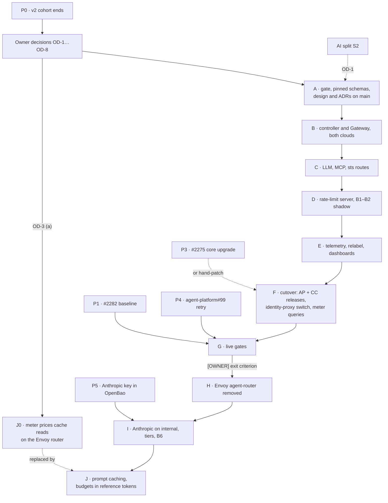

# Agent router on agentgateway: implementation plan, refreshed against `main`

> **For agentic workers:** REQUIRED SUB-SKILL: Use superpowers:subagent-driven-development (recommended) or superpowers:executing-plans to implement this plan task-by-task. Steps use checkbox (`- [ ]`) syntax for tracking.

**Status:** paper only, **not to be executed before the v2 cohort ends** (prerequisite P0) and the
owner decisions below are taken.

**Goal:** unchanged from 2026-10-01. Every agent call (LLM, MCP, octo-sts exchange) crosses
agentgateway's Gateway `agent-gateway/agent-router` with ADR-0042's boundaries intact or stronger,
B1–B2 count in shadow on our own rate-limit server, the Envoy agent-router is deleted once verified,
`internal` gets the Anthropic API (phase I), and budgets stop charging cache reads at the full input
rate (phase J).

**Read at:** cloud-native-ref `main` `cd3353dd`; `Smana/agent-platform` `main` `1899c3e` (v0.10.1);
`Smana/crossplane-configuration` `main` `50ff879` (v0.9.7); `agentgateway/agentgateway` v1.6.0
(latest GA, 2026-10-02).

**The 2026-10-01 plan stays the step-level reference.** It, the design and ADR-0053/0054 are on no
branch tip: PRs #2162 and #2194 merged them into `integration/agent-factory`, and the merge of `main`
at `b7eed5c1` (2026-10-08) dropped them. Read them at the last commit that has them:

```bash
git show 7c1a60b9:docs/superpowers/plans/2026-10-01-agent-router-agentgateway-plan.md   # old plan, 4,696 lines
git show 7c1a60b9:docs/superpowers/specs/2026-10-01-agent-router-agentgateway-design.md  # design, rulings D1–D13
git show 7c1a60b9:website/content/docs/decisions/0053-agent-router-on-agentgateway.md
git show 7c1a60b9:website/content/docs/decisions/0054-agent-model-providers-anthropic-direct.md
```

This plan gives each old task a status and its deltas. Where they disagree, this plan wins. An old
task marked **valid** is executed from the old text, with the global deltas below applied.

## What changed since 2026-10-01

| Change | Where | Effect on this plan |
|---|---|---|
| The stacks merged: SP2 (#2150), SP3 (#2153), rooms approvals (agent-platform#11), CC-S4 (crossplane-configuration#35); v1 shipped 2026-10-08 | `main` in all three repositories | Every PR targets `main`. The stack bases, the merge-only rule, `integration/agent-factory` as live branch, the merge wave and the P33 UX hold are gone |
| The design, the plan and ADR-0053/0054 left `integration/agent-factory` | `b7eed5c1` | Phase A lands the design and both ADRs on `main` first. The ADR numbers are still free there |
| The AI split: S0 (the harness moved to agent-platform `images/agent-harness/`) and S1 (`check-ai-boundary.py` in `validate-manifests.sh`) are done; S2 creates `Smana/ai-native-ref` once the v1 hardening milestone closes | [ADR-0057](../../../website/content/docs/decisions/0057-ai-platform-own-repository.md), [split design](../specs/2026-10-12-ai-platform-split-design.md), [`ai-boundary.yaml`](../../../scripts/ci/flux-schema/ai-boundary.yaml) | The harness tasks (J.5 step 6, J.6, J.9) move to agent-platform. The new paths `infrastructure/*/{agentgateway,agent-gateway}/` must join `ai_paths`, and `agent-gateway` must join the host contract's H5 namespace list. Whether this work lands before or after S2 is OD-1 |
| agent-platform v0.10.0/v0.10.1 | `cmd/`, `internal/`, `images/` | The N5 rename also touches the harness (`agent_run.py:438` matches `__room_progress`), which the old plan missed. The meter's query and throttle query are plain config here (`tooling/base/agent-factory/helm-values-configmap.yaml`), not an SP3 stack edit |
| crossplane-configuration v0.9.7 | `apis/agentrun/kcl/main.k` | One `_ROUTER_FQDN` (L61), the run CNP's router peer (L507), `_BRIDGE_IMAGE` (L68). The old plan's `_ROUTER_FQDNS`/`_ROUTER_ENDPOINTS` are names F.2 introduces. The core package still does not upgrade by itself (#2275) |
| GCP parity render roots | `infrastructure/{aws-0,gcp-0}/…`, `assert-cloud-shape.py` | Already assumed by the old plan. Still valid |
| agentgateway v1.6.0 GA (2026-10-02) | [release notes](https://github.com/agentgateway/agentgateway/releases/tag/v1.6.0) | Breaking: Anthropic Messages now converts to OpenAI Responses (affects the Z.ai backend's `/anthropic` path); a provider base URL without a path means `/`; CRDs no longer store defaults. New: a built-in model catalog that prices Claude 5.5 (not Z.ai's GLM-5.3), `error_type` on request-duration metrics, per-key local rate limits, `requiredClaims`, paginated MCP lists. No v1.6.x patch release yet. The pin is OD-2 |
| v1 review §3 roadmap | [v1 review](../specs/2026-10-12-agent-factory-v1-review.md) | "agentgateway, tiers" comes after v1 hardening, before `internal` work, and feeds "reviewer on another model" |
| v2 cohort, arm A | [cohort results](../specs/2026-10-12-v2-hard-task-cohort-results.csv) | 4 of 4 implementer runs revoked at the 1.5 M run budget (`budget-run`), 94.5–95.8 % of their input tokens cache reads, $0.58–$0.70 each; arm B finished the same issues with 1.3–3.7 M tokens. The meter sums `input|output`, so it charges a cache read like an uncached token. Phase J's acceptance is tied to these rows |
| agent-platform#99 | harness | `num_retries=0` (`agent_run.py:150`): one transient upstream 503 ends the run. A prerequisite, below |

## Prerequisites

| # | Before | What | Owner |
|---|---|---|---|
| P0 | Any task | **The v2 cohort ends** (all 15 issues have three rows, per the [cohort design](../specs/2026-10-12-v2-hard-task-cohort-design.md)). The migration replaces the gateway under arm A; changing it mid-cohort breaks the comparison | — |
| P1 | Phase G | **#2282**: F10, F12, F15 re-checked live. Phase G's parity runs compare against a verified baseline | v1 hardening |
| P2 | Phase E's acceptance | **#2283** (MCP calls not joined to the run's trace): OD-4 decides whether it is fixed on Envoy first or closed by phase E | v1 hardening |
| P3 | Phases F, H (each crossplane-configuration release) | **#2275**: until it closes, each live check hand-patches the core package (old plan, Global Constraints) | v1 hardening |
| P4 | Phase G | **agent-platform#99**: the harness retries a transient upstream error (503, reset before headers), bounded, counted in the run's metrics, never a budget refusal (OD-7). G.4's drain and rollback drill otherwise ends runs | agent-platform |
| P5 | Task I.2's live step | **[OWNER] The Anthropic API key in OpenBao**, mount `agents`, secret `anthropic`, field `api_key`, read from stdin: `bao kv put -mount=agents anthropic api_key=-`. A dedicated workspace with a monthly spend limit (old plan, P1) | Owner |
| P6 | Task I.6's real-run leg | The gateway's read-only GitHub route and a harness that clones through it ([status page](../../../website/content/docs/platform/ai-platform/status.md), `internal` work row). Without them an `internal` run fails at clone instead of at the model. Probe-level proofs do not need it | SP4 PR 2 |
| P7 | Phase A | The owner decisions below | Owner |

Other open v1-hardening issues (#2273, #2274, #2276, #2280, #2281, #2292) do not touch the gateway.

## Owner decisions before execution

| # | Decision | Options | What it changes |
|---|---|---|---|
| OD-1 | Sequence with the AI split's S2 | (a) migrate first, in cloud-native-ref; S2's `filter-repo` carries the result. (b) S2 first, then every cloud-native-ref task below lands in `ai-native-ref`. (c) Pause S2 between two phases | Both wait for v1 hardening. A split mid-migration costs 2–3 days of porting open PRs |
| OD-2 | agentgateway pin | (a) v1.6.0 now, an exception to ADR-0053 D3 ("a new minor only at its first patch release"). (b) Wait for v1.6.1. (c) v1.5.0 as designed, then a bump | (a)/(b) take the 1.6 deltas in A.3, C.1, E.2, J.1. (c) skips them now and pays them in a later bump |
| OD-3 | Phase J0: price cache reads in the run meter on today's Envoy router | (a) After P0, before phase A. (b) Not at all; wait for phase J | (a) ends the `budget-run` revocations weeks earlier, using `cached_input`, which Agent Router v1.1.0 already emits. Changing the meter during the cohort would change arm A |
| OD-4 | #2283 | (a) Fix on the Envoy router now. (b) Close it with phase E | (a) is work that phase H deletes |
| OD-5 | Live cluster for phases B–J | (a) aws-0, live today: agentgateway has never run on EKS, so B.6 adds EKS-specific checks. (b) Rebuild gcp-0, where the PoC ran | Both clouds render in CI either way. ADR-0054's providers are the same on both |
| OD-6 | Budget unit | (a) Reference tokens (design D11: REF = $1.70 per million, caps keep their numbers). (b) USD caps | Both meet phase J's acceptance. Also: does the `standard` tier keep `runTokens: 1500000`? |
| OD-7 | Harness retry versus budget 429 | (a) Retry only 503 and connection errors; any 429 stays terminal. (b) Phase D marks a budget refusal (header or body), so a provider 429 can be retried | (b) adds a task to D.2 and to P4 |
| OD-8 | agentgateway 1.6's per-key local token limits | (a) Add them as a soft per-replica backstop beside the rate-limit server (v1 review §4: "adopt beside"). (b) Not now | (a) adds a task to phase D |

## Phase order



## PR map

Every PR is based on `main` of its repository and rebased onto it before each push. Phases A–E are
additive: the Envoy agent-router keeps serving every run, so they merge after their offline gates
and get their live check on the live cluster. F onward changes the path of real runs: those PRs
merge only with live evidence from a feature-branch deploy (`TF_VAR_flux_git_ref`).

| # | Repo | Phase | Carries |
|---|---|---|---|
| AGW-0 | cloud-native-ref | J0 (OD-3) | `meter.query` prices `cached_input` |
| AGW-1 | cloud-native-ref | A | design, ADR-0053, ADR-0054, index rows; CRD schemas; `assert-agent-gateway.py` |
| AGW-2 | cloud-native-ref | B | controller, Gateway, identity, CNPs, both clouds; gate wired; boundary and host-contract rows |
| AGW-3 | cloud-native-ref | C | routes, MCP Allow lists, sts, ingress peers, probe |
| AGW-4 | cloud-native-ref | D | rate-limit server, KVStore, B1–B2 shadow |
| AGW-5 | cloud-native-ref | E | telemetry, relabel, alerts, dashboards |
| AP-AGW1 | agent-platform | F | the bridge classifier and the harness read both tool-name separators; release |
| CC-AGW1 | crossplane-configuration | F | the run CNP reaches both gateways; AP-AGW1's bridge and harness pins; release |
| AGW-6 | cloud-native-ref | F | CC-AGW1 pin, identity-proxy switch, meter throttle query |
| CC-AGW2 | crossplane-configuration | H | the run CNP reaches agentgateway only |
| AGW-7 | cloud-native-ref | H | Envoy agent-router deleted, A5–A7 retired, docs |
| AGW-8 | cloud-native-ref | I | Anthropic backend, tiers, B6, budget alerts |
| AGW-9 | cloud-native-ref | J | price overlay, AG10, reference-token budgets and meter, run page |
| AP-AGW2 | agent-platform | J | price comment, prompt-prefix pin (J.5 step 6, J.6) |
| CC-AGW3, AP-AGW3 | crossplane-configuration, agent-platform | J.9 | only if J.7 step 3's `internal` leg reads nothing |

Under OD-1 (b), every cloud-native-ref row except `namespaces/base/` and the split design's §2
table lands in `ai-native-ref` instead.

## Global constraints: what changed

The old plan's Global Constraints still bind, with these deltas:

- **Names.** Unchanged, except: the Z.ai backend's provider shape (Task C.1); the price table becomes
  an overlay of the built-in catalog (Task J.1).
- **Pins.** Per OD-2, re-resolved on the day of Task B.2 with `helm show chart` and `crane digest`.
  Gateway API is now v1.6.3 (`opentofu/config.tm.hcl`), not 1.6.2. `envoyproxy/ratelimit` is
  re-resolved too.
- **Live checks.** **[LIVE]** means the live cluster chosen in OD-5, deployed from `main` or from the
  PR branch. The core-package hand-patch stays while #2275 is open.
- **Git.** Branch from `origin/main` with `EnterWorktree`, rebase before review and push. The
  merge-only stack, the "never merge `feat/agentgateway-poc`" rule and P33 are void.
- **Boundary.** Every new AI path is in `ai-boundary.yaml`, and every host-contract change edits the
  split design's §2 in the same PR (the file's header requires it). `check-ai-boundary.py` must print
  `crossings=0`.
- **Evidence.** As before, plus `AI BOUNDARY: … crossings=0` from `validate-manifests.sh`.
  agent-platform: `task check` (not only `go test ./...`), and `python3 -m pytest images/agent-harness/tests`.

## Status of every task

**valid**: execute from the old text with the global deltas · **changed**: execute with the deltas
listed · **moved**: same work, another repo or path · **done**: already true on `main` ·
**obsolete**: drop · **new**: not in the old plan.

| Task | Status | Repo | Delta |
|---|---|---|---|
| A.1 | changed | cnref | See below: restore the design and both ADRs on `main`, no stack |
| A.2 | changed | cnref | agentgateway becomes source 7 of `gen-catalog.sh` (6 today). Pin per OD-2 |
| A.3 | changed | cnref | AG1–AG9 as written, plus the 1.6 checks below |
| A.4 | valid | cnref | A PR to `main`, not a draft on `feat/rooms-driver` |
| B.1 | changed | cnref | Plus the boundary and host-contract rows (below) |
| B.2 | changed | cnref | R5 (adopt the PoC child's name) is obsolete: no PoC on `main` or on the integration tip, so a fresh install. Helm values add `istio.enabled: false` (1.6: smaller ClusterRole); `agentgatewayModels.enabled` defaults to true in 1.6 |
| B.3 | valid | cnref | N1's drain stays: 1.6's graceful drain is standalone-only. Re-check G3's defaults on the pinned chart |
| B.4 | valid | cnref | 1.6 adds `validation.requiredClaims` and a 60 s `nbf` leeway. The `agents` sub-prefix stays CEL: `requiredClaims` matches values, not prefixes (UNVERIFIED; check on the day) |
| B.5 | valid | cnref | — |
| B.6 | changed | cnref | PoC teardown obsolete. Live install on the OD-5 cluster; on aws-0, also the EKS checks below |
| C.1 | changed | cnref | 1.6 provider rules, below |
| C.2 | changed | cnref | 1.6 pages `tools/list` (`nextCursor`): the scope test and the probe read every page. `mcp.methodName` is now a CEL attribute; N7 (Allow is OR) re-verified on the pinned CRD text |
| C.3 | valid | cnref | Paths exist: `security/base/octo-sts/{httproute,network-policy}.yaml` |
| C.4 | valid | cnref | — |
| C.5 | valid | cnref | Live on the OD-5 cluster |
| D.1 | valid | cnref | `KVStore` comes from crossplane-configuration v0.9.7. 1.6's rate-limit call timeout defaults to 10 s |
| D.2 | changed | cnref | Plus OD-7 (b)'s budget-refusal marker and OD-8 (a)'s local limits, if chosen |
| D.3 | valid | cnref | — |
| E.1 | changed | cnref | Under OD-4 (b), also #2283's acceptance: each MCP call is a child span of the run's trace, with tool name and duration, no content. 1.6 aligns HTTP span attributes with OTel semconv: re-read the attribute names E.1 step 4 records |
| E.2 | changed | cnref | Smaller: 1.6 emits `error_type` on request-duration metrics, so G2's rebuilt error ratio from `agentgateway_requests_total{status=~"5.."}` goes. The relabel to `gen_ai_*` stays (design D5) |
| E.3, E.4 | valid | cnref | — |
| F.1 | changed, moved | agent-platform | Base `main`, not `feat/room-approvals` (#11, merged). Also `images/agent-harness/agent_run.py:438` and its test (`__room_progress`), not only `internal/bridge/classify.go:93,102`. Both separators accepted until phase H. One release carries both |
| F.2 | changed | crossplane-configuration | Base `main` (v0.9.7), not `chore/room-bridge-v0.4.0` (#35, merged). `main.k` L61 and L507; pins AP-AGW1's bridge (`_BRIDGE_IMAGE`, L68) and harness |
| F.3 | valid | cnref | `identity-proxy-configmap.yaml` L225, L236, L247 |
| F.4 | new | cnref | The meter's throttle query, below |
| G.1–G.5 | changed | cnref | Live on the OD-5 cluster. G.3 also re-runs #2282's F10/F12/F15 reproductions after the switch |
| H.1 | valid | crossplane-configuration | Base CC-AGW1 merged on `main` |
| H.2–H.4 | valid | cnref | The listed Envoy files all exist on `main`. A5–A7 retire from `assert-ai-gateway.py` |
| H.5 | valid | cnref | `agent-platform` still `dependsOn: ai-gateway`; the audit stands |
| I.1 | valid | cnref | — |
| I.2 | changed | cnref | Live on either cloud (was gcp-0 only). P5 first. The built-in catalog already prices `claude-opus-5-5` and `claude-sonnet-5-5` |
| I.3 | changed | cnref | `AgentgatewayModel` is on by default in 1.6; a backend with priority groups now evicts failing targets by default |
| I.4, I.5 | valid | cnref | `infrastructure/base/agent-model-routing/` does not exist yet: I.4 creates it, as planned |
| I.6 | changed | cnref | The SP4 cross-edit targets [`2026-09-25-llm-frontier-backends-plan.md`](2026-09-25-llm-frontier-backends-plan.md) on `main`. Real `internal` runs need P6 |
| J0 | new | cnref | OD-3 (a) only, below |
| J.1 | changed | cnref | Shrinks to an overlay, below |
| J.2 | valid | cnref | Its acceptance is J-AC1 below |
| J.3 | valid | cnref | D12 still UNVERIFIED live. 1.6 improves Messages conversion; re-read `finalTransformations` on the pinned CRD |
| J.4 | valid | cnref | — |
| J.5 | changed, partly moved | cnref, agent-platform | Step 5: a plain edit of `tooling/base/agent-factory/helm-values-configmap.yaml` L136 on `main`. Step 6: agent-platform `images/agent-harness/agent_run.py` L37–43. Step 7 (ADR-0050 note): cnref |
| J.6 | moved | agent-platform | The prefix-stability test lives in `images/agent-harness/tests/`. The tool-list hash reads every page (1.6 pagination) |
| J.7 | changed | cnref | Live on the OD-5 cluster; plus J-AC1 and J-AC2 |
| J.8 | changed | cnref | Still the live measure. The cohort rows are its "before" |
| J.9 | moved | crossplane-configuration, agent-platform | Conditional, as before; `main.k` and `images/agent-harness/agent_run.py` |
| OB.1–OB.3 | valid | cnref | Off by default. With OD-5 (a), OB.2 (Bedrock) is provable live on aws-0 |

## Phase A — the gate, the pinned schemas, and the design on `main`

### Task A.1: Worktree and the design documents (changed)

**Files:**
- Create: `docs/superpowers/specs/2026-10-01-agent-router-agentgateway-design.md`,
  `website/content/docs/decisions/0053-agent-router-on-agentgateway.md`,
  `website/content/docs/decisions/0054-agent-model-providers-anthropic-direct.md`
- Modify: `website/content/docs/decisions/_index.md`

- [ ] **Step 1:** `EnterWorktree` named `feat/agw-gate` (from `origin/main`).
- [ ] **Step 2:** Restore the three files from `7c1a60b9` (`git show 7c1a60b9:<path> > <path>`). The
  programme-spec alignment the old A.1 cherry-picked is already on `main`, apart from four lines in
  `docs/superpowers/specs/2026-09-23-agent-factory-design.md` and
  `website/content/docs/platform/ai-platform/gateways.md`: diff each against `7c1a60b9` and keep
  `main`'s wording unless it contradicts ADR-0054.
- [ ] **Step 3:** In the design, point **Plan** at this file, set D3's pin to OD-2's answer, and add
  one dated line under D10 recording the built-in catalog (Task J.1). In ADR-0053, set `lastVerified`
  and the pinned version. Add rows 0053 and 0054 to `_index.md`, between 0051 and 0056.
- [ ] **Step 4:** Run `./scripts/ci/validate-links.sh && ./scripts/ci/verify-doc-paths.sh` → exit 0.
  Commit `docs(agents): agentgateway design, ADR-0053 and ADR-0054 on main`.

### Task A.3 deltas: the 1.6 checks

Under OD-2 (a) or (b), `assert-agent-gateway.py` gains, with a failing test first:

| Check | Fails when |
|---|---|
| AG5 extended | an `AgentgatewayBackend` serving Z.ai uses the `openai` provider (1.6: "use the OpenAI provider only for the OpenAI API") |
| AG11 | a configured provider base URL or `host` has no path (1.6 sends `/`) |

The gate reads the source tree's explicit fields only: 1.6 CRDs no longer store defaults, so no check
may rely on a defaulted field being present. AG1–AG9 then print `11 checks`; J.1's AG10 makes it 12.

## Phase B — the platform install

### Task B.1 deltas: boundary and host contract

**Files:** also `scripts/ci/flux-schema/ai-boundary.yaml`,
`docs/superpowers/specs/2026-10-12-ai-platform-split-design.md` (§1 move list, §2 H5),
`scripts/ci/tests/flux-schema/test-check-ai-boundary.py`.

- [ ] **Step 1:** In `ai_paths`, the `infrastructure` alternation gains `agentgateway|agent-gateway`.
  Without it, `clusters/*-agent-platform/infrastructure-agentgateway.yaml` (AI) naming
  `infrastructure/<cluster>/agentgateway` (host) is a crossing.
- [ ] **Step 2:** H5's namespace row gains `agent-gateway` (declared in `namespaces/base/`, old plan R4).
  `agentgateway-system` stays declared by the controller child (R3), on the AI side. The §1 move list
  gains both directories.
- [ ] **Step 3:** A test case: a planted reference from a host path into
  `infrastructure/base/agent-gateway/` fails. Run `validate-manifests.sh` → `crossings=0`.

### Task B.6 deltas: first install on EKS

Under OD-5 (a), the PoC's GKE evidence does not transfer. After the install, before AGW-2 leaves
draft: the proxies schedule on the Cilium ENI node pools, the Service is ClusterIP (G3), a 200 s
stream survives one proxy deletion at 120/660 (N1), and the JWKS resolves for the EKS issuer, which
changes on every rebuild.

## Phase C — routes at parity

### Task C.1 deltas: the Z.ai backend under 1.6

The old C.1 used `provider.openai` with `host: api.z.ai` and `pathPrefix: /api/paas/v4`. Under 1.6:

- [ ] Use the provider shape 1.6 prescribes for OpenAI-compatible servers (a custom provider that
  advertises Chat Completions only), with the full base path `/api/paas/v4`. Does Z.ai serve
  `/v1/responses`? UNVERIFIED, so do not advertise it.
- [ ] Prove, from the probe, both entry points on `public`: `POST /v1/chat/completions` and
  `POST /anthropic/v1/messages`. The second converts Messages → Chat Completions, which 1.6 no longer
  prefers by default.
- [ ] Re-verify N3 and D7 on the pinned version: `GET /v1/models` with a valid token still gets the
  404 JSON body. 1.6 expands wildcard models on `/v1/models`, so the `directResponse` must still win.

## Phase F — the cutover

### Task F.4: The meter's throttle query follows the gateway (new)

**Files:** Modify `tooling/base/agent-factory/helm-values-configmap.yaml` (`meter.throttleQuery`, L139).

`throttleQuery` reads Envoy access-log fields: `gateway.envoyproxy.io/owning-gateway-name:"agent-router"`
and `response_flags:~"RL"`. After the switch the meter would never see a B1/B2 throttle, and nothing
fails loudly.

- [ ] **Step 1:** From E.1 step 4's recorded field names, write the agentgateway equivalent: proxy
  pods in `agent-gateway` with `gateway.networking.k8s.io/gateway-name: agent-router`, status 429 from
  the rate-limit policy, grouped by the verified `x-ar-agent`.
- [ ] **Step 2:** Make the query match either gateway (an `OR` of both selectors) until phase H, which
  drops the Envoy half.
- [ ] **Step 3:** [LIVE] With a B1 limit lowered on a test descriptor, one probe request is refused
  and the query returns its `x_ar_agent` within 2 minutes.

`meter.query` needs no change at cutover: E.2's relabel keeps `gen_ai_client_token_usage_sum{ar_agent}`.

## Phase J — cache-aware accounting

### Task J0: The meter prices cache reads on today's router (new, OD-3 (a) only)

**Files:** Modify `tooling/base/agent-factory/helm-values-configmap.yaml` (`meter.query`, L136).

Agent Router v1.1.0 already emits `cached_input`, a subset of `input`
(`infrastructure/base/llm-gateway/vmrule-llm-gateway.yaml`, L46–47). Weighted at GLM-5.3 list
($1.40 input, $0.26 cached, $4.40 output per million) and divided by REF ($1.70 per million), a run's
reference tokens are:

```
(1.40 × (input − cached_input) + 0.26 × cached_input + 4.40 × output) ÷ 1.70
```

- [ ] **Step 1:** Write it as `meter.query`, one series per `ar_agent`; a run with no `cached_input`
  series counts its cached reads as 0, not as an absent result.
- [ ] **Step 2:** Check it against the cohort's arm A rows (J-AC1) with `promtool test rules` or a
  VictoriaMetrics query over a fixture, then `task check`.
- [ ] **Step 3:** The price is GLM-5.3's only: valid while every tier routes to `agent-default`.
  Phase J replaces the expression with the gateway's own price before phase I's Claude routes serve
  a run.

### Task J.1 deltas: an overlay, not the whole table

agentgateway 1.6 embeds a model catalog. It prices `anthropic/claude-opus-5-5` ($4 input, $20
output, $0.20 cache read, $5 cache write) and `claude-sonnet-5-5`, but has no GLM-5.3 row under the
provider that serves Z.ai: only `mistral/zai-glm-5-3`, without the $0.26 cached rate the v1 review
used.

- [ ] The `agent-model-prices` ConfigMap keeps D10's role as the one table we own, as an overlay: a
  row for **every model a backend pins**, Claude's included, so an agentgateway release never moves a
  price without a commit here.
- [ ] AG10 fails a pinned model without `input`, `output`, `cacheRead`, and `cacheWrite` where the
  provider charges it, in the overlay.
- [ ] Re-read [Z.ai pricing](https://docs.z.ai/guides/overview/pricing) and
  [Anthropic pricing](https://platform.claude.com/docs/en/about-claude/pricing) on the day.

### Phase J acceptance criteria

Phase J is accepted when all of these hold, each with a command run and its output cited:

| # | Criterion | Proof |
|---|---|---|
| J-AC1 | **A cache read is never charged at the full input rate.** The four arm-A rows of the cohort ([results](../specs/2026-10-12-v2-hard-task-cohort-results.csv): #2279, #2277, #2278, #2269), replayed through the run meter's expression, charge **at most 0.42 M** each against the `standard` run budget (their price, $0.58–$0.70, ÷ REF), not their 1.54–1.69 M raw tokens. None would have been revoked at 1.5 M. Under OD-6 (b), the same rows charge their USD price, and the USD cap reads $2.55 for `standard` | Offline: a rule test over a fixture holding the four rows' `input`, `cached_input`, `output`. Live: J.7 step 5's run, whose `agents.ogenki.io/usage-tokens` equals `gateway cost ÷ REF` within one scrape |
| J-AC2 | **The gateway and the meter count the same unit.** B1 and B2 descriptors, the run-token recording rule and `meter.query` use one expression (D11), and gate AG8 fails a token descriptor without it | AG8 in `validate-manifests.sh`; J.7 step 4 |
| J-AC3 | **Caching works with no provider field in the request** (SC-14) | J.7 step 3, or J.9 |
| J-AC4 | **An unpriced model is visible, not free.** `AgentModelUnpriced` fires for a pinned model missing from the overlay, and its budgets fall back to raw tokens | J.7 step 5; AG10 |
| J-AC5 | **A transient upstream error does not end a run.** A 503 injected once on the probe's path is retried and counted, a budget 429 is not retried (P4, OD-7) | agent-platform#99's test, then one live injection in G.4 |

## Success criteria → proving task

The old table (SC-1 to SC-17) stands, with live proofs on the OD-5 cluster. Added:

| SC | Offline | Live |
|---|---|---|
| SC-18 the cohort's arm-A token mix is charged at its price (J-AC1) | J0 step 2 or J.5 | J.7 step 5 |
| SC-19 the meter sees a B1/B2 throttle on agentgateway | — | F.4 step 3 |
| SC-20 MCP calls are child spans of the run's trace (#2283, OD-4 (b)) | E.1 | G.3 |

## Effort, re-estimated

The research's 2.5–3 weeks covered the migration, phases A–H. Phases I and J were added to the plan
later and never estimated.

| Phase | Days | Since 2026-10-01 |
|---|---|---|
| A | 2–2.5 | + design and ADRs back on `main`, 1.6 gate checks; − stack and cherry-pick work |
| B | 2–2.5 | + boundary and host contract, EKS first install; − PoC teardown and adoption |
| C | 2.5–3 | + Z.ai provider shape and the `/anthropic` path under 1.6, paginated tool lists |
| D | 2–2.5 | + OD-7 (b) and OD-8 (a), if chosen |
| E | 1.5–2 | − `error_type` is native in 1.6 |
| F | 2–2.5 | + harness rename (N5), throttle query (F.4); three repositories, two releases |
| G | 1.5–2 | + #2282 re-run |
| H | 1 | — |
| **A–H** | **14.5–18 (3–3.5 weeks)** | **+0.5 week against 2.5–3 weeks** |
| I | 3–4 | − catalog prices Claude |
| J | 3–4 | − the price table is an overlay; + J-AC1's fixture |
| **A–J** | **20.5–26 (4–5 weeks)** | |
| Outside the total | J0 0.5–1; agent-platform#99 1; OD-1 (c) or a split mid-migration +2–3 | |

Live steps depend on a running cluster and on owner-only actions (P5, G.5's exit criterion); the
estimate is focused work, not calendar time.
