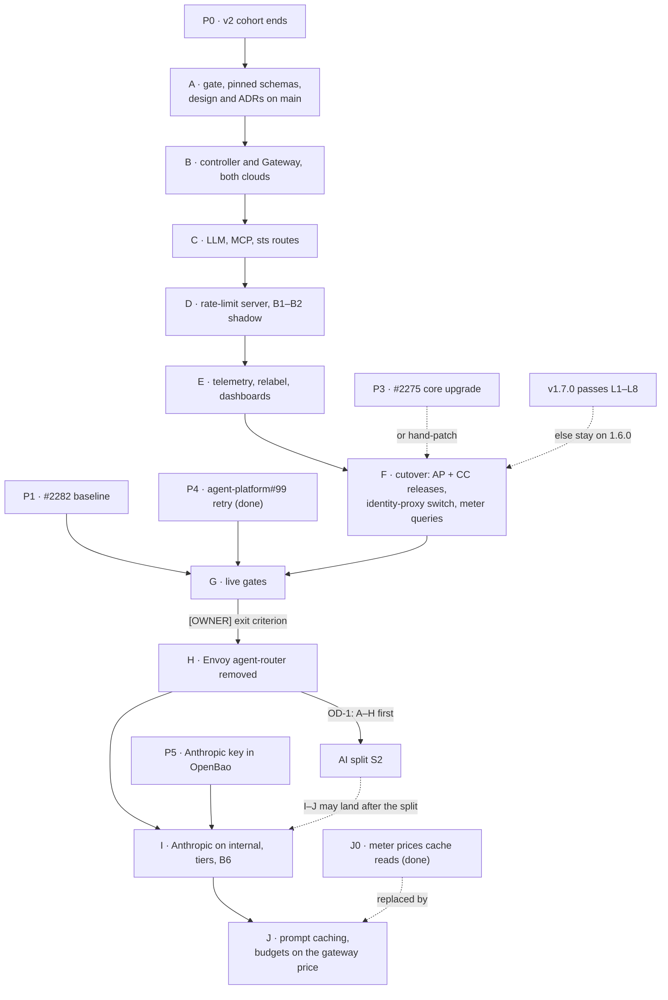

# Agent router on agentgateway: implementation plan, refreshed against `main`

> **For agentic workers:** REQUIRED SUB-SKILL: Use superpowers:subagent-driven-development (recommended) or superpowers:executing-plans to implement this plan task-by-task. Steps use checkbox (`- [ ]`) syntax for tracking.

**Status:** the owner decisions OD-1 to OD-8 are taken (2026-10-15, below). Execution still waits
for the v2 cohort to end (prerequisite P0). J0, the harness retry and part of phases B–C are already
on `main` ([Already done](#already-done)).

**Goal:** unchanged from 2026-10-01. Every agent call (LLM, MCP, octo-sts exchange) crosses
agentgateway's Gateway `agent-gateway/agent-router` with ADR-0042's boundaries intact or stronger,
B1–B2 count in shadow on our own rate-limit server, the Envoy agent-router is deleted once verified,
`internal` gets the Anthropic API (phase I), and budgets stop charging cache reads at the full input
rate (phase J).

**Read at:** cloud-native-ref `main` `cd3353dd`; `Smana/agent-platform` `main` `1899c3e` (v0.10.1);
`Smana/crossplane-configuration` `main` `50ff879` (v0.9.7); `agentgateway/agentgateway` v1.6.0
(latest GA, 2026-10-02).

**The 2026-10-01 plan stays the step-level reference.** It, the design and ADR-0053/0054 are on no
branch tip: PRs #2162 and #2194 merged them into `integration/agent-factory`, and the merge of `main`
at `b7eed5c1` (2026-10-08) dropped them. Read them at the last commit that has them:

```bash
git show 7c1a60b9:docs/superpowers/plans/2026-10-01-agent-router-agentgateway-plan.md   # old plan, 4,696 lines
git show 7c1a60b9:docs/superpowers/specs/2026-10-01-agent-router-agentgateway-design.md  # design, rulings D1–D13
git show 7c1a60b9:website/content/docs/decisions/0053-agent-router-on-agentgateway.md
git show 7c1a60b9:website/content/docs/decisions/0054-agent-model-providers-anthropic-direct.md
```

This plan gives each old task a status and its deltas. Where they disagree, this plan wins. An old
task marked **valid** is executed from the old text, with the global deltas below applied.

## What changed since 2026-10-01

| Change | Where | Effect on this plan |
|---|---|---|
| The stacks merged: SP2 (#2150), SP3 (#2153), rooms approvals (agent-platform#11), CC-S4 (crossplane-configuration#35); v1 shipped 2026-10-08 | `main` in all three repositories | Every PR targets `main`. The stack bases, the merge-only rule, `integration/agent-factory` as live branch, the merge wave and the P33 UX hold are gone |
| The design, the plan and ADR-0053/0054 left `integration/agent-factory` | `b7eed5c1` | Phase A lands the design and both ADRs on `main` first. The ADR numbers are still free there |
| The AI split: S0 (the harness moved to agent-platform `images/agent-harness/`) and S1 (`check-ai-boundary.py` in `validate-manifests.sh`) are done; S2 creates `Smana/ai-native-ref` once the v1 hardening milestone closes | [ADR-0057](../../../website/content/docs/decisions/0057-ai-platform-own-repository.md), [split design](../specs/2026-10-12-ai-platform-split-design.md), [`ai-boundary.yaml`](../../../scripts/ci/flux-schema/ai-boundary.yaml) | The harness tasks (J.5 step 6, J.6, J.9) move to agent-platform. The new paths `infrastructure/*/{agentgateway,agent-gateway}/` must join `ai_paths`, and `agent-gateway` must join the host contract's H5 namespace list. This work lands before S2 (OD-1) |
| agent-platform v0.10.0/v0.10.1 | `cmd/`, `internal/`, `images/` | The N5 rename also touches the harness (`agent_run.py:438` matches `__room_progress`), which the old plan missed. The meter's query and throttle query are plain config here (`tooling/base/agent-factory/helm-values-configmap.yaml`), not an SP3 stack edit |
| crossplane-configuration v0.9.7 | `apis/agentrun/kcl/main.k` | One `_ROUTER_FQDN` (L61), the run CNP's router peer (L507), `_BRIDGE_IMAGE` (L68). The old plan's `_ROUTER_FQDNS`/`_ROUTER_ENDPOINTS` are names F.2 introduces. The core package still does not upgrade by itself (#2275) |
| GCP parity render roots | `infrastructure/{aws-0,gcp-0}/…`, `assert-cloud-shape.py` | Already assumed by the old plan. Still valid |
| agentgateway v1.6.0 GA (2026-10-02) | [release notes](https://github.com/agentgateway/agentgateway/releases/tag/v1.6.0) | Breaking: Anthropic Messages now converts to OpenAI Responses (affects the Z.ai backend's `/anthropic` path); a provider base URL without a path means `/`; CRDs no longer store defaults. New: a built-in model catalog that prices Claude 5.5 (not Z.ai's GLM-5.3), `error_type` on request-duration metrics, per-key local rate limits, `requiredClaims`, paginated MCP lists. No v1.6.x patch release yet; v1.7.0 is due 2026-10-26. Pinned at v1.6.0 (OD-2) |
| v1 review §3 roadmap | [v1 review](../specs/2026-10-12-agent-factory-v1-review.md) | "agentgateway, tiers" comes after v1 hardening, before `internal` work, and feeds "reviewer on another model" |
| v2 cohort, arm A | [cohort results](../specs/2026-10-12-v2-hard-task-cohort-results.csv) | 4 of 4 implementer runs revoked at the 1.5 M run budget (`budget-run`), 94.5–95.8 % of their input tokens cache reads, $0.58–$0.70 each; arm B finished the same issues with 1.3–3.7 M tokens. The meter sums `input|output`, so it charges a cache read like an uncached token. Phase J's acceptance is tied to these rows |
| agent-platform#99 | harness | `num_retries=0` (`agent_run.py:150`): one transient upstream 503 ended the run. Fixed by agent-platform#101 (P4) |

## Prerequisites

| # | Before | What | Owner |
|---|---|---|---|
| P0 | Any task | **The v2 cohort ends** (all 15 issues have three rows, per the [cohort design](../specs/2026-10-12-v2-hard-task-cohort-design.md)). The migration replaces the gateway under arm A; changing it mid-cohort breaks the comparison | — |
| P1 | Phase G | **#2282**: F10, F12, F15 re-checked live. Phase G's parity runs compare against a verified baseline | v1 hardening |
| P2 | Phase E's acceptance | **#2283** (MCP calls not joined to the run's trace) closes with phase E (OD-4), **on live proof** (SC-20, below): AGW-5 ships the gateway half, AP-AGW1 the harness half | this plan |
| P3 | Phases F, H (each crossplane-configuration release) | **#2275**: until it closes, each live check hand-patches the core package (old plan, Global Constraints) | v1 hardening |
| P4 | Phase G | **Done**: agent-platform#99, fixed by agent-platform#101. The harness retries a 503 or a connection error, bounded; any 429 stays terminal (OD-7) | agent-platform |
| P5 | Task I.2's live step | **[OWNER] The Anthropic API key in OpenBao**, mount `agents`, secret `anthropic`, field `api_key`, read from stdin: `bao kv put -mount=agents anthropic api_key=-`. A dedicated workspace with a monthly spend limit (old plan, P1) | Owner |
| P6 | Task I.6's real-run leg | The gateway's read-only GitHub route and a harness that clones through it ([status page](../../../website/content/docs/platform/ai-platform/status.md), `internal` work row). Without them an `internal` run fails at clone instead of at the model. Probe-level proofs do not need it | SP4 PR 2 |
| P7 | Phase A | **Done**: the owner decisions below | Owner |

Other open v1-hardening issues (#2273, #2274, #2276, #2280, #2281, #2292) do not touch the gateway.

## Owner decisions (2026-10-15)

| # | Decision | Chosen | What it changes |
|---|---|---|---|
| OD-1 | Sequence with the AI split's S2 | **Phases A–H before S2**: the migration ends with the Envoy router removed, in cloud-native-ref, and S2's `filter-repo` carries it. **I–J may land after the split** | AGW-1 to AGW-7, AP-AGW1, CC-AGW1 and CC-AGW2 target cloud-native-ref's repositories as today. AGW-8 and AGW-9 land in `ai-native-ref` if S2 has happened by then |
| OD-2 | agentgateway pin | **v1.6.0**, after the PoC's live check passed L1–L7 on aws-0 (2026-10-15). L8 was only partly evidenced: the captured output has no line labelled L8, so **L8 still needs a full captured log on v1.6.0**. The gate stays L1–L8. **Re-run L1–L8 on v1.7.0 before phase F** and take it if it passes | ADR-0053 D3's rule becomes "a minor that passes our live gate (L1–L8)": agentgateway rarely ships a patch release ([research](../specs/2026-10-15-agentgateway-open-issues-research.md#releases)). The 1.6 deltas apply to A.3, C.1, E.2, J.1 |
| OD-3 | Price cache reads in the run meter before the migration | **Shipped**: agent-platform v0.11.0 (#100), pinned by #2379 | J0 is done |
| OD-4 | #2283 | **Closes with phase E** | E.1 carries its acceptance (SC-20) |
| OD-5 | Live cluster for phases B–J | **aws-0** | **[LIVE]** means aws-0. The PoC ran B.6's EKS checks. gcp-0 renders in CI only |
| OD-6 | Budget unit | **USD is the policy unit**: caps per run and task, shipped (#2379: `runUSD`, `taskUSD`; `runTokens` applies only to a run the meter cannot price). Reference tokens (USD ÷ $1.70 per million) remain only as the gateway rate limiter's integer for the same money | Design D11 says so. J-AC1 is read in USD; B1, B2 and B6 descriptors count reference tokens |
| OD-7 | Harness retry versus budget 429 | **Retry 503 and connection errors only**; any 429 stays terminal. Shipped in agent-platform#101 | No budget-refusal marker in D.2 |
| OD-8 | agentgateway 1.6's per-key local token limits | **Adopt as a per-replica backstop** beside the rate-limit server | D.2 adds them; the PoC's per-sub limit is the template |

## Already done

| Item | Where | What it covers |
|---|---|---|
| J0, the meter prices cache reads | agent-platform#100 (v0.11.0), cnref #2379 | `meter.query` reads `input`, `cached_input`, `cache_creation_input`, `output`; `meter.prices` holds GLM-5.3's rates; tiers carry USD caps |
| P4, the harness retry | agent-platform#101 | OD-7; J-AC5's offline half |
| The PoC, beside agent-router on aws-0 | cnref #2385 | Controller and CRDs (`infrastructure/aws-0/agentgateway/`): pinned OCIRepositories, HelmReleases with `istio.enabled: false`, restricted context, controller CNP. A twin Gateway (`infrastructure/aws-0/agentgateway-poc/`) with the G3 overlay, `shutdown` 10/660, per-listener JWT, the `/v1/models` 404, the Z.ai backends, MCP federation and the per-sub local limit. `ai-boundary.yaml` and `.policy.yml` rows. Live check L1–L8 (`scripts/ops/k8s/agentgateway-poc-live-check.sh`) |

**What that leaves of B and C** (before AGW-2 and AGW-3, which did it). The PoC is aws-0-only, in a throwaway namespace, with no `sts`
listener and two of four MCP targets. Still to do: the cloud-neutral base under
`infrastructure/base/agent-gateway/` and both render roots; the real Gateway `agent-gateway/agent-router`
with three listeners; the data-plane and ingress CNPs; `flux-operator-mcp` and `room-broker` as
targets, per-role Allow lists and the scope test; the octo-sts route; the probe; the gate (A.3). The
PoC's objects are the starting text for each, and phase H removes the PoC.

## Live findings from the PoC (2026-10-15)

| Finding | Where it lands |
|---|---|
| The drain defaults (10 s / 60 s) cut a 200 s stream. `shutdown: {min: 10, max: 660}` held it; the maximum is what counts | B.3 and AG9 pin 10/660. Design N1's `min: 120` is no longer needed |
| agentgateway emits `input_cache_read` and `input_cache_write`; the meter reads `cached_input` and `cache_creation_input` | E.2's relabel maps both, before cutover. Without it the meter prices every cache read at the input rate. **Done** in AGW-5 |
| The proxy's metrics are not scraped yet (the PoC stays out of observability) | **Done** in AGW-5: `infrastructure/base/agent-gateway/vmpodscrape.yaml` |
| A controller version change does not re-render the proxy Deployment until the Gateway object is touched | Every pin change (B.2, the v1.7.0 re-run) touches the Gateway, then checks the proxy image digest |
| Z.ai needs `provider.custom` with typed routes (`Completions`, `Messages`), never `provider.openai`, `Detect` or `Passthrough` (#3853) | C.1, AG5, AG11 |
| MCP federation runs `sessionRouting: Stateless` (#3834, #3622) | C.2 |
| JWT policies carry `requiredClaims: [exp, sub]`: a sub-less token gets 401, never an unlimited descriptor (#3523) | B.4, AG2, AG8 |

## Phase order



## PR map

Every PR is based on `main` of its repository and rebased onto it before each push. Phases A–E are
additive: the Envoy agent-router keeps serving every run, so they merge after their offline gates
and get their live check on the live cluster. F onward changes the path of real runs: those PRs
merge only with live evidence from a feature-branch deploy (`TF_VAR_flux_git_ref`).

| # | Repo | Phase | Carries |
|---|---|---|---|
| AGW-0 | cloud-native-ref | J0 | **Merged** as #2379 |
| AGW-1 | cloud-native-ref | A | design, ADR-0053, ADR-0054, index rows; CRD schemas; `assert-agent-gateway.py` |
| AGW-2 | cloud-native-ref | B | controller, Gateway, identity, CNPs, both clouds; gate wired; boundary and host-contract rows |
| AGW-3 | cloud-native-ref | C | routes, MCP Allow lists, sts, ingress peers, probe |
| AGW-4 | cloud-native-ref | D | rate-limit server, KVStore, B1–B2 shadow |
| AGW-5 | cloud-native-ref | E | telemetry, relabel, alerts, dashboards. #2283 closes on live proof |
| AP-AGW1 | agent-platform | F | the bridge classifier and the harness read both tool-name separators; the harness sends its `agent-run` span's `traceparent` on MCP requests (#2283); release |
| CC-AGW1 | crossplane-configuration | F | the run CNP reaches both gateways; AP-AGW1's bridge and harness pins; release |
| AGW-6 | cloud-native-ref | F | CC-AGW1 pin, identity-proxy switch, meter throttle query |
| CC-AGW2 | crossplane-configuration | H | the run CNP reaches agentgateway only |
| AGW-7 | cloud-native-ref | H | Envoy agent-router deleted, A5–A7 retired, docs |
| AGW-8 | cloud-native-ref | I | Anthropic backend, tiers, B6, budget alerts |
| AGW-9 | cloud-native-ref | J | price overlay, AG10, reference-token budgets and meter, run page |
| AP-AGW2 | agent-platform | J | price comment, prompt-prefix pin (J.5 step 6, J.6) |
| CC-AGW3, AP-AGW3 | crossplane-configuration, agent-platform | J.9 | only if J.7 step 3's `internal` leg reads nothing |

Under OD-1, phases A–H (AGW-1 to AGW-7, AP-AGW1, CC-AGW1, CC-AGW2) land before S2, with the
Envoy router removed. Phases I–J (AGW-8, AGW-9, AP-AGW2 and J.9's rows) may land after it, in
`ai-native-ref`.

## Global constraints: what changed

The old plan's Global Constraints still bind, with these deltas:

- **Names.** Unchanged, except: the Z.ai backend's provider shape (Task C.1); the price table becomes
  an overlay of the built-in catalog (Task J.1).
- **Pins.** v1.6.0 (OD-2), by the tags and digests #2385 resolved; v1.7.0 replaces it only after L1–L8 pass on it.
  Gateway API is now v1.6.3 (`opentofu/config.tm.hcl`), not 1.6.2. `envoyproxy/ratelimit` is
  re-resolved too.
- **Live checks.** **[LIVE]** means aws-0 (OD-5), deployed from `main` or from the
  PR branch. The core-package hand-patch stays while #2275 is open.
- **Git.** Branch from `origin/main` with `EnterWorktree`, rebase before review and push. The
  merge-only stack, the "never merge `feat/agentgateway-poc`" rule and P33 are void.
- **Boundary.** Every new AI path is in `ai-boundary.yaml`, and every host-contract change edits the
  split design's §2 in the same PR (the file's header requires it). `check-ai-boundary.py` must print
  `crossings=0`.
- **Evidence.** As before, plus `AI BOUNDARY: … crossings=0` from `validate-manifests.sh`.
  agent-platform: `task check` (not only `go test ./...`), and `python3 -m pytest images/agent-harness/tests`.

## Status of every task

**valid**: execute from the old text with the global deltas · **changed**: execute with the deltas
listed · **moved**: same work, another repo or path · **done**: already true on `main` ·
**obsolete**: drop · **new**: not in the old plan.

| Task | Status | Repo | Delta |
|---|---|---|---|
| A.1 | changed | cnref | See below: restore the design and both ADRs on `main`, no stack |
| A.2 | done (#2395) | cnref | agentgateway becomes source 7 of `gen-catalog.sh` (6 today), pinned to v1.6.0. The hosted catalog carries v1.6.0 today (#2385: `Invalid: 0`); A.2 stops a catalog bump from moving it |
| A.3 | done (#2395) | cnref | AG1–AG9 as written, plus the 1.6 checks below. Wired as gate 6 now, not in B (old R2): `PROFILES` judges the PoC Gateway until phase H removes its entry |
| A.4 | valid | cnref | A PR to `main`, not a draft on `feat/rooms-driver` |
| B.1 | done (AGW-2) | cnref | Plus the boundary and host-contract rows (below) |
| B.2 | done (AGW-2) | cnref | Partly done by #2385 on aws-0: move `infrastructure/aws-0/agentgateway/` to a base plus both render roots. R5 returns: the controller child keeps the PoC's name `agentgateway`. After any pin change, touch the Gateway so the proxy re-renders |
| B.3 | done (AGW-2) | cnref | `shutdown: {min: 10, max: 660}`, proven on aws-0; the defaults fail. G3's overlay from the PoC's `AgentgatewayParameters` |
| B.4 | done (AGW-2) | cnref | `requiredClaims: [exp, sub]` on every listener (L5). The `agents` sub-prefix stays CEL: `requiredClaims` checks presence, not a prefix |
| B.5 | done (#2395, AGW-2) | cnref | Wired by #2395; AGW-2 makes `agent-gateway/agent-router` a required profile, so the PoC alone fails AG1 |
| B.6 | done, live 2026-10-15 | cnref | All of L1–L8 green on v1.6.0 with a full captured log (#2369), so phase F runs on 1.6.0 (OD-2). The PoC ran the EKS checks; B.6 repeats L1–L8 against the real Gateway, below. Since AGW-3, `agentgateway-poc-live-check.sh --gateway real` runs all of L1–L8, the JWKS issuer check and the proxy shape |
| C.1 | done (AGW-3) | cnref | 1.6 provider rules, below; the PoC's `llm.yaml` is the text. `/anthropic` takes the native backend `zai-anthropic`; `/v1/messages` converts. Routes are prefixed `agentgateway-` (see C.3) |
| C.2 | done (AGW-3) | cnref | `sessionRouting: Stateless`, `failureMode: FailOpen`. 1.6 pages `tools/list` (`nextCursor`): the scope test and the probe read every page. `mcp.methodName` is now a CEL attribute; N7 (Allow is OR) re-verified on the pinned CRD text. Grants keep `room_progress`, which the old text dropped |
| C.3 | done (AGW-3) | cnref | All phase C objects live in `infrastructure/base/agent-gateway/` (child `agent-gateway`), not the `agent-router` and `agent-mcp` children, whose `dependsOn` stays unchanged. Names avoid agent-system's existing HTTPRoutes `agent-models` (generated from the AIGatewayRoute), `agent-models-list` and `octo-sts`: octo-sts gets its own route `agentgateway-sts`, not a second parent. **Phase H moves** `externalsecret-zai.yaml` (the backends read `agents-zai-api-key`) into that directory before deleting the Envoy files |
| C.4 | done (AGW-3) | cnref | — |
| C.5 | done (AGW-3), live 2026-10-15 | cnref | On aws-0: `agentgateway-poc-live-check.sh --gateway real` (L1–L8) |
| D.1 | done (AGW-4) | cnref | `KVStore` comes from crossplane-configuration v0.9.7. 1.6's rate-limit call timeout defaults to 10 s. The server also sets `SHADOW_MODE=true`, so no descriptor can enforce before SP4 PR 7. The child gains `agent-secrets` and `crossplane-configuration` in `dependsOn` |
| D.2 | done (AGW-4) | cnref | Plus OD-8's per-key local token limit, per replica, from the PoC's policy, at 30 M tokens per hour per sub: more than the frontier run cap can buy. No budget-refusal marker (OD-7). J.2's reference-token `cost` lands here (OD-6); AG8 pins it and fails an entry or key that reads a claim the JWT policy does not require (#3523) |
| D.3 | done (AGW-4), live 2026-10-15 except fail-open | cnref | Shadow counters rose (`total_hits` 417 = the check's 190 input + 227 output tokens), no `over_limit` series, Valkey reachable under default-deny. A server restart failing open is still to prove (G.4) |
| E.1 | done (AGW-5), live check after merge | cnref | Also #2283's acceptance (OD-4): each MCP call is a child span of the run's trace, with tool name and duration, no content. Telemetry joins the existing `frontend` policy, not a second `policy-telemetry.yaml`. Step 4's facts were read from the PoC's access logs; see Phase E below. **#2283 closes on live proof** |
| E.2 | done (AGW-5), live check after merge | cnref | Adds the proxy `VMPodScrape`. The relabel maps `input_cache_read` → `cached_input` and `input_cache_write` → `cache_creation_input`, which the meter reads. 1.6's `error_type` is `_OTHER` for every failure: an error ratio, not a per-status split. Only the token and request-duration families are renamed. Alerts land in a new `agent-gateway` group |
| E.3 | done (AGW-5) | cnref | 1.6 has `error_type`, so the run page's error-rate panel reads both gateways unchanged; only the log panels change. Plus an `agent-gateway` dashboard |
| E.4 | steps 1–2 live 2026-10-15 | cnref | Token types relabelled, with `ar_agent`; the five `agent-gateway` rules inactive. Step 3 (the span) needs AP-AGW1 and lands with #2283 at G.3. Whether `/anthropic`'s `input` includes cache reads needs a cached request |
| F.1 | done (agent-platform#117, v0.12.0) | agent-platform | Base `main`, not `feat/room-approvals` (#11, merged). Also `images/agent-harness/agent_run.py:438` and its test (`__room_progress`), not only `internal/bridge/classify.go:93,102`. Both separators accepted until phase H. One release carries both |
| F.2 | done (crossplane-configuration#44, v0.9.9, cnref #2406) | crossplane-configuration | Base `main` (v0.9.7), not `chore/room-bridge-v0.4.0` (#35, merged). `main.k` L61 and L507; pins AP-AGW1's bridge (`_BRIDGE_IMAGE`, L68) and harness |
| F.3 | done (#2408), live 2026-10-16 | cnref | `identity-proxy-configmap.yaml` L225, L236, L247. Merged on `main` without a feature-branch deploy (owner): the ConfigMap is read at run start, so rollback is a revert |
| F.4 | steps 1–2 done | cnref | The query matches either gateway; the real Gateway's log fields re-read live. Step 3 is live, at G |
| G.0 | new, read-only part done 2026-10-16 | cnref | **agent-platform v0.12.0** ([below](#task-g0-agent-platform-v0120-new)), deployed by #2405 and #2406 |
| G.1–G.5 | changed, in progress | cnref | Live on aws-0 on v1.6.0 (OD-2; v1.7.0 is a later re-test, not a gate). G.1 passed 2026-10-16; G.3 and G.4's rollback drill [below](#live-evidence-2026-10-16). G.3's runs start from `factory/ready` issues (pair: implementer, reviewer, room); tester, triager and `internal` need `task agent:run` (owner's `roomctl login`). G.3 also re-runs #2282's F10/F12/F15 reproductions after the switch |
| H.1 | valid | crossplane-configuration | Base CC-AGW1 merged on `main` |
| H.2–H.4 | valid | cnref | The listed Envoy files all exist on `main`. A5–A7 retire from `assert-ai-gateway.py` |
| H.5 | valid | cnref | `agent-platform` still `dependsOn: ai-gateway`; the audit stands |
| I.1 | done (ai-native-ref#6) | ai-native-ref | Gate: AG5 holds Anthropic to `internal` and refuses a split rule; new AG12 holds one provider and listed models per backend. The spike was not run (live-only). Ruling: `policies.ai.modelAliases` with a `*` catch-all, no `AgentgatewayModel`; an unknown name gets `agent-default`, not a refusal |
| I.2 | done offline (ai-native-ref#6) | ai-native-ref | Native Anthropic provider, key from P5, no auth `location` (the provider moves Bearer to `x-api-key`). Live step pending a release on aws-0 |
| I.3 | done offline (ai-native-ref#6) | ai-native-ref | Tiers: `glm-5.3-flash`, `glm-5.3-flashx`, `glm-5.3` on `public`; `claude-haiku-5-5`, `claude-sonnet-5-5`, `claude-opus-5-5` on `internal`; `agent-default` = frontier |
| I.4, I.5 | done offline (ai-native-ref#6) | ai-native-ref | B6 is a descriptor in the Gateway-wide `token-budgets`, keyed on the verified `aud`: a listener-scoped policy could replace B1–B2 there. Only `AnthropicFleetNearCap` and the price rows were added; the existing run and fleet alerts cover the rest. No `agent-model-routing/` |
| I.6 | step 1 done; live and rotation pending | cnref | SP4 cross-edit done. Real `internal` runs need P6 and phase J's meter price first |
| J0 | done | agent-platform, cnref | agent-platform#100, #2379 |
| J.1 | changed | cnref | Shrinks to an overlay, below |
| J.2 | valid | cnref | Its acceptance is J-AC1 below |
| J.3 | valid | cnref | D12 still UNVERIFIED live. 1.6 improves Messages conversion; re-read `finalTransformations` on the pinned CRD |
| J.4 | valid | cnref | — |
| J.5 | changed, partly moved | cnref, agent-platform | Step 5: a plain edit of `tooling/base/agent-factory/helm-values-configmap.yaml` L136 on `main`. Step 6: agent-platform `images/agent-harness/agent_run.py` L37–43. Step 7 (ADR-0050 note): cnref |
| J.6 | moved | agent-platform | The prefix-stability test lives in `images/agent-harness/tests/`. The tool-list hash reads every page (1.6 pagination) |
| J.7 | changed | cnref | Live on aws-0; plus J-AC1 and J-AC2 |
| J.8 | changed | cnref | Still the live measure. The cohort rows are its "before" |
| J.9 | moved | crossplane-configuration, agent-platform | Conditional, as before; `main.k` and `images/agent-harness/agent_run.py` |
| OB.1–OB.3 | valid | cnref | Off by default. OB.2 (Bedrock) is provable live on aws-0 |

## Phase A — the gate, the pinned schemas, and the design on `main`

### Task A.1: Worktree and the design documents (changed)

**Files:**
- Create: `docs/superpowers/specs/2026-10-01-agent-router-agentgateway-design.md`,
  `website/content/docs/decisions/0053-agent-router-on-agentgateway.md`,
  `website/content/docs/decisions/0054-agent-model-providers-anthropic-direct.md`
- Modify: `website/content/docs/decisions/_index.md`

**Done** on branch `docs/agentgateway-design-adrs`; the steps are kept for the record.

- [ ] **Step 1:** `EnterWorktree` named `feat/agw-gate` (from `origin/main`).
- [ ] **Step 2:** Restore the three files from `7c1a60b9` (`git show 7c1a60b9:<path> > <path>`). The
  programme-spec alignment the old A.1 cherry-picked is already on `main`, apart from four lines in
  `docs/superpowers/specs/2026-09-23-agent-factory-design.md` and
  `website/content/docs/platform/ai-platform/gateways.md`: diff each against `7c1a60b9` and keep
  `main`'s wording unless it contradicts ADR-0054.
- [ ] **Step 3:** In the design, point **Plan** at this file, set D3's pin to OD-2's answer, and add
  one dated line under D10 recording the built-in catalog (Task J.1). In ADR-0053, set `lastVerified`
  and the pinned version. Add rows 0053 and 0054 to `_index.md`, between 0051 and 0056.
- [ ] **Step 4:** Run `./scripts/ci/validate-links.sh && ./scripts/ci/verify-doc-paths.sh` → exit 0.
  Commit `docs(agents): agentgateway design, ADR-0053 and ADR-0054 on main`.

### Task A.3 deltas: the 1.6 checks

`assert-agent-gateway.py` gains, with a failing test first:

| Check | Fails when |
|---|---|
| AG5 extended | an `AgentgatewayBackend` serving Z.ai uses the `openai` provider (1.6: "use the OpenAI provider only for the OpenAI API") |
| AG11 | a configured provider base URL or `host` has no path (1.6 sends `/`), or a Z.ai backend routes `Detect` or `Passthrough` (#3853) |
| AG2, AG9 extended | a JWT policy lacks `requiredClaims: [exp, sub]`; `shutdown` is not `{min: 10, max: 660}` |

The gate reads the source tree's explicit fields only: 1.6 CRDs no longer store defaults, so no check
may rely on a defaulted field being present. AG1–AG9 then print `11 checks`; J.1's AG10 makes it 12.

## Phase B — the platform install

### Task B.1 deltas: boundary and host contract

**Files:** also `scripts/ci/flux-schema/ai-boundary.yaml`,
`docs/superpowers/specs/2026-10-12-ai-platform-split-design.md` (§1 move list, §2 H5),
`scripts/ci/tests/flux-schema/test-check-ai-boundary.py`.

- [ ] **Step 1:** In `ai_paths`, the `infrastructure` alternation gains `agentgateway|agent-gateway`.
  Without it, `clusters/*-agent-platform/infrastructure-agentgateway.yaml` (AI) naming
  `infrastructure/<cluster>/agentgateway` (host) is a crossing.
- [ ] **Step 2:** H5's namespace row gains `agent-gateway` (declared in `namespaces/base/`, old plan R4).
  `agentgateway-system` stays declared by the controller child (R3), on the AI side. The §1 move list
  gains both directories.
- [ ] **Step 3:** A test case: a planted reference from a host path into
  `infrastructure/base/agent-gateway/` fails. Run `validate-manifests.sh` → `crossings=0`.

### Task B.6 deltas: first install on EKS

The aws-0 PoC passed L1–L7 on EKS. L8 (JWT from an EKS projected token) was only partly evidenced
and still needs a full captured log on v1.6.0. Before AGW-2 leaves draft, all of L1–L8 must pass
against the real Gateway, plus one new check: the JWKS resolves for the EKS issuer after a rebuild,
which changes it.

## Phase C — routes at parity

### Task C.1 deltas: the Z.ai backend under 1.6

The old C.1 used `provider.openai` with `host: api.z.ai` and `pathPrefix: /api/paas/v4`, which 1.6
breaks (`/api/paas/v4/responses` → 404). The PoC's `infrastructure/aws-0/agentgateway-poc/llm.yaml`
passed L1–L2 on aws-0 and is the text:

- [ ] `provider.custom` advertising `Completions` at `/api/paas/v4/chat/completions`, typed routes
  only (`/v1/chat/completions: Completions`, `/v1/messages: Messages`). Do not advertise
  `/v1/responses`: Z.ai is not known to serve it.
- [ ] Choose the `/anthropic` path: Messages → Completions conversion, or the second backend that
  sends Messages natively to Z.ai's `/api/anthropic/v1/messages`. Both passed; the native one avoids
  #3835 and #3700. Prove the chosen one from the probe with the harness's real request.
- [ ] Re-verify N3 and D7 on the pinned version: `GET /v1/models` with a valid token still gets the
  404 JSON body. 1.6 expands wildcard models on `/v1/models`, so the `directResponse` must still win.

## Phase E — telemetry (AGW-5)

### What E.1 step 4 recorded

Read from the PoC's access logs in VictoriaLogs and from agentgateway v1.6.0's source
(`telemetry/metrics.rs`, `telemetry/log.rs`), not from the real Gateway, which is not live yet:

| Fact | Value | Used by |
|---|---|---|
| Token series | `agentgateway_gen_ai_client_token_usage_{bucket,sum,count}`, types `input`, `output`, `input_cache_read`, `input_cache_write` | the relabel |
| Model labels | `gen_ai_request_model` = the backend's model (`glm-5.3`, as Envoy's), `gen_ai_system` (Envoy: `gen_ai_provider_name`) | the run page's cost join; the relabel |
| Duration | `agentgateway_gen_ai_server_request_duration_*`, observed in seconds, `error_type="_OTHER"` on failure | the relabel adds `_seconds` |
| Requests | `agentgateway_requests_total{status, reason, route="agent-system/<route>", ar_agent}`; reasons seen: `JwtAuth`, `Authorization`, `DirectResponse`, `MCP`; a rate-limit refusal is `RateLimit` | alerts, dashboard |
| Access log | `log.http.status`, `log.http.path`, `log.reason`, `log.route`, `log.jwt.sub`, `log.x_ar_agent`, `log.mcp.method.name`, `log.gen_ai.tool.name` | run page, F.4 |
| Spans | server span, parent = the incoming `traceparent`; named after the MCP method (`tools/call`), with `gen_ai.tool.name`, `mcp.target` | #2283 |

### Metric contract after the relabel

| agentgateway emits | The meter and dashboards read |
|---|---|
| `agentgateway_gen_ai_client_token_usage_{bucket,sum,count}` | `gen_ai_client_token_usage_{bucket,sum,count}` |
| `gen_ai_token_type="input_cache_read"` | `gen_ai_token_type="cached_input"` |
| `gen_ai_token_type="input_cache_write"` | `gen_ai_token_type="cache_creation_input"` |
| `agentgateway_gen_ai_server_request_duration_{bucket,sum,count}` | `gen_ai_server_request_duration_seconds_{bucket,sum,count}` |
| `gen_ai_system` | `gen_ai_provider_name` |
| `ar_agent` (metrics attribute `jwt.sub`) | `ar_agent`, unchanged |

Envoy's series carry `namespace="envoy-gateway-system"`, agentgateway's `namespace="agent-gateway"`,
so no two series collide, and one request crosses one gateway, so `meter.query`'s sum counts it
once. Every other agentgateway family keeps its own name: the shared LLM-gateway dashboards read the
`gen_ai_*` time-to-first-token series unscoped.

### #2283: the trace join

The gateway half ships in AGW-5: agentgateway parents its server span on the caller's
`traceparent` (client sampling defaults to 100 %), names an MCP span after its method, records
`gen_ai.tool.name` and the duration, and drops `http.path` and `mcp.error.message`. It exports to
the agent traces collector as service `agent-router`.

The harness half is AP-AGW1's: today the harness's MCP client sends no `traceparent`, which is
why each Envoy `/mcp` span is its own root (F16). The harness adds
`headers: {traceparent: 00-<agent-run trace id>-<agent-run span id>-01}` to
`mcp_config.platform` (`images/agent-harness/agent_run.py`, `build_request`); identity-proxy
forwards it unchanged.

**#2283 closes on live proof** (SC-20, at G.3): one factory run through agentgateway, then
VictoriaTraces `GET /select/jaeger/api/traces/<run trace id>` returns `tools/call` spans of
service `agent-router` whose parent is the `agent-run` span, each with `gen_ai.tool.name` and a
duration, and no `http.path`, `url.path` or content key.

### E.4 live step, once the umbrella is resumed

- [ ] `sum by (gen_ai_token_type) (gen_ai_client_token_usage_sum{namespace="agent-gateway", ar_agent=~".*:agent-probe"})`
  returns `input` and `output` after one probe completion.
- [ ] `AgentRouterMetricContractBroken` and `AgentRateLimitDown` are inactive.
- [ ] One probe completion sent with `traceparent: 00-<32 hex>-<16 hex>-01` has a server span of
  service `agent-router` whose parent is the sent span id, `agent.principal` = the probe's sub, no
  `http.path` tag.

## Phase F — the cutover

### Task F.4: The meter's throttle query follows the gateway (new)

**Files:** Modify `tooling/base/agent-factory/helm-values-configmap.yaml` (`meter.throttleQuery`, L139).

`throttleQuery` reads Envoy access-log fields: `gateway.envoyproxy.io/owning-gateway-name:"agent-router"`
and `response_flags:~"RL"`. After the switch the meter would never see a B1/B2 throttle, and nothing
fails loudly.

- [ ] **Steps 1–2:** AGW-5 recorded the fields (Phase E above) and ran this query against
  VictoriaLogs with the PoC's selector in place of `agent-gateway`'s; it matches either gateway until phase H drops the Envoy half:
  `_time:2m ((kubernetes.pod_labels.gateway.envoyproxy.io/owning-gateway-name:"agent-router") OR (kubernetes.pod_namespace:"agent-gateway" AND kubernetes.pod_labels.gateway.networking.k8s.io/gateway-name:"agent-router")) | unpack_json | filter (log.response_code:429 AND log.response_flags:~"RL") OR (log.http.status:429 AND log.reason:RateLimit) | stats by (log.x_ar_agent) count() hits`.
  It belongs to F, not E: a gateway that serves no run throttles nothing.
- [ ] **Step 3:** [LIVE] With a B1 limit lowered on a test descriptor, one probe request is refused
  and the query returns its `x_ar_agent` within 2 minutes.

`meter.query` needs no change at cutover: E.2's relabel keeps `gen_ai_client_token_usage_sum{ar_agent}`.

## Phase G — live gates on aws-0

### Task G.0: agent-platform v0.12.0 (new)

v0.12.0 (agent-platform #102–#117) ships AP-AGW1 and the 2026-10-15 review's fixes. On aws-0 the
factory, broker and retention job moved from v0.11.0 (#2405), and the room bridge from v0.8.0 and
the harness from v0.11.0 (crossplane-configuration v0.9.9, #2406). The review found that every new required
key is already set: system grants (#104) still cover `system:factory`, `api.groups` (#106) defaults
to our groups, and `MCP_READ_ONLY_TOOLS` is on the bridge.

| Change | Operator impact | Proved by |
|---|---|---|
| #111 run-request API 8443 → 8082 | config, done in #2405 | R1–R3 |
| #103 the meter revokes run caps when the ledger write fails; `input` includes cache tokens | safer; contract unchanged | R4, R6, PC6 |
| #104 explicit system grants; a heredoc naming `git … push` is denied unattended | behaviour | PC3 (watch the bridge for a `forge` deny) |
| #105 replayable approvals, lease waits for cache sync, fork copies the queue | behaviour | PC4 |
| #106 the kill switch reads only the `agent-factory-stop` ConfigMap; the bridge reads `MCP_READ_ONLY_TOOLS` | behaviour; config set by #2406 | R5, PC11, kill-switch drill |
| #107 purge `statement_timeout` 10 min per room | the CronJob's 900 s deadline stays above it | the 03:17 UTC run |
| #116 `rooms_participants` now populated | aggregate with `max`, not `sum`; nothing reads it yet | R7 |
| #117 bridge reads `server_tool`; harness sends `traceparent` | enables PC9, PC11 | PC9, PC11 |

Read-only checks on aws-0, 2026-10-16 05:20 UTC:

| # | Check | Result |
|---|---|---|
| R1 | factory, broker and retention images | all v0.12.0 |
| R2–R3 | factory and broker warn/error lines since start | 0 and 0 |
| R4 | meter last success; usage read errors over 1 h | 31 s ago; none |
| R5 | `agent_factory_kill_switch_engaged`; `agent-factory-stop` ConfigMap | 0; NotFound |
| R6 | `gen_ai_token_type` values | `input`, `cached_input`, `cache_creation_input`, `output`, plus Envoy-only `reasoning`, which the meter does not read |
| R7 | `max by (kind)(rooms_participants)` | no series with no live room; re-read during G.3 |

With a real run (G.3): the bridge logs `count=40` read-only tools and no "unset" warning; PC11's
`room_read` raises no approval; `agent_factory_run_cost_usd` stays below `runUSD`. Then the
kill-switch drill: label the control issue (#2188) `factory/stop`, expect the ConfigMap and
`kill_switch_engaged=1` within a minute, remove the label, expect both gone.

Open: `system:factory`'s principal budget read 4.1 M of 25 M remaining at 05:20 UTC with no run since
09:08 UTC the day before, so the daily window did not reset at 00:00 UTC. Shadow only
(`enforcePrincipal: false`); explain before enforcement.

### Live evidence, 2026-10-16

Seven `pair` tasks from `factory/ready` issues (#2409, #2410, #2414, #2415, #2416, #2421, #2422),
05:24–06:40 UTC, on agent-platform v0.12.0 and crossplane-configuration v0.9.9. **16 runs** (8
implementer, 8 reviewer; #2416 took two review rounds), **all `Succeeded`**; seven PRs, all merged.
LogsQL and MetricsQL over the 3 h window:

| # | Check | Result |
|---|---|---|
| PC1 | gateway lines per run | 15 runs on agentgateway only (583 lines: 553 `200`, 30 `202`, **0 non-2xx**); Envoy's router saw only the rollback drill's run |
| PC3 | `/sts/exchange` | 13 exchanges, all `200` (7 `agent-implementer`, 6 `agent-reviewer`); every implementer pushed and opened its PR |
| PC4 | room events (`rooms_events_appended_total`, `rooms_verdict_posts_total`) | 8 `handoff`, 8 verdicts `posted`: one per review round |
| PC6 | `ratelimit_service_rate_limit_total_hits{key1="agent"}` vs `gen_ai_client_token_usage_sum{input,output}` | 8,727,296 vs 8,726,879: the 417 apart are B.6's live check, before these runs (N2 holds) |
| PC9 | the run's trace (`xplane-run-ixer3zrc`) | one trace with the harness spans and agentgateway's MCP spans; every named `tools/call` span's parent is in it. 4 unnamed `tools/call` spans point at a parent outside the trace (`traceparent` is per run, not per step). Evidence on #2283 |
| PC11 | approvals | 0 requested, 0 pending, over 429 tool calls; no bridge `deny` or `mcp.write` line |
| E.4 | does `input` include cache reads | yes: `cached_input` 8.14 M of `input` 8.62 M |
| PC2, PC8 | internal run's tool set; dashboards | not run: an `internal` run needs `task agent:run` (owner); PC8 is the owner's look |

Room broker refusals in the window: 25 `rate_limited` and 10 `invalid_arguments`, causes not yet
read; no run failed on them.

**G.4 step 3, the rollback drill (PC10), passed.** #2424 reverted #2408: the ConfigMap named Envoy 3/3
at 06:17, and #2421's implementer (`xplane-run-a7n5cl3h`) logged 74 lines on Envoy and 0 on
agentgateway. #2425 reverted the revert: agentgateway 3/3 at 06:24, and #2422's implementer
(`xplane-run-ixer3zrc`) logged on agentgateway only. Each switch reached aws-0 about 2 minutes after
its merge. The drill first found that #2419's test pinned the upstreams to agentgateway, so the revert
failed CI; #2420 accepts either router until phase H.

**Still open in G:** G.4 steps 1 and 2 (a long stream across a proxy restart; the rate-limit server
at zero replicas, fail-open) are scripted but the session may not mutate aws-0 that way, so the owner
runs them; P5 (a proxy pod deleted under a live run); the tester, triager and `internal` runs, which
need `task agent:run` (owner's `roomctl login`).

## Phase J — cache-aware accounting

### Task J0: The meter prices cache reads (done)

Shipped as agent-platform#100 (v0.11.0), pinned by #2379: the meter prices `input`, `cached_input`,
`cache_creation_input` and `output` per model from `meter.prices`, and the tiers cap runs and tasks
in USD (OD-6). Phase J replaces `meter.prices` with the gateway's own price before phase I's Claude
routes serve a run. Until E.2's relabel lands, agentgateway's series carry none of the meter's
cache token types.

### Task J.1 deltas: an overlay, not the whole table

agentgateway 1.6 embeds a model catalog. It prices `anthropic/claude-opus-5-5` ($4 input, $20
output, $0.20 cache read, $5 cache write) and `claude-sonnet-5-5`, but has no GLM-5.3 row under the
provider that serves Z.ai: only `mistral/zai-glm-5-3`, without the $0.26 cached rate the v1 review
used.

- [ ] The `agent-model-prices` ConfigMap keeps D10's role as the one table we own, as an overlay: a
  row for **every model a backend pins**, Claude's included, so an agentgateway release never moves a
  price without a commit here.
- [ ] AG10 fails a pinned model without `input`, `output`, `cacheRead`, and `cacheWrite` where the
  provider charges it, in the overlay.
- [ ] Re-read [Z.ai pricing](https://docs.z.ai/guides/overview/pricing) and
  [Anthropic pricing](https://platform.claude.com/docs/en/about-claude/pricing) on the day.

### Phase J acceptance criteria

Phase J is accepted when all of these hold, each with a command run and its output cited:

| # | Criterion | Proof |
|---|---|---|
| J-AC1 | **A cache read is never charged at the full input rate.** The four arm-A rows of the cohort ([results](../specs/2026-10-12-v2-hard-task-cohort-results.csv): #2279, #2277, #2278, #2269), replayed through the run meter's expression, charge **at most 0.42 M** each against the `standard` run budget (their price, $0.58–$0.70, ÷ REF), not their 1.54–1.69 M raw tokens. None would have been revoked at 1.5 M. Under OD-6, they charge their USD price against `standard`'s `runUSD: 2.55` | Offline: a rule test over a fixture holding the four rows' `input`, `cached_input`, `output`. Live: J.7 step 5's run, whose `agents.ogenki.io/usage-tokens` equals `gateway cost ÷ REF` within one scrape |
| J-AC2 | **The gateway and the meter count the same money.** USD is the policy unit; B1 and B2 descriptors count it as reference tokens (USD ÷ REF), from the same price expression as the run-token recording rule and `meter.query` (D11), and gate AG8 fails a token descriptor without it | AG8 in `validate-manifests.sh`; J.7 step 4 |
| J-AC3 | **Caching works with no provider field in the request** (SC-14) | J.7 step 3, or J.9 |
| J-AC4 | **An unpriced model is visible, not free.** `AgentModelUnpriced` fires for a pinned model missing from the overlay, and its budgets fall back to raw tokens | J.7 step 5; AG10 |
| J-AC5 | **A transient upstream error does not end a run.** A 503 injected once on the probe's path is retried and counted, a budget 429 is not retried (P4, OD-7) | agent-platform#99's test, then one live injection in G.4 |

## Success criteria → proving task

The old table (SC-1 to SC-17) stands, with live proofs on aws-0. Added:

| SC | Offline | Live |
|---|---|---|
| SC-18 the cohort's arm-A token mix is charged at its price (J-AC1) | J0 step 2 or J.5 | J.7 step 5 |
| SC-19 the meter sees a B1/B2 throttle on agentgateway | — | F.4 step 3 |
| SC-20 MCP calls are child spans of the run's trace (#2283, OD-4) | E.1 | G.3 |

## Effort, re-estimated

Re-estimated 2026-10-15 after the decisions and the PoC. "Was" is this plan's estimate before them.

| Phase | Days | Was | Why it moved |
|---|---|---|---|
| A | 1.5–2 | 2–2.5 | − A.1 is the design-and-ADR PR; the hosted catalog already validates v1.6.0 |
| B | 1.5–2 | 2–2.5 | − controller install, G3 overlay, drain values and EKS checks proven by the PoC; + base and gcp-0 root from an aws-0-only PoC |
| C | 2–2.5 | 2.5–3 | − Z.ai provider shape, both `/anthropic` paths and MCP federation proven; + `sts`, two more MCP targets, per-role Allow lists |
| D | 2–2.5 | 2–2.5 | − no budget-refusal marker (OD-7); + local limit (OD-8), prototyped |
| E | 2–2.5 | 1.5–2 | + #2283's trace acceptance (OD-4); + scrape and cache-token relabel |
| F | 2–2.5 | 2–2.5 | + v1.7.0 re-run of L1–L8 before the cutover |
| G | 1.5–2 | 1.5–2 | — |
| H | 1 | 1 | + PoC removal |
| **A–H** | **13.5–17 (about 3–3.5 weeks)** | 14.5–18 | **−1 day** |
| I | 3–4 | 3–4 | — |
| J | 2.5–3.5 | 3–4 | − USD caps and cache pricing shipped in the meter (J0, OD-6) |
| **A–J** | **19–24.5 (about 4–5 weeks)** | 20.5–26 | |
| Outside the total | v1.7.0 bump if it passes, 0.5–1 | J0 0.5–1, agent-platform#99 1, S2 mid-migration +2–3 | J0 and #99 shipped; OD-1 removes the split risk |

Live steps depend on a running cluster and on owner-only actions (P5, G.5's exit criterion); the
estimate is focused work, not calendar time.
