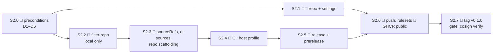

# AI platform split — S2 (create `ai-native-ref`) Implementation Plan

> **For agentic workers:** REQUIRED SUB-SKILL: use superpowers:subagent-driven-development (recommended)
> or superpowers:executing-plans to implement this plan task by task. Steps use checkbox (`- [ ]`)
> syntax for tracking.

**Goal:** `Smana/ai-native-ref` exists, carries §1's paths with their history, its children read
`OCIRepository/ai-native-ref`, its CI renders it against a pinned host commit, and tag `v0.1.0` is
a signed OCI artifact that passes `cosign verify`. The host changes nothing: it keeps applying its
own copies until S3.

**Architecture:** one `git filter-repo` pass over a fresh single-branch clone of cnref, driven by
`ai_paths` from `scripts/ci/flux-schema/ai-boundary.yaml` plus an explicit list of AI-owned CI files.
CI builds a **host profile**: cnref checked out at the commit in `HOST_REF`, its `ai_paths` deleted,
`ai-native-ref`'s tree laid over it, then the host's own `validate-manifests.sh` runs on that
composite. The release workflow stages the manifest directories, `flux push artifact`s them to
`ghcr.io/smana/ai-native-ref:<tag>` and signs the digest keyless (agent-platform's pattern).

**Tech Stack:** git-filter-repo, GitHub Actions, Flux CLI 2.9 (`flux push artifact`), cosign keyless,
GHCR, Python 3 + PyYAML, Taskfile, mise.

**Spec:** `docs/superpowers/specs/2026-10-12-ai-platform-split-design.md` §1, §2 (H1, H3), §6 S2;
ADR-0057. **Read at:** cnref `origin/main` `3764674e` (#2429, OD-1 phase H merged 2026-10-16).

---

## Global Constraints

- **Preconditions (S2.0):** the v1 hardening milestone is closed (design §6); OD-1's phases A–H are on
  cnref `main` (H = #2429 ✓). `ai_paths` already lists `agentgateway`, `agent-gateway`,
  `agentgateway-poc` ✓.
- **Freeze window.** From `SPLIT_FROM` (the cnref sha filtered) until S3 merges, AI-path changes on
  cnref are ported, not lost: S2.7's catch-up replays them. Keep S2 → S3 short.
- **Host untouched.** No cnref file changes in S2 except this plan and the design amendments in D6.
- **👤 = owner-only** (GitHub UI, or a decision); **🤖 = agent with `gh`** (runs as the owner's token,
  so each 🤖 GitHub write is announced first and read back after; no `|| …; echo ok`).
- Heavy runs (`validate-manifests.sh`) under `systemd-run --user --scope -q -p MemoryMax=6G`; never
  two in one checkout (`.bundle/` race).
- Commits in `ai-native-ref`: plain conventional subjects (agent-platform style), English, no trailers.

## Decisions to confirm

| # | Decision | Recommended default | Why |
|---|---|---|---|
| D1 | Visibility | **Public** | cnref is public and the history already is; Flux and `cosign verify` pull anonymously; GHCR packages from a public repo can be public |
| D2 | Artifact name | **`ghcr.io/smana/ai-native-ref`** | Same as the repo, sits beside `ghcr.io/smana/charts/agent-factory`; H1 names the source `ai-native-ref` |
| D3 | First tag | **`v0.1.0`** | Pre-1.0 while the host contract can still move; S3 pins it by digest |
| D4 | Docs | **S4**, history included then by a second `filter-repo` merged with `--allow-unrelated-histories` | The AI pages `relref` host pages (12 links, e.g. `/docs/platform/networking/private-access.md`) and `refLinksErrorLevel: ERROR` fails the build until S4 rewrites them; filtering docs at S4 also avoids a docs catch-up |
| D5 | PR pre-releases (H1 feature branches) | **In S2**, `v<next>-pr<N>.g<sha8>`, signed by `ci.yaml` | Same steps as release; S3 needs them for live gates |
| D6 | Tests the design's §1 list misses | **Move** `test-identity-proxy-upstreams.py`, `test-room-broker-config-rollout.py`, `assert-agent-gateway.py` and both `flux-schema/test-assert-{ai,agent}-gateway.py`; amend §1 | Each reads only AI paths |

---

## File map (`Smana/ai-native-ref`)

| Path | Origin | Task |
|---|---|---|
| `clusters/{aws-0,gcp-0}-{ai-gateway,llm-platform,agent-platform}/` | filtered (history) | S2.2, sourceRef edit S2.3 |
| `infrastructure/`, `security/`, `tooling/`, `observability/`, `apps/` (the §1 subsets) | filtered | S2.2 |
| `flux/sources/<the 10 AI sources>.yaml` | filtered | S2.2 |
| `clusters/{aws-0,gcp-0}-ai-gateway/flux-sources-ai.yaml` | new | S2.3 |
| `scripts/ci/flux-schema/assert-{ai,agent}-gateway.py`, `scripts/ci/tests/flux-schema/test-assert-{ai,agent}-gateway.py` | filtered | S2.2 |
| `scripts/ci/tests/test-{agent-factory-pins,octo-sts-issuer,agent-observability,crossplane-reads-run-pods,identity-proxy-upstreams,room-broker-config-rollout}.py`, `test-{agent-mcp-scope,agent-traces-filter,agent-alert-annotations}.sh` | filtered | S2.2 |
| `scripts/ci/host-profile.sh`, `scripts/ci/run-tests.sh`, `HOST_REF` | new | S2.4 |
| `scripts/ci/validate-links.sh` | copied fresh from cnref | S2.4 |
| `.github/workflows/{ci,release}.yaml`, `.github/renovate.json` | new | S2.4, S2.5 |
| `HOST-CONTRACT.md` | copied from design §2 | S2.3 |
| `README.md`, `AGENTS.md`, `CLAUDE.md` (→ `@AGENTS.md`), `taskfile.yaml`, `mise.toml`, `.pre-commit-config.yaml`, `.secrets.baseline`, `.gitignore`, `LICENSE` | new / trimmed copies | S2.3 |

Not carried: `.github/` of cnref (rulesets, chainguard and `.policy.yml` stay with the host, §1),
`.fluxschema.yml`, `.polaris.yaml` and every host script (used from the host profile, never vendored).



---

### Task S2.0 👤: preconditions

- [ ] **Step 1:** confirm D1–D6 (defaults above).
- [ ] **Step 2:** v1 hardening milestone closed: `gh api repos/Smana/cloud-native-ref/milestones -q '.[]|[.title,.state,.open_issues]|@tsv'` → the v1 hardening row shows `open` issues `0` or is absent.
- [ ] **Step 3:** record `SPLIT_FROM`: `git -C <cnref> fetch origin main && git -C <cnref> rev-parse origin/main`.

### Task S2.1 🤖 (👤 approves): create the repository

- [ ] **Step 1:** `gh repo create Smana/ai-native-ref --public --description "AI platform (serving, agent factory) hosted on cloud-native-ref" --disable-wiki`
  Expected: `✓ Created repository Smana/ai-native-ref on github.com`. Leave it empty (no README): the
  filtered history is pushed as-is in S2.6.
- [ ] **Step 2:** settings: `gh api -X PATCH repos/Smana/ai-native-ref -F delete_branch_on_merge=true -F allow_merge_commit=false -F has_projects=false`
  then read back: `gh api repos/Smana/ai-native-ref -q '{v:.visibility,d:.delete_branch_on_merge,m:.allow_merge_commit}'` → `{"d":true,"m":false,"v":"public"}`.
- [ ] **Step 3:** Actions default token read-only: `gh api -X PUT repos/Smana/ai-native-ref/actions/permissions/workflow -f default_workflow_permissions=read -F can_approve_pull_request_reviews=false`.

### Task S2.2 🤖: history with `git filter-repo` (local only)

`--path-regex` takes Python regexes matched against the full path, so `ai_paths` (anchored `^…/`)
are used verbatim. Only two files were renamed *into* an AI path from outside (vmrules and
vmservicescrapes under `observability/base/victoria-metrics-k8s-stack/`): their pre-move history is
dropped, accepted.

- [ ] **Step 1: fresh clone** (filter-repo refuses a non-fresh one): `git clone --single-branch --branch main --no-tags https://github.com/Smana/cloud-native-ref.git ~/Sources/ai-native-ref`, then `git -C ~/Sources/ai-native-ref reset --hard SPLIT_FROM`.
- [ ] **Step 2: argument file** from the contract (write to the scratchpad, never into the clone):
  `python3 -c 'import yaml,sys;[print(f"--path-regex\n{p}") for p in yaml.safe_load(open(sys.argv[1]))["ai_paths"]]' <cnref>/scripts/ci/flux-schema/ai-boundary.yaml > filter-args.txt`
  and append one `--path` line pair per AI-owned CI file in the file map (2 assert scripts, 2
  flux-schema suites, 9 tests).
- [ ] **Step 3: message rewrite** so `(#123)` keeps pointing at cnref: `messages.txt` = `regex:\(#(\d+)\)==>(Smana/cloud-native-ref#\1)`.
- [ ] **Step 4: filter:** `cd ~/Sources/ai-native-ref && xargs -a <scratch>/filter-args.txt -d '\n' git filter-repo --replace-message <scratch>/messages.txt`
- [ ] **Step 5: verify the tree is exactly the move list.**
  `git ls-files | wc -l` → 307 manifest/MD files (count at `3764674e`) + 13 CI files = **320**.
  `diff <(git -C <cnref> ls-tree -r --name-only SPLIT_FROM | python3 <scratch>/match-ai.py) <(git ls-files | grep -v '^scripts/')` → empty.
  `git log --oneline | wc -l` → a few hundred commits, none empty; `git log -3 --format=%s` shows `(Smana/cloud-native-ref#2429)`.
- [ ] **Step 6: secrets over the whole rewritten history:** `trufflehog git file://$PWD --only-verified --fail` → exit 0. (cnref's `.secrets.baseline` has no entry under an AI path, checked at `3764674e`.)

### Task S2.3 🤖: sourceRefs, the AI sources child, scaffolding

H1: children use `sourceRef: {kind: OCIRepository, name: ai-native-ref}` (namespace `flux-system`,
defined by the host at S3). The artifact root is the repo root, so **every child's `spec.path` is
unchanged** (`./infrastructure/base/agent-sandbox`, `./apps/llm`, …), and so are the umbrellas'
`./clusters/<cluster>-<umbrella>`. The tag is not on the child: it lives on the host's
`OCIRepository` (S3).

- [ ] **Step 1: retarget** (every child names one of `infra|security|observability|tooling|apps-artifact`, nothing else, at `3764674e`):
  `sed -i -E '/sourceRef:/,/name:/{s/kind: ExternalArtifact/kind: OCIRepository/;s/name: (infra|security|observability|tooling|apps)-artifact/name: ai-native-ref/}' clusters/*-{ai-gateway,llm-platform,agent-platform}/*.yaml`
  Check: `grep -rn 'ExternalArtifact\|-artifact$' clusters/` → nothing; `grep -rc 'name: ai-native-ref' clusters/ | awk -F: '{s+=$2}END{print s}'` → the number of child Kustomizations (one per non-`kustomization.yaml`, non-README file).
- [ ] **Step 2: the AI sources child.** §1 moves 10 sources out of `flux/sources/`, which the host's
  `flux-sources` Kustomization applies wholesale; nothing in the AI tree applies them yet. Add
  `clusters/{aws-0,gcp-0}-ai-gateway/flux-sources-ai.yaml`: Kustomization `ai-sources`,
  `path: ./flux/sources` (no `kustomization.yaml` there, so Flux applies every file, all AI),
  same `sourceRef`, `prune: true`, `dependsOn: [crds]`; list it first in both `kustomization.yaml`s.
  In the ai-gateway umbrella because the other two depend on it.
- [ ] **Step 3: cross-boundary Markdown links** (2 found): `clusters/aws-0-llm-platform/README.md`
  → `docs/specs/done/2026-Q2/0001-…/spec.md`, `clusters/gcp-0-llm-platform/README.md` → ADR-0021.
  Rewrite as `https://github.com/Smana/cloud-native-ref/blob/main/…` URLs.
- [ ] **Step 4: scaffolding:** `HOST-CONTRACT.md` (design §2 verbatim, header "contract version 1,
  tested against cnref `HOST_REF`"); `README.md` (what it is, the four `flux resume` commands, link
  to the contract); `AGENTS.md` (worktrees, `task check`, the host-profile rule, constitution
  pointer); `mise.toml` = cnref's minus `go`, golangci, opentofu, tflint, terramate, trivy;
  `.pre-commit-config.yaml` = cnref's pre-commit-hooks + detect-secrets blocks only;
  `detect-secrets scan > .secrets.baseline`; `.gitignore` adds `.host/ .composite/ .bundle/ .schemas/ dist/`.
- [ ] **Step 5: commit** `feat: retarget the children to the ai-native-ref OCIRepository`.

### Task S2.4 🤖: CI against the host profile

**Host profile** = cnref at `HOST_REF` (a full sha, one line; Renovate `git-refs` custom manager bumps
it) providing the CRDs, namespaces, shared sources, `.fluxschema.yml`, `.polaris.yaml`, fixtures
(`render-bundle.py`'s `FIXTURE_VARS`) and every host script. Vendored here: only the AI-owned
scripts and tests, which overwrite the host's same-path copies in the composite (before S3 the host
still has them; after S3 it does not).

| Script | Does |
|---|---|
| `scripts/ci/host-profile.sh` | `cp -a .host .composite`; delete every file matching `.composite`'s own `ai_paths`; `rsync -a` this repo's `clusters infrastructure security tooling observability apps flux scripts/ci` into it |
| `scripts/ci/run-tests.sh` | for each `git ls-files 'scripts/ci/tests/*'`: run `.composite/<path>` with `bash`/`python3`, honouring `# requires:`, PASS/SKIP/FAIL like cnref's `run.sh` |
| `taskfile.yaml` `check` | `ci:host-profile` → `.composite/scripts/ci/validate-manifests.sh` → `ci:test` → `ci:links` |

What runs on the composite, and why it covers the design's list:

| Design S2 CI item | Here |
|---|---|
| Render against the host profile | `.composite/scripts/ci/validate-manifests.sh`: substitution wiring, `check-ai-boundary.py` (both directions, from the host's contract), VMRules, catalog, render, flux schema, polaris, `assert-ai-gateway.py`, `assert-cloud-shape.py`, `assert-agent-gateway.py` (ours, overlaid) |
| `assert-ai-gateway.py` | gate 3 above, our copy |
| The moved tests | `run-tests.sh` |
| Links | `validate-links.sh` over this repo (~9 MD files) |
| Doc claims | **Deferred to S4**: the AI entries' pages are in cnref until then |
| Site build | **Deferred to S4** (D4) |

- [ ] **Step 1:** `HOST_REF` = `SPLIT_FROM`; write both scripts and the taskfile.
- [ ] **Step 2: local proof.** `git clone --filter=blob:none https://github.com/Smana/cloud-native-ref .host && git -C .host checkout "$(cat HOST_REF)"`; then `systemd-run --user --scope -q -p MemoryMax=6G task check`.
  Expected: `==> All gates passed`, `run-tests.sh` → `13 passed, 0 failed` (or SKIPs naming a missing tool), links exit 0.
- [ ] **Step 3: equivalence.** Render the composite and cnref at `HOST_REF` with the host's
  `render-both.sh`/`diff-bundles.py`; the only differences are the children's `sourceRef`s and the new
  `ai-sources` Kustomization. This is S3's gate rehearsed.
- [ ] **Step 4: negative proof.** Plant `kind: ExternalArtifact` back into one child → `check-ai-boundary`
  stays green (a host source), so add a 5-line grep step to `ci.yaml`: no `ExternalArtifact` and no
  `GitRepository/flux-system` under `clusters/`. Plant it, see red, revert.
- [ ] **Step 5: `.github/workflows/ci.yaml`** (pull_request + push to main), jobs `validate`
  (checkout; checkout `Smana/cloud-native-ref` at `HOST_REF` into `.host`; mise; `flux plugin install
  schema@0.11.0`; pyyaml, jq; the host's `fetch-xrd-crds.sh` → `XRD_CRDS_FILE`; `task check`) and
  `lint` (pre-commit, TruffleHog on the PR range). Action SHAs copied from cnref's `ci.yaml`.
- [ ] **Step 6: commit** `ci: render and gate against a pinned cloud-native-ref host profile`.

### Task S2.5 🤖: release and PR pre-release

`.github/workflows/release.yaml`, on `push: tags: ["v*"]`, `permissions: {}` at the top, job
`permissions: {contents: read, packages: write, id-token: write}`:

```yaml
      - run: task check           # a tag can point at a commit that never passed CI
      - uses: sigstore/cosign-installer@6f9f17788090df1f26f669e9d70d6ae9567deba6 # v4.1.2
      - uses: docker/login-action@c94ce9fb468520275223c153574b00df6fe4bcc9 # v3.7.0
        with: {registry: ghcr.io, username: "${{ github.actor }}", password: "${{ secrets.GITHUB_TOKEN }}"}
      - name: Push and sign
        run: |
          set -euo pipefail
          mkdir dist && cp -a clusters infrastructure security tooling observability apps flux dist/
          digest="$(flux push artifact "oci://ghcr.io/smana/ai-native-ref:${GITHUB_REF_NAME}" \
            --path=dist --source="${GITHUB_SERVER_URL}/${GITHUB_REPOSITORY}" \
            --revision="${GITHUB_REF_NAME}@sha1:${GITHUB_SHA}" --output json | jq -r .digest)"
          [ -n "$digest" ] && [ "$digest" != null ] || { echo "no digest" >&2; exit 1; }
          cosign sign --yes "ghcr.io/smana/ai-native-ref@${digest}"
          echo "digest=${digest}" >> "$GITHUB_STEP_SUMMARY"
```

`ci.yaml` gains `prerelease` (D5), same body, `if:` same-repo PR and not Dependabot, tag
`v<latest+patch>-pr<N>.g<sha8>` derived as agent-platform's `ci.yaml` does.

- [ ] **Step 1:** write both; `actionlint` → exit 0.
- [ ] **Step 2:** commit `ci: release a signed OCI artifact on v* tags`.

### Task S2.6 🤖 (👤 GHCR): push, rulesets, first green run

- [ ] **Step 1: push** (repo empty, no ruleset yet): `git -C ~/Sources/ai-native-ref remote add origin https://github.com/Smana/ai-native-ref.git && git -C ~/Sources/ai-native-ref push -u origin main`.
- [ ] **Step 2:** open a trivial PR (`HOST-CONTRACT.md` header date) to exercise `ci.yaml` and
  `prerelease`; poll `gh pr view N --json statusCheckRollup`; all `SUCCESS`. This first push
  **creates the GHCR package, private**.
- [ ] **Step 3 👤: make the package public** (no REST endpoint for container visibility):
  `https://github.com/users/Smana/packages/container/ai-native-ref/settings` → Change visibility →
  Public. Check: `curl -s -o /dev/null -w '%{http_code}' https://ghcr.io/v2/smana/ai-native-ref/tags/list -H "Authorization: Bearer $(curl -s 'https://ghcr.io/token?scope=repository:smana/ai-native-ref:pull' | jq -r .token)"` → `200`.
- [ ] **Step 4: rulesets** (agent-platform's two, with cnref's no-bypass rule on `main`):
  `main`: `~DEFAULT_BRANCH`, rules `deletion`, `non_fast_forward`, `required_linear_history`,
  `pull_request` (0 approvals), `required_status_checks` [`validate`, `lint`], **no bypass actors**.
  `release-tags`: `refs/tags/v*`, `creation`, `update`, `deletion`, bypass `RepositoryRole 5`
  (admin) `always`, so only the owner creates release tags.
  `gh api -X POST repos/Smana/ai-native-ref/rulesets --input main.json` (and `release-tags.json`);
  read back `gh api repos/Smana/ai-native-ref/rulesets -q '.[]|[.name,.enforcement]|@tsv'` → both `active`.
- [ ] **Step 5:** merge the PR; `main`'s push run green.

### Task S2.7 👤: tag v0.1.0 — the S2 gate

- [ ] **Step 1 👤:** `git -C ~/Sources/ai-native-ref tag -s v0.1.0 -m "v0.1.0: tested against cnref $(cat HOST_REF)" && git push origin v0.1.0`
  (or 🤖 `gh api repos/Smana/ai-native-ref/git/refs -f ref=refs/tags/v0.1.0 -f sha=<main sha>` on the owner's go).
- [ ] **Step 2: gate.**

```bash
cosign verify ghcr.io/smana/ai-native-ref:v0.1.0 \
  --certificate-identity-regexp '^https://github\.com/Smana/ai-native-ref/\.github/workflows/release\.yaml@refs/tags/v.*$' \
  --certificate-oidc-issuer https://token.actions.githubusercontent.com
```

  Expected: `Verification for ghcr.io/smana/ai-native-ref:v0.1.0 --` followed by "The cosign claims
  were validated", "Existence of the claims in the transparency log was verified offline", "The code-
  signing certificate was verified using trusted certificate authority certificates", exit 0.
- [ ] **Step 3: content.** `flux pull artifact oci://ghcr.io/smana/ai-native-ref:v0.1.0 -o <scratch>/a && ls <scratch>/a/clusters` → the six child directories; `grep -rl ExternalArtifact <scratch>/a` → nothing.
- [ ] **Step 4: catch-up check before S3.** `git -C <cnref> log --oneline SPLIT_FROM..origin/main -- <ai paths>`.
  Empty → done. Otherwise port: `git -C <cnref> format-patch SPLIT_FROM..origin/main -o <scratch>/p -- <ai paths>` then `git -C ~/Sources/ai-native-ref am -3 <scratch>/p/*.patch` in a PR, and release `v0.1.1`.
- [ ] **Step 5:** close S2's issue with the digest, the verify output and the run URL.

---

## For S3 (noted, not done here)

| Item | Note |
|---|---|
| Host source | `OCIRepository ai-native-ref` in `flux-system`, `suspend: true`, `ref: {tag: v0.1.0, digest: sha256:…}`, `verify: {provider: cosign, matchOIDCIdentity: [{issuer: '^https://token\.actions\.githubusercontent\.com$', subject: '^https://github\.com/Smana/ai-native-ref/\.github/workflows/release\.yaml@refs/tags/v.*$'}]}` (the `ocirepo-agent-factory` pattern) |
| `ai_native_ref_tag` override | **Ambiguous in H1:** Flux pulls the digest when both are set, so substituting the tag alone changes nothing; and pre-releases are signed by `ci.yaml`, which the release-only identity rejects. S3 must template the whole `ref` and add a `ci.yaml@refs/pull/.*` subject for the override path |
| `ai-sources` | Host `flux-sources` stops applying the 10 files, the child takes them; S3's "everything else identical" gate must allow this one new Kustomization |
| `host_sources` | Add `OCIRepository/ai-native-ref` to `ai-boundary.yaml` (today it is "defined on neither side", so the check passes without it) |

## Risks

| Risk | Mitigation |
|---|---|
| A file the AI tree references stays behind | S2.2 step 5's exact diff, S2.4's composite render and `check-ai-boundary.py` from the AI side |
| AI edits on cnref during the window are lost | Freeze + S2.7 step 4's catch-up before S3 |
| Host change breaks the AI render unseen | `HOST_REF` bumped by Renovate; each bump is a PR that re-renders |
| A secret in rewritten history | TruffleHog over the full history before the first push (S2.2 step 6) |
| GHCR package left private | Flux and `cosign verify` fail anonymously; S2.6 step 3 checks with an anonymous token |
| `.github` carried by mistake | Not in any `--path`; S2.2 step 5's diff excludes it |
| Commit messages autolink to the wrong repo | `--replace-message` (S2.2 step 3) |
