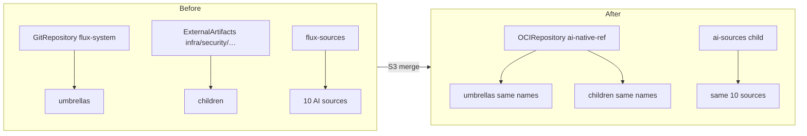

# AI platform split — S3 (host switches to the artifact) Implementation Plan

> **For agentic workers:** REQUIRED SUB-SKILL: use superpowers:subagent-driven-development (recommended)
> or superpowers:executing-plans to implement this plan task by task. Steps use checkbox (`- [ ]`)
> syntax for tracking.

**Goal:** cnref applies the AI platform from the signed `OCIRepository/ai-native-ref`, not from its
own tree. The AI paths and their tests leave cnref. The rendered platform is unchanged apart from
sources and `sourceRef`s, and aws-0 keeps running while it switches: no AI object is deleted, the
`agents-zai-api-key` Secret and the `xplane-rooms` database included.

**Conclusion first:** the live switch is safe **if three guards land one PR ahead** (S3.0):
`kustomize.toolkit.fluxcd.io/prune: disabled` on the 10 moving sources and the two stateful objects,
and `deletionPolicy: Orphan` on the `ai-sources` child. With them, every name stays the same, every
inventory stays the same, and the only ownership handover (10 sources from `flux-sources` to
`ai-sources`) cannot delete anything in either order or on rollback.

**Spec:** `docs/superpowers/specs/2026-10-12-ai-platform-split-design.md` §2 H1/H3, §3, §4, §6 S3.
**Follows:** `2026-10-16-ai-split-s2-plan.md` ("For S3"). **Read at:** cnref `origin/main` `5b187e8e`.

| Fact | Value |
|---|---|
| `SPLIT_FROM` | `3764674edd4f3d302ffeb96f648ae07a8d739083` |
| `CAUGHT_UP_TO` | `5b187e8e74b3a72073aff8dc253cc6e5dea49540` (#2431 ported as ai-native-ref#2) |
| Latest release | `v0.1.1` = ai-native-ref `6f8d877c`, `sha256:4c991752fb0c046115dc16ef56d00d84ce4aa5fafc0e5cf121376d986de2c6e9` (S3.0 cuts `v0.1.2`) |
| Release identity | `…/ai-native-ref/.github/workflows/release.yaml@refs/tags/v*` |
| Pre-release identity | `…/ai-native-ref/.github/workflows/ci.yaml@refs/pull/<N>/merge` (checked: `cosign verify` of `v0.0.1-pr1.g39c1796f` with that regexp, rc 0) |

---

## Global constraints

- **👤 = owner-only**; 🤖 = agent with `gh`, each GitHub write announced and read back.
- **Freeze (now → S3 merge).** No cnref change under `ai_paths` or the moved CI files. If one is
  unavoidable, port it to ai-native-ref the same day (S2 plan S2.7 step 4 recipe) and record the new
  `CAUGHT_UP_TO`. Do not label AI-path issues `factory/ready` in the window.
- Heavy runs under `systemd-run --user --scope -q -p MemoryMax=6G`; one `render-bundle.py` per checkout.
- No cluster is touched by an agent. Every live step is 👤.

## Decisions to confirm

| # | Decision | Recommended default | Why |
|---|---|---|---|
| D1 | Where the source lives | **`flux/sources/ocirepo-ai-native-ref.yaml`**, `flux-system`, `suspend: true`; aws-0 un-suspends it with a `spec.patches` entry on `clusters/aws-0/flux/flux-sources.yaml` | Sources live under `flux-sources` (no `apps` shard label); one pin for both clusters; the design default stays suspended, and aws-0's umbrellas are live (#2431) so its source cannot be |
| D2 | `ref` and the feature-branch override | **Static pin in Git** (`tag` + `digest`); the override is a pin edit on the cnref feature branch the cluster tracks (`TF_VAR_flux_git_ref`). Drop `ai_native_ref_tag` from H3 | Flux pulls the digest when both are set, so substituting a tag alone does nothing; templating the digest too needs two `${var:=default}` keys wired through `flux_cluster_vars` (OpenTofu), a Renovate regex manager and check-substitution support. The branch route needs none |
| D3 | Verify identities | **Both** release tags and same-repo PR pre-releases in `matchOIDCIdentity` | D2's override pins pre-releases; only owner-writable PRs get one (S2 `prerelease` job), and the pin itself is a gate path |
| D4 | How host CI sees AI manifests | **Overlay**: `scripts/ci/ai-overlay.sh` verifies and pulls the pinned digest into the tree; the AI paths are `.gitignore`d | Render, `assert-cloud-shape`, `verify-doc-paths` (314 backticked AI paths in host docs), `validate-links` (70 links) and doc claims keep working until S4 unchanged; the ignore also stops AI files creeping back |
| D5 | aws-0 cutover | **Live switch with the S3.0 guards**, runbook 11 step 7 on the switched cluster as the merge acceptance; a rebuild of one cluster as S3's closing gate at the next planned rebuild (before S4) | aws-0 runs the factory; a teardown first would avoid any handover but costs a rebuild and Let's Encrypt quota for no extra proof that the rebuild gate does not give anyway |
| D6 | Dead AI gate paths in `.policy.yml` | **Keep** them until S4, add the pin paths | Still block an agent from re-creating AI paths in cnref; removing them is a human-authored policy change with no payoff |

---

## Why the live switch does not delete anything



| Object | What changes | Inventory / ownership | Prune risk | Guard |
|---|---|---|---|---|
| 3 umbrellas × 2 clusters | `sourceRef` only, `path` unchanged | Same name → in-place SSA; their inventory gains `ai-sources`, loses nothing | None | — |
| Each child Kustomization | `sourceRef` ExternalArtifact → OCIRepository | Same name, same `kustomize.toolkit.fluxcd.io/name` labels; inventory = what the artifact renders | **Only if the artifact differs from cnref**: a missing object is pruned. `agents-zai-api-key` is `creationPolicy: Owner`, so pruning its ExternalSecret GCs the Secret; pruning SQLInstance `xplane-rooms` deletes the CNPG database | Render equivalence (S3.4) + `prune: disabled` on both (S3.0) |
| Child whose umbrella has not yet reconciled | Still on the ExternalArtifact, whose new revision lacks the AI dirs | `kustomize build` fails "path not found" | None: GC runs only after a successful apply; the child stalls until the umbrella updates it | — |
| Children while the source is not Ready (suspended, cosign fail, GHCR private) | — | Not reconciled | None: stall, `SourceNotReady` | S3.6 checks the source first |
| 10 AI sources (`ocirepo-agent-factory`, `gitrepo-agent-sandbox`, …) | Leave `flux-sources`, join `ai-sources` | **Handover**: if `flux-sources` GCs first, it deletes them (HelmReleases go not-Ready but are not uninstalled; recreated when `ai-sources` applies) | Transient outage; on rollback, deleting `ai-sources` would GC them | `prune: disabled` on all 10 (S3.0) + `ai-sources` `deletionPolicy: Orphan` |
| `OCIRepository/ai-native-ref` | New | `flux-sources` | — | — |

The `prune: disabled` annotation self-cleans where it should: both Kustomizations apply with the
`kustomize-controller` field manager, so when the ai-native-ref copy drops it later (S3.8), SSA
removes it from the live object.

---

### Task S3.0 🤖: guards, then `v0.1.2` (one PR each side, one tag)

- [ ] **Step 1 (cnref PR, freeze exception):** add `metadata.annotations: {kustomize.toolkit.fluxcd.io/prune: disabled}`
  to the 10 `ai_paths` files under `flux/sources/`, to `infrastructure/base/room-broker/sqlinstance.yaml`
  and to `infrastructure/base/agent-router/externalsecret-zai.yaml`, each with a one-line *why*
  comment ("S3 handover: never pruned"). `task check` green. 👤 merges.
- [ ] **Step 2 👤 (live, read-only check):** after Flux applies it,
  `kubectl get sqlinstance -n agent-system xplane-rooms externalsecret -n agent-system agents-zai-api-key -o jsonpath='{range .items[*]}{.metadata.annotations.kustomize\.toolkit\.fluxcd\.io/prune}{"\n"}{end}'`
  → `disabled` twice; same for `ocirepository -n agent-system agent-factory`.
- [ ] **Step 3 (ai-native-ref PR):** port step 1 (catch-up recipe) **and** add `deletionPolicy: Orphan`
  to `ai-sources` in both `clusters/{aws-0,gcp-0}-ai-gateway/flux-sources-ai.yaml`. CI green, merge.
- [ ] **Step 4:** tag `v0.1.2` (`gh api repos/Smana/ai-native-ref/git/refs -f ref=refs/tags/v0.1.2 -f sha=<main sha>`),
  wait for `release.yaml`, `cosign verify` (S2 plan S2.7 step 2) → rc 0, record the digest `D`.

### Task S3.1 🤖: the host source

`flux/sources/ocirepo-ai-native-ref.yaml`:

```yaml
# The AI platform (ADR-0057, split design H1). Suspended by default: a default deploy never fetches
# it. aws-0 un-suspends it in its flux-sources Kustomization (its umbrellas are live).
apiVersion: source.toolkit.fluxcd.io/v1
kind: OCIRepository
metadata:
  name: ai-native-ref
  namespace: flux-system
spec:
  suspend: true
  interval: 10m
  url: oci://ghcr.io/smana/ai-native-ref
  # Flux pulls the digest. A feature-branch cluster pins a pre-release here, on its branch (D2).
  ref:
    tag: "v0.1.2"
    digest: sha256:<D>
  verify:
    provider: cosign
    matchOIDCIdentity:
      - issuer: "^https://token\\.actions\\.githubusercontent\\.com$"
        subject: "^https://github\\.com/Smana/ai-native-ref/\\.github/workflows/release\\.yaml@refs/tags/v.*$"
      - issuer: "^https://token\\.actions\\.githubusercontent\\.com$"
        subject: "^https://github\\.com/Smana/ai-native-ref/\\.github/workflows/ci\\.yaml@refs/pull/[0-9]+/merge$"
```

- [ ] **Step 1:** write it; add to `clusters/aws-0/flux/flux-sources.yaml`:
  `spec.patches: [{target: {kind: OCIRepository, name: ai-native-ref}, patch: '[{"op":"replace","path":"/spec/suspend","value":false}]'}]`.
  Note: `render-bundle.py` does not apply Kustomization `spec.patches`, so the bundle shows `suspend: true` for aws-0 too.
- [ ] **Step 2:** `ai-boundary.yaml` `host_sources`: add `OCIRepository/ai-native-ref`; remove the five
  `ExternalArtifact/*-artifact` and `GitRepository/flux-system`; `substitution_keys`: remove `ai_native_ref_tag` (D2).
  Same PR edits design §2 H1/H3 and bumps the contract version; ai-native-ref's `HOST-CONTRACT.md` follows in S3.8.

### Task S3.2 🤖: retarget the umbrellas

- [ ] `clusters/{aws-0,gcp-0}/{ai-gateway,llm-platform,agent-platform}.yaml`: `sourceRef: {kind: OCIRepository, name: ai-native-ref}`;
  `path`, `suspend`, `dependsOn`, `deletionPolicy` unchanged. Fix the comments that say "a sibling of clusters/aws-0/"
  (the reason is gone: the children are no longer in the `flux-system` tree). Check:
  `grep -A2 sourceRef clusters/*/{ai-gateway,llm-platform,agent-platform}.yaml | grep -c ai-native-ref` → `6`.

### Task S3.3 🤖: delete the moved paths, add the overlay

- [ ] **Step 1: delete** every tracked file matching `ai_paths` (307 at `5b187e8e`) and the 13 moved CI files (S2 file map):
  `git ls-files | python3 <scratch>/match-ai.py | xargs git rm -q` then `git rm` the 13. Expected `git status --short | grep -c '^D'` = 320.
- [ ] **Step 2: `.gitignore`** the AI paths, generated from `ai_paths` (`/clusters/*-ai-gateway/`, `/infrastructure/*/agent-sandbox/`, …, the 10 source files), with a header pointing at `ai-boundary.yaml`.
- [ ] **Step 3: `scripts/ci/ai-overlay.sh`:** read `url`/`digest` from `flux/sources/ocirepo-ai-native-ref.yaml` (yq), `cosign verify <url>@<digest>` with both identities, `flux pull artifact <url>@<digest> -o .ai-artifact`, `rsync -a .ai-artifact/ ./` (only ignored paths land). Idempotent; `task ai:overlay`; called first by `task check` and by CI before `validate-manifests.sh`, `verify-doc-paths.sh`, `validate-links.sh`, `validate-doc-claims.sh`.
- [ ] **Step 4: `validate-manifests.sh`:** drop the `assert-ai-gateway.py` and `assert-agent-gateway.py` calls (they run in ai-native-ref now); keep `assert-cloud-shape.py` (host gate, sees the overlay).
- [ ] **Step 5: ArtifactGenerator:** **no change.** `monorepo-split` copies whole top-level dirs (`@repo/infrastructure/**`, …); with the AI dirs gone from Git (the overlay never reaches the cluster's GitRepository) its artifacts carry no AI paths. Check after S3.6: `flux get artifact generator monorepo-split` revisions advance, host children Ready.

### Task S3.4 🤖: `.policy.yml` and gate coverage

- [ ] Add to every agent rule's `no_changed_files` (D6 keeps the rest):
  `'^flux/sources/ocirepo-ai-native-ref\.yaml$'`, `'^clusters/[^/]+/(ai-gateway|llm-platform)\.yaml$'` (agent-platform's is there),
  `'^clusters/[^/]+/flux/flux-sources\.yaml$'` (aws-0's un-suspend patch), `'^\.gitignore$'` (the AI-path ignore), `'^scripts/ci/ai-overlay\.sh$'`.
- [ ] `check-policy-gate-coverage.sh`: the `clusters/*-agent-platform/*.yaml` loop finds nothing after the delete. Point it at `.ai-artifact/clusters/*-agent-platform/` when present, else skip with a note; add the five new paths to `SENTINELS`. `scripts/ci/tests/test-policy-gate-coverage.sh` green.

### Task S3.5 🤖: render equivalence (the S3 gate)

```bash
S=<scratch>; BEFORE=$(git rev-parse origin/main)            # rebased: = CAUGHT_UP_TO + S3.0
mkdir "$S/before" && git archive "$BEFORE" | tar -x -C "$S/before"   # no worktree: see ../AGENTS.md
(cd "$S/before" && systemd-run --user --scope -q -p MemoryMax=6G \
   python3 scripts/ci/flux-schema/render-bundle.py "$S/b-before")
task ai:overlay                                              # S3 branch, pinned digest D
systemd-run --user --scope -q -p MemoryMax=6G python3 scripts/ci/flux-schema/render-bundle.py "$S/b-after"
python3 scripts/ci/flux-schema/diff-bundles.py "$S/b-before" "$S/b-after" "$S/diff.md"
python3 "$S/assert-equiv.py" "$S/b-before" "$S/b-after"
```

`assert-equiv.py` (scratch, ~25 lines): load every document of both bundles keyed by
`(apiVersion, kind, namespace, name)`; on `Kustomization` delete `spec.sourceRef`; assert
`after − before == {OCIRepository/flux-system/ai-native-ref, Kustomization/flux-system/ai-sources}`
(per cluster), `before − after == ∅`, and every common key equal. Exit 1 printing the first diff.

- [ ] Expected: exit 0; `diff.md` lists only sourceRef lines, the new source and `ai-sources`.
- [ ] **Tree check:** `diff -r` of the AI paths in `$S/before` against `.ai-artifact/` → only the
  `sourceRef` lines and the two `flux-sources-ai.yaml` files.
- [ ] Negative: change one child's `path` in `.ai-artifact/`, re-render → `assert-equiv.py` exits 1.

### Task S3.6 🤖→👤: PR, merge, live switch on aws-0

- [ ] **Step 1:** catch-up check: `git log --oneline 5b187e8e..origin/main -- <ai paths> <13 CI files>` → only S3.0's commit (already ported). Otherwise port, re-tag, re-pin, redo S3.5.
- [ ] **Step 2:** one PR (`feat(clusters)!: apply the AI platform from the ai-native-ref artifact`), body with `diff.md`'s summary and the mermaid above. CI green. **ADR:** none needed (ADR-0057 covers it).
- [ ] **Step 3 👤 (before merge, live, read-only):** `flux get kustomizations -A | grep -v True` → nothing on aws-0 (start from green).
- [ ] **Step 4 👤:** merge. Then in order, each until Ready:
  `flux get sources oci ai-native-ref -n flux-system` (Ready, `v0.1.2@sha256:<D>`, verified) →
  `flux get ks ai-gateway agent-platform -n flux-system` → `flux get ks ai-sources -n flux-system` →
  every child `flux get ks -n flux-system | grep -E 'agent|room|kueue|envoy|llm|sandbox'`.
- [ ] **Step 5 👤 (nothing deleted):** `kubectl get secret -n agent-system agents-zai-api-key -o jsonpath='{.metadata.creationTimestamp}'`,
  `kubectl get cluster.postgresql.cnpg.io -n agent-system -o custom-columns=N:.metadata.name,C:.metadata.creationTimestamp`,
  `kubectl get ocirepository -n agent-system agent-factory -o jsonpath='{.metadata.creationTimestamp}{" "}{.metadata.labels.kustomize\.toolkit\.fluxcd\.io/name}'`
  → timestamps older than the merge; the last shows `ai-sources`.
- [ ] **Step 6 👤 (acceptance):** runbook `docs/runbooks/agent-factory/11-v1-validation.md` step 7 on the switched aws-0 → terminal phase `Done`.

### Task S3.7 👤: closing gate — a rebuild

At the next planned rebuild of one cluster (default aws-0, before S4): `terramate script run deploy`
from `main`, then runbook 11 step 7. Proves what a live switch cannot: a fresh source fetch and
cosign verify on bootstrap, and `ai-sources` → umbrellas ordering. Record the run in the S3 issue.

### Task S3.8 🤖: ai-native-ref follow-up

- [ ] `HOST-CONTRACT.md` = design §2 at the new version; `HOST_REF` = S3's merge sha (CI then renders
  against a host with no AI paths: `host-profile.sh`'s delete step becomes a no-op, expected).
- [ ] Drop the `prune: disabled` annotations from the 10 sources (keep the two stateful ones: they are
  worth having permanently). Release `v0.1.3`; Renovate bumps the host pin.

---

## Rollback

`git revert` the S3 PR (👤 merge). Umbrellas go back to `GitRepository/flux-system`, children to the
ExternalArtifacts, the AI paths return to Git, `flux-sources` re-adopts the 10 sources. The umbrella
`ai-gateway` prunes the `ai-sources` Kustomization; its `deletionPolicy: Orphan` (S3.0) leaves the 10
sources in place, and their `prune: disabled` annotation (still in cnref's restored copies) covers the
reverse handover. The new `OCIRepository` is pruned by `flux-sources`, harmless. Fast path without a
revert: `flux suspend ks ai-gateway agent-platform -n flux-system` freezes the children as they are.

## Risks

| Risk | Mitigation |
|---|---|
| Artifact ≠ cnref (missed catch-up) → child prunes an object | Freeze, S3.6 step 1, S3.5 equivalence on the pinned digest, S3.0 annotations on the stateful objects |
| Source not Ready on aws-0 (patch missing, GHCR private, identity mismatch) | Children stall, nothing pruned; S3.6 step 4 checks the source first |
| Host change breaks AI assertions unseen (asserts moved out) | ai-native-ref renders against `HOST_REF`; Renovate bumps it; the overlay keeps `assert-cloud-shape` on the host |
| Docs/links to deleted paths (314 + 70) | D4 overlay until S4 moves the docs |
| Accepting PR-signed artifacts | Pre-releases exist only for same-repo PRs (owner); the pin is a gate path |
| A suspended source on a rebuild of aws-0 | The un-suspend patch is in Git, not a manual resume |
