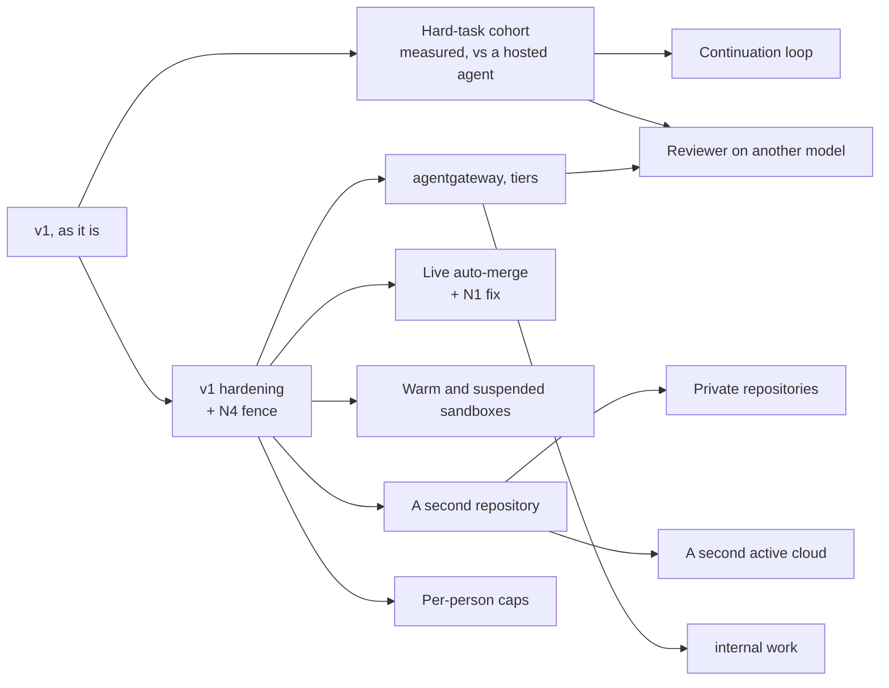

# Agent factory v1: review, and a proposed v2 amendment

**Date:** 2026-10-12 · **Status:** proposed, owner review pending · **Type:** source, design and
ecosystem review. Docs only; nothing was run on a cluster.

**Read at:** cloud-native-ref `main` `edeffe0e`; agent-platform `v0.8.0` (`aa0eb28`);
crossplane-configuration `v0.9.3` (`a425e4c`). The 2026-10-02 external review is taken as applied
([#2173](https://github.com/Smana/cloud-native-ref/pull/2173)). The draft was itself re-checked by
three independent reviewers (code, external sources, reasoning); their corrections are folded in.

## Conclusion

v1 is a sound control plane. Keep every architectural choice. The amendment, proposed on the
[status page](../../../website/content/docs/platform/ai-platform/status.md#v2-roadmap), which owns
the gates:

| Change | Why |
|---|---|
| **First, a hard-task cohort on v1 as it is, now** | It needs neither code nor the hardening: a human merges every PR. Every merged outcome is a docs fix adding at most 12 lines because the pilot fed it docs issues, not because of what it can do. 10 to 20 real `tests`, `dashboards` and `scripts` issues through today's `pair` template, measured per task and run through a hosted agent too (and through the factory on that agent's model, to separate model from governance), answer the question the roadmap cannot answer without it |
| **Fix the one-way merge path, as a gate for live auto-merge** ([N1](#n1)) | No PR the merge gate hands to a human ever returns to it. A CI-fixed PR on a reviewed template always lands there. Live auto-merge cannot pass as coded. The fix does not wait for any loop |
| **Fence `internal` runs now, with the hardening** ([N4](#n4), fixed in v0.9.5) | RunLore investigations already run as `internal` triagers with GitHub egress and a GitHub token. The design marks those threats closed |
| **A continuation loop, with its bounds kept** | Step from the PR's state instead of fixed per-trigger paths, but keep per-trigger sub-caps, a small step limit and fast escalation |
| **Warm and suspended sandboxes** | The chosen runtime ships warm pools and suspend; a run starts in about 90 s on a fresh node and holds or ends its pod while it waits |
| **Teams: research, not a roadmap line** | The evidence does not support them yet, and the cheapest version reverses a recorded design decision |

Nothing in the existing roadmap is removed or reordered: a second repository, private repositories,
`internal` work, per-person caps and a second cloud keep their gates.

## 1. Maturity

### 1.1 Outcomes to date

All agent-authored PRs on `Smana/cloud-native-ref`, 2026-09-27 to 2026-10-08
(`gh pr list --author app/ogenki-agents`; intake from each PR's `Agent-Task` footer).

| Measure | Value |
|---|---|
| Opened / merged / closed | 16 / 13 / 3 |
| Merged through label intake | 11 (#2206, #2218–#2221, #2224, #2227, #2228, #2264, #2267, #2272). Four ended `Done` from the factory; seven had their task stopped by the kill switch during live gates and were merged by hand |
| Merged from hand-launched runs | 2 (#2114, #2141), before intake existed |
| Closed | #2199, a wrong fix the maintainer rejected (the only quality failure on record); #2207, a live-gate probe; #2239, the walkthrough PR, closed by design before the merge wave |
| Change size, merged | 9 one-line; largest `+12/-6` (#2267) |
| Kind | 13 of 13 docs: version pins, a header, a CA prerequisite |
| Tokens | 667,878 for PR #2267 (implementer 505,528, reviewer 162,350); 1,078k for issue #2238 → PR #2239 over five runs, closed |

What it shows is the pilot's scope: the classes the design defines are docs-only (SP3 S8), and the
issues labelled were docs pins a script could also have caught. It does not show what the factory
does on code. Hence the cohort.

### 1.2 Cost

The gateway prices each run (`llm_gateway:price_usd_per_mtoken`,
`infrastructure/base/llm-gateway/vmrule-llm-gateway.yaml`) and the run dashboard shows a "Cost
(USD)" panel. Nothing aggregates money per task or per accepted outcome.

Re-priced at GLM-5.3 list (the same price as GLM-5.2: $1.40 input, $0.26 cached, $4.40 output per
million). Both columns assume an input/output split and a cache share, so
these are estimates, not bounds:

| Task | 90/10 split assumed, no cache | 97/3 split assumed, 90 % of input cached |
|---|---|---|
| PR #2267 | ≈ $1.14 | ≈ $0.33 |
| Issue #2238 | ≈ $1.83 | ≈ $0.53 |

The gateway records input and output tokens apart, and Agent Router v1.1.0 emits `cached_input` as
its own observation (`vmrule-llm-gateway.yaml`), so the real split and cache share can be read; the
cohort should read them. For scale, a published comparison of 23 model-and-harness arms puts a merged *feature* at
$2.59 to $33.38 ([Insight, 2026-07-06](https://blog.apac.insight.com/2026/07/06/cost-to-a-merged-feature)).

### 1.3 Code and tests

| Repository | Size | Tests |
|---|---|---|
| agent-platform | 29,606 Go lines (29,109 without generated code); factory packages 9,827 | `internal/factory`: 41 test files for 36 source files, 11,921 test lines; one envtest suite, run in CI by `task check`; no end-to-end test |
| crossplane-configuration `apis/agentrun` | 2,739 lines, of which `main_test.k` 1,038 | KCL unit tests and golden tests |
| Harness | `agent_run.py`, 540 lines around OpenHands agent-server 1.49.6 | `container-images/agent-harness/tests` |
| Live validation | Runbooks 00 to 11; v1 validation 5 pass, 3 partial, 4 open | — |

### 1.4 Verdict per layer

| Layer | Not yet | Verdict |
|---|---|---|
| Runtime | No warm pool (`extensions: false`); `Suspended` is used only for finished runs, not for a live run waiting on a human; `internal` egress fence ([N4](#n4)) | Dependable for `public` |
| Identity | Tokens live to the run deadline: up to 90 min for factory runs, 120 for API runs, 8 h at the schema ceiling | Dependable |
| Rooms | Private-repo checks 5b to 5e; finished rooms never close (agent-platform#56) | Dependable for one team |
| Factory controller | agent-platform #52, #53, #54; silent wait while a human holds the room ([N3](#n3)) | Dependable for sequential pairs on one repo |
| Merge gate | One-way hand-off to a human ([N1](#n1)); breaker forgotten on rebuild (R08) | Not ready to leave shadow |
| Budgets | Principal and fleet caps in shadow; two daily-spend paths disagree ([N2](#n2)) | Bounded, not exact |

## 2. New findings

Not on the hardening milestone as of 2026-10-12. `K` is `apis/agentrun/kcl/main.k` in
crossplane-configuration and `X` its `apis/agentrun/definition.yaml`. Bare file names are in
agent-platform's `internal/factory/reconciler/`; other paths are from agent-platform's root,
except `vmrule-agent-factory.yaml` (cloud-native-ref, `observability/base/agent-platform/`).

**N1 · A PR handed to a human never returns to the merge gate.** `AwaitingCI` is entered only from
`ready` (`team.go:92`) and `head_moved` (`merge.go:117,245`). The `human` and `shadow`
`DecideArm` verdicts move the task to `AwaitingHuman` (`merge.go:98-109`; `wait` stays in
`AwaitingCI`, `ci_red` queues a fix run, `merge.go:90-94`), and nothing from there
re-enters `AwaitingCI`: `awaitingHuman` only revises or reminds and closes
(`implement.go:515-528`), and a revision returns to `AwaitingHuman` (`implement.go:478-480`). The sharpest
case: a `ci` fix run skips review (`implement.go:482-484`), moves the head, and the next decision is
`verdict_stale` (`arm.go:112-121`). The same holds for a transient `policy_pending`, `policy_absent`
or `head_unreported`. Reach today: about 10 % of `docs-links` tasks (`solo` except at the frontier
tier, which, while the classifier is not deployed and triage falls back to `standard`, only the
control group gets: `internal/factory/triage/classify.go:24-35,77-80`) and every `revert` and
review-class task. It also skews the shadow log: a CI-fixed PR records `verdict_stale`, not
`shadow_would_arm` (`arm.go:118`, before `:139-141`). **Fix**, independent of any loop: re-review
after a fix run, and a path from `AwaitingHuman` back to `AwaitingCI` when the head or the policy
changes. Only after a transient verdict (`verdict_stale`, `policy_*`, `head_unreported`) and a head
the factory moved: a substantive hand-off stays with the human, or a later revision could
auto-merge what a human was asked to judge.

**N2 · Two daily-spend paths disagree.** `Queued` evaluates the factory's daily cap by summing live
runs created today (`implement.go:142-156`), in shadow (`reconciler.go:607-612`), while the API and
the meter use the per-day ConfigMap ledger (`server.go:345-429`). A deleted run is refunded on one
path only. **Fix:** read the ledger in `Queued` before the cap is enforced.

**N3 · A task waits silently while a human holds its room.** `waiting_room_busy` and
`waiting_human_driver` are status reasons only (`implement.go:66-80`); the stuck alert excludes
`Queued` (`vmrule-agent-factory.yaml:44-45`). The hold ends when the driver lease lapses (2 or
15 minutes, `internal/app/rooms.go:30-31`) or a human run ends (120 minutes,
`internal/factory/api/server.go:234`).
**Fix:** narrate the wait once, and list it under `needsYou`.

**N4 · `internal` runs keep GitHub egress, today (fixed in v0.9.5).** The SP1 design says internal runs get no direct
GitHub egress and the XRD refuses profiles for them, and marks T4 and T5 closed
(`docs/superpowers/specs/2026-09-23-agent-runtime-identity-design.md:191,480-481`). At v0.9.3 the
`github` profile is unconditional (`K:296`); neither the XRD (`X:184-198`), the Kyverno policies nor the run API (`internal/factory/api/server.go:205-208`) fence
it. RunLore findings already create `internal` triager runs (`internal/factory/intake/runlore.go:191`,
`internal/factory/triage/classify.go:63-64`) holding a read token. **Fix:** the composition change; until then,
reopen T4 and T5 in the design.

Fixed: crossplane-configuration v0.9.5, agent-platform#72; live proof pending.

**N5 · Single-repository literals are wider than the second-repository gate suggests.** Both GitHub
connections bind to one repository (`internal/app/factory.go:116-127`, `internal/factory/forge/github.go:50-78`),
intake stamps every Task with it (`internal/factory/intake/issues.go:242`,
`internal/factory/intake/schedule.go:141`, `internal/factory/intake/runlore.go:191`), the
Room CRD defaults to it (`api/v1alpha1/room_types.go:69`), and `github.com`, `main`, `factory/*`
labels, `renovate[bot]` and the two live class names are literals elsewhere. **Fix:** name this
inventory as the scope of that gate.

Backlog: `PhaseMerged` is written by nothing (`api/factory/v1alpha1/task_phases.go:17`); agent-platform's
`docs/roadmap.md` stops at 2026-09-30 and omits the factory.

## 3. The amendment, argued

### 3.1 What the roadmap had, and what changes

The 2026-10-08 roadmap was a set of gates hanging off hardening, in parallel: "passing one gate
opens nothing else". This amendment keeps that shape and adds to it.

### 3.2 The cohort, and the minimum measurement

The five measures the status page lists are mostly not collected, and a dashboard is not needed to
decide: one row per task from counters that exist plus `gh` is enough (the cohort row on the
status page lists the fields). Human minutes are logged by hand because timestamps measure latency,
not effort.

The same issues run through a hosted agent under the same checks give the comparison the status
page already calls for, and the one number this review cannot supply: whether the factory's
governance pays for operating it. A second repository with code and tests, such as agent-platform,
is a good source of cohort issues.

### 3.3 The continuation loop

v1 spends three counters on fixed triggers: `maxReviewRounds` 2 (`team.go:98-100,167-173`),
`merge.fixRuns` 2 (`merge.go:205-209`) and `resume.maxPerTask` 2 (`implement.go:396-414`). Symphony
instead re-checks the tracker after each turn and starts another while the issue stays active, up
to `max_turns` per worker session ([SPEC §7.1](https://github.com/openai/symphony/blob/main/SPEC.md));
it has no total per-issue budget.

The proposal: choose the next step from the PR's state (CI red, a `changes` verdict, a maintainer's
review, a head moved since the last verdict) under the task budget that exists. A budget alone would
lose what the counters give, which is why the status page's loop row keeps bounds:

| Property today | Why a budget alone loses it |
|---|---|
| A human sees the PR after two failed rounds | At about 670k tokens a cycle, a 3 M to 8 M task budget allows 4 to 12 cycles first |
| A crash loop is bounded apart from agent progress | Resumes spend few tokens, so the budget barely bounds them |
| Only a maintainer steers (T1) | A loop keyed on issue state would let an issue author keep a task alive |
| Rework is countable | One budget hides which trigger spent it |

"No task over budget" cannot be the gate: the meter already enforces it. The loop changes SP3 §3
and §6.3, which record the change before it is built.

### 3.4 Warm and suspended sandboxes

agent-sandbox, pinned at v1.0.5, already has `SandboxWarmPool`, `warmPoolRef` claims (KEP-208,
landed), claim expiry and `operatingMode: Suspended` (since v0.5.0; it deletes the pod and keeps
its volumes, so memory is lost). Memory snapshots are GKE-only and client-driven. Today a run starts
in about 90 s on a fresh node (SP1 spike) and a run waiting on a human holds its pod or ends.

Costs to price before the gate: the extensions controller (`extensions: true`, its RBAC and network
policy); a `SandboxTemplate` rendering the run pod minus its per-run parts; and the catch that a
claim setting `env` or `volumeClaimTemplates` bypasses the pool and cold-starts. The composition
renders a `Sandbox` directly today, with per-run `env` in its pod template (`K:307,592`), so the
per-run values must move out of the claim before a pool pays off. The OpenHands SDK's `AgentSandboxWorkspace` wraps the same features, but its
client calls the agent-server inside the pod, and contract C4 allows no ingress into `agents`; the
mechanics belong in the composition.

### 3.5 A reviewer on another model

The reviewer already runs on a different tier from the implementer (`team.go:45-60`, `otherTier`);
every tier routes to `agent-default`. Only a `tier-*` route and a `tiers.*.model` change are
missing, and the name must be one of the XRD's four logical names. It is a model choice with a
rejected alternative, so it needs an ADR before it ships.

### 3.6 Teams: why not on the roadmap

| Step considered | Why it waits |
|---|---|
| Sub-agents inside a run (OpenHands `Task` tool) | Reverses SP2 S6 ("no agent prompts another"). The room bridge is bound to one conversation id and gates actions through its confirmation policy (`internal/bridge/harness.go:113-114,333-351`); whether sub-conversations pass through it is unverified. Only `Task` inherits a budget, in dollars, and each child gets the parent's whole one. Run caps were sized for one agent |
| A planner proposing child issues | R38's mechanism is a human writing the public text; labelling agent-written issues is a new trust rule, and on `internal`-origin work it breaks R38. A new `planner` role touches the role enums, the per-role audiences and the octo-sts trust policies; reusing `triager` avoids that |
| Parallel lanes | Multiplies PRs into the bottleneck the design names: one maintainer's review |

The evidence also cuts against them: Anthropic reports multi-agent systems at about 15× the tokens
and calls most coding a poor fit ([multi-agent research system](https://www.anthropic.com/engineering/built-multi-agent-research-system)),
and the cost study's strongest lever, a self-review before the external one, is a loop, not a team.
The cheapest test is manual: the maintainer decomposes a few cohort issues by hand and the factory
runs the children as ordinary tasks. Teams come back to the roadmap on that evidence.

### 3.7 Decisions this amendment would change, to record where they live

| Decision | Owner |
|---|---|
| The loop | SP3 design §3 and §6.3 |
| Warm pools, suspend | SP1 design S1 and its non-goals |
| Reviewer model | A new ADR |
| T4 and T5 status | SP1 threat model |

## 4. Positioning and build-or-adopt

**Positioning.** The closest open-source statement of the orchestration problem is OpenAI's
Symphony, evaluated on the
[alternatives page](../../../website/content/docs/platform/ai-platform/agents/alternatives.md#openai-symphony):
it leaves sandboxing, approval and merge to each implementation. The factory's claim is
the combination: governed autonomous coding on your own Kubernetes, any OpenAI-compatible model,
identity, egress, budgets and merge policy enforced outside the agent. No project evaluated here or
on the alternatives page offers it. Whether that pays for itself is what the cohort's hosted-agent
comparison answers.

**Build or adopt.** Checked 2026-10-12 against release pages and Context7.

| Layer | Strongest open-source candidate | Verdict |
|---|---|---|
| Controller, intake | Symphony; Temporal 1.32 (MIT) | Not now. Symphony replaces polling and slots only and leaves sandbox, budgets and merge to us. Its defaults are a baseline: stall 300 s, `max_turns` 20, backoff capped at 5 min |
| Runtime | agent-sandbox, the chosen one: warm pools and suspend are in the pinned version | Use what we have first; the Substrate spike compares against them |
| Rooms | Agent Host Protocol (1.0 status unverified), A2A (agent-to-agent only) | Keep ours; no candidate has attributed multi-party approval |
| Harness wrapper | OpenHands `AgentSandboxWorkspace` | Borrow the mechanics; its client dials in (C4) |
| Budgets | agentgateway 1.6 per-claim token limits (per replica, in memory); money budgets standalone-only | Adopt beside as a soft backstop |
| Merge gate, identity | policy-bot, octo-sts, the chosen ones | Keep |

Worth borrowing, each to be weighed on its own: a rubric grader before the reviewer (Managed
Agents Outcomes; Jules' Planning Critic reports 9.5 % fewer failures), follow-up on a PR after its
task ends, enforced PR shape from gh-aw `safe-outputs`, and Kueue priority classes between tiers.

## 5. Limits of this review

- Every `path:line` was read by subagents and re-checked by a second, independent pass; the
  programme design itself records that subagent claims can be overstated.
- Unverified: whether OpenHands sub-conversations pass through the bridge's confirmation policy; the
  Agent Host Protocol's 1.0 status; vendor figures (Jules, the Insight study) beyond their own pages.
- Not priced: the operator burden of the platform for one maintainer, against a hosted agent.

## Sources

- agent-platform `v0.8.0`, crossplane-configuration `v0.9.3`, cloud-native-ref `main`, read
  2026-10-12.
- GitHub: `gh pr list --author app/ogenki-agents`, PR bodies, issue timelines, the hardening
  milestones.
- [openai/symphony](https://github.com/openai/symphony) `SPEC.md` §2.2, §5.3, §7.1, §8.4, §10.6,
  Appendix A; `elixir/README.md`.
- agent-sandbox releases v0.5.0 to v1.0.6 and `docs/keps/208`; agentgateway v1.6.0 release notes.
- Context7: `/openhands/software-agent-sdk`, `/kubernetes-sigs/agent-sandbox`,
  `/websites/agentgateway_dev`, `/github/gh-aw`, `/websites/kueue_sigs_k8s_io`.
- [Alternatives considered](../../../website/content/docs/platform/ai-platform/agents/alternatives.md),
  which owns the detailed evaluations.
