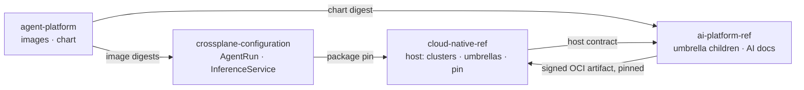
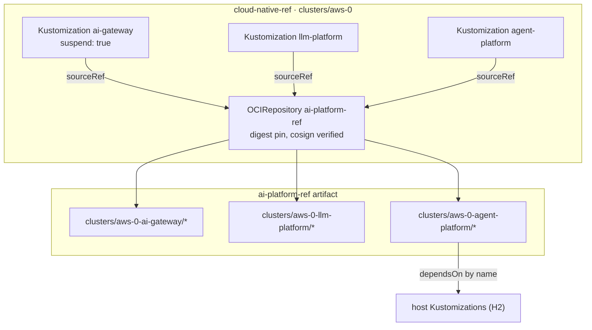
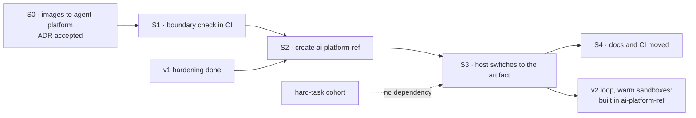

# AI platform split: `ai-platform-ref` and its host contract

**Date:** 2026-10-12 · **Status:** proposed, owner review pending ·
**ADR:** [0057](../../../website/content/docs/decisions/0057-ai-platform-own-repository.md) ·
**Part of:** the v2 roadmap on the
[status page](../../../website/content/docs/platform/ai-platform/status.md#v2-roadmap)

## Outcome

The AI platform (serving and the agent factory) leaves `cloud-native-ref` for a new repository,
`Smana/ai-platform-ref`. `cloud-native-ref` stays the host: it builds the clusters and the shared
platform, and pulls `ai-platform-ref` as one signed, version-pinned Flux artifact, the way it already
pulls `crossplane-configuration`. A default deploy stays AI-free.

| After the split | Owns |
|---|---|
| `cloud-native-ref` (host) | OpenTofu, clusters, Flux, Cilium, OpenBao, ZITADEL, Crossplane, CNPG, the observability stack, the shared Gateways; the three umbrella Kustomizations and the pin; the controls that protect it as a factory target |
| `ai-platform-ref` | Every manifest the three umbrellas deploy, their Flux sources, the AI docs, ADRs, runbooks, specs and plans, and their CI |
| `agent-platform` (code) | The Go services and the factory chart, plus the harness and token-exchange images (moved before the split) |
| `crossplane-configuration` | Unchanged: `AgentRun`, `InferenceService`, `App`, `SQLInstance`, `KVStore`, `EPI` |

## 1. What moves, what stays

Paths are as of `main` `edeffe0e`. Each cloud has the same set under `aws-0` or `gcp-0`.

| Moves to `ai-platform-ref` | Stays in `cloud-native-ref` |
|---|---|
| `clusters/<cluster>-{ai-gateway,llm-platform,agent-platform}/` (the children) | `clusters/<cluster>/{ai-gateway,llm-platform,agent-platform}.yaml` (the umbrellas, retargeted, still suspended) |
| `infrastructure/{base,<cloud>}/`: `agent-sandbox`, `agent-runtime`, `agent-router`, `agent-mcp`, `room-broker`, `kueue`, `kueue-queues`, `envoy-gateway`, `envoy-ai-gateway`, `llm-gateway`, `vllm-semantic-router`, `karpenter-nodepools-agents`, `karpenter-nodepools-gpu`, `runtimeclass-gvisor`, `runtimeclass-nvidia` | Every other `infrastructure/` path, including Karpenter itself, its `EC2NodeClass`es, Cilium and the Gateways |
| `security/{base,<cloud>}/`: `agent-policies`, `agent-secrets`, `octo-sts`, `merge-gate-secrets`, `epis-llm`, `llm-models-preload` | `security/` otherwise; OpenBao's mounts, policies and Kubernetes auth roles (OpenTofu) |
| `tooling/{base,<cloud>}/`: `agent-factory`, `policy-bot`, `promptfoo` | — |
| `observability/{base,<cloud>}/agent-platform`, `observability/base/runlore-factory` | `observability/base/runlore` (RunLore is the platform's SRE agent) |
| `apps/base/ai`, `apps/<cloud>/llm`, `apps/base/openwebui` (already deployed through `apps/<cloud>/llm` by the `llm-platform` umbrella) | `apps/` otherwise |
| `flux/sources/`: `gitrepo-agent-sandbox`, `ocirepo-agent-factory`, `ocirepo-envoy-ai-gateway{,-crds}`, `ocirepo-envoy-gateway`, `ocirepo-kueue`, `ocirepo-vllm-semantic-router` | Every other source |
| `website/content/docs/platform/ai-platform/` and the AI ADRs (0041–0051, 0056, 0057, and 0047, 0052–0054 when they merge) | One overview page and an index row per moved ADR, linking out |
| `docs/runbooks/agent-factory/`, AI specs and plans under `docs/superpowers/` | — |
| CI: `assert-ai-gateway.py`, `tests/test-agent-factory-pins.py`, `tests/test-octo-sts-issuer.py`, the AI entries of `.doc-claims.yaml` | `check-policy-gate-coverage.sh`, rewritten for the pin (§4) |
| — | `opentofu/` entirely, including `aws/llm-platform` (S3 Files), the GKE sandbox pool and the Cilium `socketLB` setting |
| — | `.policy.yml`, `.github/rulesets/agent-*.json`, `.github/chainguard/agent-*.sts.yaml`, `.agents/skills/factory-handoff` |

`container-images/agent-harness` and `container-images/token-exchange-proxy` move to
`agent-platform` first (§5, S0), where images are already built, signed and released.

The tree keeps its layout in `ai-platform-ref` (`infrastructure/`, `security/`, `tooling/`,
`observability/`, `apps/`, `clusters/`), so `git filter-repo` preserves history without renames and
every path in the moved docs stays valid.

## 2. Host contract

What `cloud-native-ref` guarantees, and `ai-platform-ref` may rely on. This section is copied as
`HOST-CONTRACT.md` into `ai-platform-ref` at the split. Changing an item is a breaking change for
both repositories: it lands with a version bump of the pin and a note in both.

### H1 · Flux

| Item | Contract |
|---|---|
| Namespace | Every Flux object lives in `flux-system` |
| Source | `cloud-native-ref` defines one `OCIRepository` `ai-platform-ref` in `flux-system`, pinned by digest with a tag for Renovate, verified with cosign against `ai-platform-ref`'s release workflow identity (the `ocirepo-agent-factory` pattern) |
| Umbrellas | `ai-gateway`, `llm-platform`, `agent-platform`: names unchanged, `suspend: true` by default, `sourceRef` the `ai-platform-ref` source, `path: ./clusters/<cluster>-<umbrella>`. `llm-platform` and `agent-platform` depend on `ai-gateway` |
| Children | Use `sourceRef: {kind: OCIRepository, name: ai-platform-ref}` |
| Default deploy | Does not fetch `ai-platform-ref`: the source is created by the umbrellas' own opt-in (§3), so an unreachable artifact can never block a default deploy |
| Feature branches | A deploy-time override points the source at a branch or pre-release tag, as `TF_VAR_flux_git_ref` does for the host |

### H2 · Host Kustomizations children may depend on

Stable names in `flux-system`. Renaming one breaks a child's `dependsOn`.

| Name | Provides |
|---|---|
| `crds` | Gateway API, Cilium, External Secrets, VictoriaMetrics operator, grafana-operator, Kyverno, cert-manager, Karpenter CRDs |
| `crossplane-configuration` | The XRDs and compositions in `cloud.ogenki.io` |
| `security` | Kyverno, External Secrets, cert-manager, the platform PKI issuers |
| `security-openbao` | OpenBao reachable, its CA published |
| `eks-pod-identities` (aws) | The `EPI` composition's prerequisites |
| `karpenter-nodepools` (aws) | Karpenter and the shared `EC2NodeClass`es |
| `observability` | VictoriaMetrics, VictoriaLogs, VictoriaTraces, Grafana with its datasources |
| `apps` | The host apps layer, for children that must come after it |

### H3 · Substitution variables

Children use `postBuild.substituteFrom` the ConfigMap `<eks|gke>-<cluster>-vars` in `flux-system`
(today `eks-aws-0-vars` and `gke-gcp-0-vars`). Keys the AI platform reads:

| Key | Used for |
|---|---|
| `private_domain_name`, `public_domain_name` | Hostnames on the tailnet and public Gateways |
| `identity_provider_url` | ZITADEL issuer for humans (rooms, run API) |
| `oidc_issuer_url`, `oidc_issuer_host`, `oidc_jwks_uri`, `oidc_jwks_host` | The cluster's ServiceAccount issuer, for run tokens at the gateway, octo-sts and the broker |
| `region` | Cloud region in backends and buckets |
| `storage_class` | Persistent volumes |
| `llm_hf_token_secret` | The model-download secret name |

Grafana dashboard variables (`${datasource}`, `${model}`) are not Flux substitutions.

### H4 · Network

| Item | Contract |
|---|---|
| Gateways | `platform-tailscale-general` (tailnet) and `platform-public` (internet), Gateway API, in the namespaces their routes reference today |
| Cilium | Default-deny CNP is the constitution's rule; `socketLB.hostNamespaceOnly: true` on both clouds (gVisor needs it) and the startup taint on every node pool (F2) |
| DNS | Hostnames under `private_domain_name` resolve on the tailnet |

### H5 · Secrets and identity

| Item | Contract |
|---|---|
| OpenBao | Mounts `agents/` and `platform/merge-gate/`, with the policies and Kubernetes auth roles the `agents-secrets` and `merge-gate-secrets` stores log in with (`opentofu/<cloud>/openbao/management`) |
| Stores | `ai-platform-ref` creates its own namespaced stores (`agents-secrets`, `merge-gate-secrets`); it reads the cluster-wide `openbao-platform` store only where it does today, and the CA from `openbao-ca` |
| ZITADEL | The rooms and `roomctl` OIDC clients and the link-only GitHub IdP, provisioned by the host's scripts |
| PKI | The OpenBao PKI role signs certificates for the broker's in-cluster and private names (F7) |
| Workload identity | EKS Pod Identity (never IRSA) and GKE Workload Identity, through the `EPI` and `GCPWorkloadIdentity` compositions |

### H6 · Compute

| Item | Contract |
|---|---|
| AWS | Karpenter, an AL2023 `EC2NodeClass` that installs `runsc` for the agents pool, GPU-capable instance families allowed in the account |
| GCP | A GKE Sandbox node pool (`opentofu/gcp/gke/init/sandbox.tf`) and node auto-provisioning for GPUs |
| Kubernetes | The versions in `opentofu/config.tm.hcl`; GKE ≥ 1.35.0-gke.1171000 for the 120 s Spot window |

### H7 · Data and storage

CNPG through `SQLInstance`, Valkey through `KVStore`, and on AWS the S3 Files filesystem for model
weights from `opentofu/aws/llm-platform`, mounted through the EFS CSI driver.

### H8 · Observability

VictoriaMetrics accepts `VMServiceScrape` and `VMRule`, grafana-operator accepts `GrafanaDashboard`
in folders the AI platform names, the trace collector's OTLP endpoint is reachable, and the
datasource names in H2's `observability` are stable.

### What `ai-platform-ref` guarantees back

- Every workload keeps the constitution: `xplane-*` names for composed resources, default-deny CNP,
  requests and limits, both probes, restricted security context, least-privilege RBAC.
- It never writes to a host namespace except through the H2 dependencies above.
- Each release states the host contract version it was tested against.

## 3. How the host consumes it

The `OCIRepository` sits in a small host Kustomization that the first umbrella resumed creates, so
H1's "default deploy does not fetch" holds. Resuming the AI platform stays the same three
`flux resume` commands, plus that one.

## 4. The factory after the split

The factory keeps working on `cloud-native-ref` (`config.repository` is unchanged). Its own
configuration moves to `ai-platform-ref`, which changes the self-modification surface:

| Before | After |
|---|---|
| An agent PR on `cloud-native-ref` could touch factory config, so every agent-platform child path is a gate path | The factory config is no longer in the repository agents work on. The gate path becomes the pin (`ai-platform-ref` source and the three umbrellas); `check-policy-gate-coverage.sh` checks those |
| — | The factory working on `ai-platform-ref` itself is the v2 "second repository" gate, with its own `.policy.yml`, rulesets and trust policies there. Not part of this split |

## 5. Sequence within v2

| Step | Content | Gate |
|---|---|---|
| **S0** | `agent-harness` and `token-exchange-proxy` built and released by `agent-platform`; the composition and the gateway pin the new image names. ADR-0057 accepted | The next `agent-platform` release carries both images, signed; the composition pins them |
| **S1** | A CI job in `cloud-native-ref` renders only the AI paths against a host profile (H2 names stubbed, H3 values from a fixture) and fails on any reference from a host path into an AI path, or the reverse, outside the contract | The job passes on `main` and fails on a planted cross-reference |
| **S2** | `ai-platform-ref` created with `git filter-repo` over §1's paths; its CI (render against the host profile, `assert-ai-gateway.py`, the moved tests, links, doc claims); a release workflow pushing a signed OCI artifact | First tag released and verifiable with `cosign verify` |
| **S3** | One `cloud-native-ref` PR: the source, the umbrellas retargeted, the moved paths deleted, `.policy.yml` gate paths updated | The rendered cluster bundle before and after differs only in `sourceRef` and `path`; a rebuild of one cluster passes runbook 11 step 7 on release pins |
| **S4** | Docs: the AI section, ADRs, runbooks, specs and plans live in `ai-platform-ref`; `cloud-native-ref` keeps an overview page and index rows linking out | `validate-links.sh` and `verify-doc-paths.sh` pass in both repositories |

S2 waits for the v1 hardening milestone, so no hardening PR has to be rebased across the move. The
hard-task cohort needs no code and runs whenever it is ready. New v2 code (the loop, warm and
suspended sandboxes) is built after S3, in `ai-platform-ref`.

## 6. Risks

| Risk | Mitigation |
|---|---|
| The release chain grows a hop: a runtime fix is `agent-platform`, then `crossplane-configuration`, then `ai-platform-ref`, then the host pin | S0 removes the harness hop from `cloud-native-ref`; Renovate bumps each pin; the feature-branch override (H1) keeps live gates on pre-releases |
| A host change breaks the AI platform silently | The contract lists every dependency; `ai-platform-ref` CI renders against a host profile pinned to a host commit, and the host's CI renders the pinned artifact |
| Cross-repository `dependsOn` by name fails at reconcile, not render | S1's check and the H2 table; the S3 gate renders and reconciles a full cluster |
| History and links break | `filter-repo` keeps paths; S4 leaves link-out pages |
| Two repositories to operate for one maintainer | Same tooling (`mise`, `task check`, Renovate, the same skills), one contract file to keep true |

## 7. Open questions

| Question | Default if unanswered |
|---|---|
| Does `opentofu/aws/llm-platform` (S3 Files) move? | Stays: all OpenTofu stays with the host and its Terramate gates |
| One docs site or two? | Two: `ai-platform-ref` gets its own Hugo site; the host keeps an overview page |
| ADR numbering | Moved ADRs keep their numbers; `ai-platform-ref` continues from the highest moved number |
