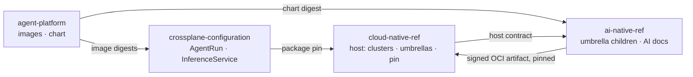
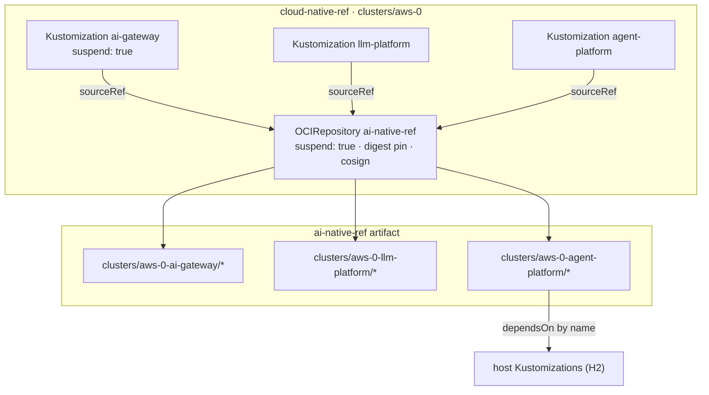
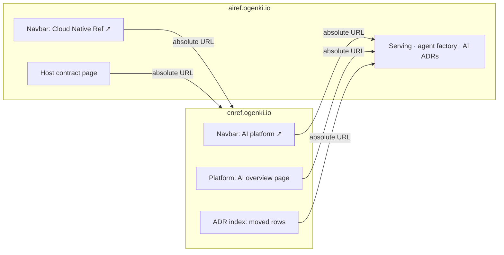
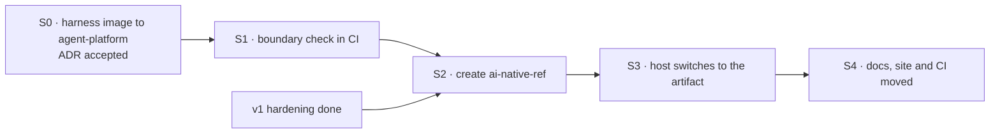

# AI platform split: `ai-native-ref` and its host contract

**Date:** 2026-10-12 · **Status:** accepted (ADR-0057) ·
**ADR:** [0057](https://airef.ogenki.io/docs/decisions/0057-ai-platform-own-repository/) ·
**Part of:** the v2 roadmap on the
[status page](https://airef.ogenki.io/docs/platform/ai-platform/status/#v2-roadmap)

## Outcome

The AI platform (serving and the agent factory) leaves `cloud-native-ref` for a new repository,
`Smana/ai-native-ref`. `cloud-native-ref` stays the host: it builds the clusters and the shared
platform, and pulls `ai-native-ref` as one signed, version-pinned Flux artifact, the way it already
pulls `crossplane-configuration`. A default deploy stays AI-free.

| After the split | Owns |
|---|---|
| `cloud-native-ref` (host) | OpenTofu, clusters, Flux, Cilium, OpenBao, ZITADEL, Crossplane, CNPG, the observability stack, the shared Gateways; the namespaces; the three umbrella Kustomizations and the pin; the controls that protect it as a factory target |
| `ai-native-ref` | Every manifest the three umbrellas deploy, their Flux sources, the AI docs and their site, ADRs, runbooks, specs and plans, and their CI |
| `agent-platform` (code) | The Go services and the factory chart, plus the harness image (moved before the split) |
| `crossplane-configuration` | Unchanged: `AgentRun`, `InferenceService`, `App`, `SQLInstance`, `KVStore`, `EPI` |

## 1. What moves, what stays

Paths are as of `main` `edeffe0e`. Most exist under both `aws-0` and `gcp-0`; a few are one cloud
only (`llm-models-preload` is GCP's, `openwebui` is AWS's). The GCP compute classes
(`infrastructure/gcp-0/computeclass`) are applied by the host and stay. The enforced boundary is
[`scripts/ci/flux-schema/ai-boundary.yaml`](../../../scripts/ci/flux-schema/ai-boundary.yaml): the
move list below, checked in CI (S1).

| Moves to `ai-native-ref` | Stays in `cloud-native-ref` |
|---|---|
| `clusters/<cluster>-{ai-gateway,llm-platform,agent-platform}/` (the children) | `clusters/<cluster>/{ai-gateway,llm-platform,agent-platform}.yaml` (the umbrellas, retargeted, still suspended) |
| `infrastructure/{base,<cloud>}/`: `agent-sandbox`, `agent-runtime`, `agent-router`, `agent-mcp`, `room-broker`, `kueue`, `kueue-queues`, `envoy-gateway`, `envoy-gateway-ratelimit`, `envoy-ai-gateway`, `llm-gateway`, `vllm-semantic-router`, `karpenter-nodepools-agents` and `karpenter-nodepools-gpu` (with their `EC2NodeClass`es), `runtimeclass-gvisor`, `runtimeclass-nvidia`, the agent router's `agentgateway` (controller) and `agent-gateway` (Gateway), and the aws-0 PoC's `agentgateway-poc` | Every other `infrastructure/` path, including Karpenter itself, the shared `EC2NodeClass`es, Cilium and the Gateways |
| `security/{base,<cloud>}/`: `agent-policies`, `agent-secrets`, `octo-sts`, `merge-gate-secrets`, `epis-llm`, `llm-models-preload` | `security/` otherwise; OpenBao's mounts and policies and the JWT auth roles (OpenTofu) |
| `tooling/{base,<cloud>}/`: `agent-factory`, `policy-bot`, `promptfoo` | — |
| `observability/{base,<cloud>}/agent-platform`, `observability/base/runlore-factory` | `observability/base/runlore` (RunLore is the platform's SRE agent) |
| `apps/llm` (what aws-0's `llm-platform-apps` applies), `apps/base/ai`, `apps/<cloud>/llm`, `apps/base/openwebui` (pulled in by `apps/llm`) | `apps/` otherwise |
| `flux/sources/`: `gitrepo-agent-sandbox`, `ocirepo-agent-factory`, `ocirepo-envoy-ai-gateway{,-crds}`, `ocirepo-envoy-gateway`, `ocirepo-kueue`, `ocirepo-vllm-semantic-router`, `ocirepo-inferencepool`, `ocirepo-flux-operator-mcp`, `helmrepo-open-telemetry` | Every other source, including `gitrepo-inference-extension` and `helmrepo-oauth2-proxy`, which the rooms share with Headlamp. `flux/sources/` has no `kustomization.yaml`: the host's `flux-sources` Kustomization applies every file in it, so the AI sources stay applied from the host until S2 and S3 ship them in `ai-native-ref` |
| — | `namespaces/base/{agents,agent-system,agent-gateway,llm,llm-gateway,envoy-ai-gateway-system,envoy-gateway-system,merge-gate}.yaml`: namespaces and their PSA labels are the host's (H5) |
| — | `crds/base/kustomization-inference-extension.yaml`: CRDs are the host's (H2) |
| `website/content/docs/platform/ai-platform/`, its diagrams (`website/static/images/diagrams/{ai-platform,agent-factory,llm-platform}-*.svg`) and the AI ADRs (the serving ones 0003, 0004, 0021; 0041–0046, 0048–0051, 0056, 0057, and 0047, 0052–0054 when they merge), published on `ai-native-ref`'s own site (§5) | One overview page and an index row per moved ADR, linking out to that site |
| `docs/runbooks/agent-factory/`, AI specs and plans under `docs/superpowers/` | — |
| CI: `assert-ai-gateway.py`; under `scripts/ci/tests/`, `test-agent-factory-pins.py`, `test-octo-sts-issuer.py`, `test-agent-observability.py`, `test-agent-mcp-scope.sh`, `test-agent-traces-filter.sh`, `test-agent-alert-annotations.sh`, `test-crossplane-reads-run-pods.py`; the AI entries of `.doc-claims.yaml` | `test-openbao-agent-mounts.sh`, `test-gcp-agent-prereqs.sh` (they test OpenTofu); `check-policy-gate-coverage.sh`, extended to the pin (§4) |
| — | `opentofu/` entirely, including `aws/llm-platform` (S3 Files), the GKE sandbox pool and the Cilium `socketLB` setting |
| — | `.policy.yml`, `.github/rulesets/agent-*.json`, `.github/chainguard/agent-*.sts.yaml`, `.agents/skills/factory-handoff` |
| — | `container-images/token-exchange-proxy`: Headlamp's Workforce Identity shim on GKE, not AI |

`container-images/agent-harness` moves to `agent-platform` first (§6, S0), where images are
already built, signed and released.

The tree keeps its layout in `ai-native-ref` (`infrastructure/`, `security/`, `tooling/`,
`observability/`, `apps/`, `clusters/`), so `git filter-repo` preserves history without renames and
every path in the moved docs stays valid.

## 2. Host contract

What `cloud-native-ref` guarantees, and `ai-native-ref` may rely on. This section is copied as
`HOST-CONTRACT.md` into `ai-native-ref` at the split. Changing an item is a breaking change for
both repositories: it lands with a version bump of the pin and a note in both.

**Contract version 2** (S3, 2026-10-16). Changes from 1: H1 Source names both signing identities,
the aws-0 un-suspend patch and the children's sources; H1 Feature branches is a pin edit on the
branch, not a variable; H3 drops `ai_native_ref_tag` (S3 plan D1–D3).

### H1 · Flux

| Item | Contract |
|---|---|
| Namespace | Every Flux `Kustomization` lives in `flux-system`; most sources and every HelmRelease live in their consumer's namespace (`agent-system`, `llm`, `envoy-*-system`, …); a few sources stay in `flux-system` |
| Shared sources | `HelmRepository/oauth2-proxy` (namespace `tooling`) |
| Source | `cloud-native-ref` defines one `OCIRepository` `ai-native-ref` in `flux-system` (`flux/sources/ocirepo-ai-native-ref.yaml`), `suspend: true` by default, pinned by digest with a tag for Renovate, verified with cosign against `ai-native-ref`'s release workflow (`release.yaml@refs/tags/v*`) and same-repository PR pre-releases (`ci.yaml@refs/pull/<N>/merge`). A cluster whose umbrellas are live un-suspends it with a `spec.patches` entry on its `flux-sources` Kustomization (aws-0) |
| Umbrellas | `ai-gateway`, `llm-platform`, `agent-platform`: names unchanged, `suspend: true` by default, `sourceRef` the `ai-native-ref` source, `path: ./clusters/<cluster>-<umbrella>`. `llm-platform` and `agent-platform` depend on `ai-gateway` |
| Children | Use `sourceRef: {kind: OCIRepository, name: ai-native-ref}`, never an `ExternalArtifact` of the `monorepo-split` ArtifactGenerator or `GitRepository/flux-system`. The AI Flux sources are applied by the artifact's own `ai-sources` child, not by the host's `flux-sources` |
| Default deploy | Does not fetch `ai-native-ref`: the source is suspended until the opt-in (§3), so an unreachable artifact can never block a default deploy |
| Feature branches | `ai-native-ref` CI pushes a signed pre-release artifact per same-repository PR; a cnref feature branch pins it (tag and digest) in the source file, and the cluster tracks that branch with `TF_VAR_flux_git_ref`. Flux pulls the digest when both are set, so a tag variable alone would change nothing |

### H2 · Host Kustomizations children may depend on

Stable names in `flux-system`. Renaming one breaks a child's `dependsOn`.

| Name | Provides |
|---|---|
| `crds` | Gateway API (with the Inference Extension), Cilium, External Secrets, VictoriaMetrics operator, grafana-operator, Kyverno, cert-manager, Karpenter CRDs |
| `crossplane-configuration` | The XRDs and compositions in `cloud.ogenki.io` |
| `security` | Kyverno, External Secrets, cert-manager, the platform PKI issuers |
| `security-openbao` | OpenBao reachable, its CA published |
| `eks-pod-identities` (aws) | The `EPI` composition's prerequisites |
| `karpenter-nodepools` (aws) | Karpenter and the shared `EC2NodeClass`es |
| `observability` | VictoriaMetrics, VictoriaLogs, VictoriaTraces, Grafana with its datasources |
| `apps` | The host apps layer, for children that must come after it |
| `infrastructure` | KEDA, the Atlas operator and the cluster add-ons `llm-platform-apps` waits for |

### H3 · Substitution variables

Children use `postBuild.substituteFrom` the ConfigMap `<eks|gke>-<cluster>-vars` in `flux-system`
(today `eks-aws-0-vars` and `gke-gcp-0-vars`). Keys the AI platform reads:

| Key | Used for |
|---|---|
| `cluster_name` | OpenBao JWT auth paths (`jwt/${cluster_name}`), Karpenter's node role |
| `environment` | Karpenter subnet and security-group discovery |
| `project_id` (gcp) | The model bucket and its volume, room-broker backups |
| `private_domain_name`, `public_domain_name` | Hostnames on the tailnet and public Gateways |
| `identity_provider_url` | ZITADEL issuer for humans (rooms, run API) |
| `oidc_issuer_url`, `oidc_issuer_host`, `oidc_jwks_uri`, `oidc_jwks_host` | The cluster's ServiceAccount issuer, for run tokens at the gateway, octo-sts and the broker |
| `region` | Cloud region in backends and buckets |
| `storage_class` | Persistent volumes |
| `llm_hf_token_secret` | The model-download secret name |

Grafana dashboard variables (`${datasource}`, `${model}`) are not Flux substitutions.

### H4 · Network

| Item | Contract |
|---|---|
| Gateways | `platform-tailscale-general` (tailnet) and `platform-public` (internet, with a `policy-bot` listener for `merge-gate` on both clouds), Gateway API, in the namespaces their routes reference today |
| Cilium | Default-deny CNP is the constitution's rule; `socketLB.hostNamespaceOnly: true` on both clouds (gVisor needs it) and the startup taint on every node pool (F2) |
| DNS | Hostnames under `private_domain_name` resolve on the tailnet |

### H5 · Namespaces, secrets and identity

| Item | Contract |
|---|---|
| Namespaces | The host creates `agents`, `agent-system`, `agent-gateway`, `llm`, `llm-gateway`, `envoy-ai-gateway-system`, `envoy-gateway-system` and `merge-gate`, with their PSA labels (`agents` is `restricted`) |
| OpenBao | Mounts `agents` and `merge-gate` (both clouds), with the policies in `opentofu/<cloud>/openbao/management` and the JWT auth roles at `jwt/${cluster_name}` from `opentofu/<cloud>/{eks,gke}/configure/openbao.tf` that the `agents-secrets` and `merge-gate-secrets` stores log in with |
| Stores | `ai-native-ref` creates its own namespaced stores (`agents-secrets`, `merge-gate-secrets`); it reads the cluster-wide `openbao-platform` store only where it does today, and the CA from `openbao-ca` |
| ZITADEL | The rooms and `roomctl` OIDC clients, the `factory-slack-app` machine user (client credentials, no project role; its client id, secret and project id at `agents/factory-slack-principal`), and the link-only GitHub IdP, provisioned by the host's scripts |
| PKI | The OpenBao PKI role signs certificates for the broker's in-cluster and private names (F7) |
| Workload identity | EKS Pod Identity (never IRSA) and GKE Workload Identity, through the `EPI` and `GCPWorkloadIdentity` compositions |

### H6 · Compute

| Item | Contract |
|---|---|
| AWS | Karpenter, its node role `Karpenter-${cluster_name}`, subnets and security groups discoverable by `${environment}`, GPU-capable instance families allowed in the account. The gVisor and GPU `EC2NodeClass`es are `ai-native-ref`'s |
| GCP | A GKE Sandbox node pool (`opentofu/gcp/gke/init/sandbox.tf`) and node auto-provisioning for GPUs |
| Kubernetes | The versions in `opentofu/config.tm.hcl`; GKE ≥ 1.35.0-gke.1171000 for the 120 s Spot window |

### H7 · Data and storage

CNPG through `SQLInstance`, Valkey through `KVStore`, and on AWS the S3 Files filesystem for model
weights from `opentofu/aws/llm-platform`, mounted through the EFS CSI driver.

### H8 · Observability

VictoriaMetrics accepts `VMServiceScrape` and `VMRule`, grafana-operator accepts `GrafanaDashboard`
in folders the AI platform names, the trace collector's OTLP endpoint is reachable, and the
datasource names in H2's `observability` are stable. The host's RunLore HelmRelease reads the
ConfigMap `runlore-factory-values` in `runlore` through `valuesFrom` with `optional: true`, so it
deploys without the AI platform.

### What `ai-native-ref` guarantees back

- Every workload keeps the constitution: `xplane-*` names for composed resources, default-deny CNP,
  requests and limits, both probes, restricted security context, least-privilege RBAC.
- It writes to two host namespaces only: `observability` (scrapes, rules, dashboards, the agent
  trace collector) and `runlore` (the `runlore-factory-values` ConfigMap, H8).
- Each release states the host contract version it was tested against.

## 3. How the host consumes it

The `OCIRepository` is part of a default deploy but suspended, so it fetches nothing until the
opt-in. Resuming the AI platform is the three umbrella `flux resume` commands, preceded by
`flux resume source oci ai-native-ref`.

## 4. The factory after the split

The factory keeps working on `cloud-native-ref` (`config.repository` is unchanged). Its own
configuration moves to `ai-native-ref`, which changes the self-modification surface:

| Before | After |
|---|---|
| An agent PR on `cloud-native-ref` could touch factory config, so every agent-platform child path is a gate path | The factory config is no longer in the repository agents work on. The pin (the `ai-native-ref` source, the three umbrellas) joins the gate paths. Host paths that define agent authority stay gated: OpenBao's agent mounts and policies, the JWT roles, and the AI namespaces with their PSA labels. `check-policy-gate-coverage.sh` checks all of them |
| — | The factory working on `ai-native-ref` itself is the v2 "second repository" gate, with its own `.policy.yml`, rulesets and trust policies there. Not part of this split |

## 5. Two documentation sites

`ai-native-ref` publishes its own Hugo site, built like `cnref.ogenki.io` and told apart by its
colour. `cnref.ogenki.io` drops its AI section, and the two sites link to each other.

| | `cloud-native-ref` | `ai-native-ref` |
|---|---|---|
| URL | `cnref.ogenki.io` | `airef.ogenki.io` (§8) |
| Source | `website/` | `website/`, copied from the host's at S2 |
| Theme | Hextra, primary hue 204° (ogenki navy) | Same Hextra pin, layouts, shortcodes and semantic colours; primary hue 320° (plum) |
| Publish | GitHub Pages, `docs.yml` | GitHub Pages, the same workflow |
| Owns | Platform, concepts, guides, host ADRs | Serving, the agent factory, the AI ADRs and runbooks |

**Theme.** Hextra derives its whole primary scale from three variables in
`website/assets/css/custom.css`; only the hue changes. 320° stays clear of the navy and of the six
semantic colours shared with the drawio preset, so a callout or legend never reads as the brand
colour. Links measure 11.0:1 on white (`#770050`) and 5.1:1 on `#111` (`#D754AB`). The sites copy
their layouts rather than share a theme module: about ten files, until they drift.

**Cleaning up `cnref.ogenki.io`**, at S4:

| Where | Change |
|---|---|
| `docs/platform/ai-platform/` | Removed; one `_index.md` remains: what the AI platform is, the four `flux resume` commands, a link out |
| `docs/platform/_index.md` | The AI Platform and Agent Factory cards point to the AI site |
| `docs/platform/gitops/_index.md`, ADRs 0043 and 0056 | Their `relref`s into moved pages become absolute URLs |
| `docs/decisions/_index.md` | Each moved ADR keeps its row, linked to the AI site |
| `hugo.yaml` menu | An "AI platform ↗" entry beside GitHub |

**Cross-site links.** A `relref` cannot cross sites, so `refLinksErrorLevel: ERROR` stops guarding
them. They stay few (navbar, overview page, ADR index, host contract), and a check fetches each
one from the other site after deploy.

## 6. Sequence within v2

| Step | Content | Gate |
|---|---|---|
| **S0** | `agent-harness` built and released by `agent-platform`; the `AgentRun` composition in `crossplane-configuration` (the only thing that pins the harness) repins it. The image name is unchanged (owner decision, 2026-10-12). ADR-0057 accepted | The next `agent-platform` release carries the image, signed; the composition pins it |
| **S1** | A step of `validate-manifests.sh` (`scripts/ci/flux-schema/check-ai-boundary.py`, data `scripts/ci/flux-schema/ai-boundary.yaml`) reads the source tree and fails on any reference from a host path into an AI path, or the reverse, outside the contract (H8's ConfigMap is the one listed host-to-AI reference). Rendering against a host profile belongs to S2's CI | Passes on `main`; fails on a planted crossing in each direction (`scripts/ci/tests/flux-schema/test-check-ai-boundary.py`) |
| **S2** | `ai-native-ref` created with `git filter-repo` over §1's paths; the children switched to the `OCIRepository` source; its CI (render against the host profile, `assert-ai-gateway.py`, the moved tests, links, doc claims, the site build); a release workflow pushing a signed OCI artifact | First tag released and verifiable with `cosign verify` |
| **S3** | One `cloud-native-ref` PR: the suspended source, the umbrellas retargeted, the moved paths and tests deleted, `monorepo-split` unchanged (it copies whole top-level directories, so there are no AI entries to drop), `.policy.yml` gate paths updated | Rendered before and after, every object other than the new source and the umbrellas' and children's `sourceRef`s is identical; a rebuild of one cluster passes runbook 11 step 7 on release pins |
| **S4** | Docs: the AI section, ADRs, runbooks, specs and plans live in `ai-native-ref`, published on `airef.ogenki.io`; `cnref.ogenki.io` is cleaned up and both sites link to each other (§5) | `hugo --gc --minify`, `validate-links.sh` and `verify-doc-paths.sh` pass in both repositories; every cross-site link answers 200 |

S2 waits for the v1 hardening milestone, so no hardening PR has to be rebased across the move.
**The rest of v2 does not wait for the split.** The cohort needs no code. The continuation loop is
factory Go code in `agent-platform`. Warm pools and suspend are `AgentRun` composition changes in
`crossplane-configuration`. Only the manifests that come with them (the agent-sandbox chart values,
the extensions controller's policy) land wherever the AI paths live at the time.

## 7. Risks

| Risk | Mitigation |
|---|---|
| An AI manifest change gains a hop: `ai-native-ref`, then the host pin. A runtime fix keeps today's chain (`agent-platform`, `crossplane-configuration`, the host pin) | Renovate bumps each pin; the feature-branch override (H1) keeps live gates on pre-releases |
| A host change breaks the AI platform silently | The contract lists every dependency; `ai-native-ref` CI renders against a host profile pinned to a host commit, and the host's CI renders the pinned artifact |
| Cross-repository `dependsOn` by name fails at reconcile, not render | S1's check and the H2 table; the S3 gate renders and reconciles a full cluster |
| History and links break | `filter-repo` keeps paths; S4 leaves link-out pages |
| Cross-site links rot unseen: `relref` cannot check them | Few of them, each fetched after deploy (§5) |
| The two sites' layouts drift | Copied once at S2; a shared theme module only if they diverge |
| Two repositories to operate for one maintainer | Same tooling (`mise`, `task check`, Renovate, the same skills), one contract file to keep true |

## 8. Open questions

One docs site or two is decided: two (owner, 2026-10-12; §5).

| Question | Default if unanswered |
|---|---|
| Does `opentofu/aws/llm-platform` (S3 Files) move? | Stays: all OpenTofu stays with the host and its Terramate gates |
| The AI site's domain | `airef.ogenki.io`, a sibling of `cnref.ogenki.io` |
| The AI site's primary hue | 320° (plum): clear of the navy and the semantic colours, contrast measured in §5 |
| ADR numbering | Moved ADRs keep their numbers; `ai-native-ref` continues from the highest moved number |
