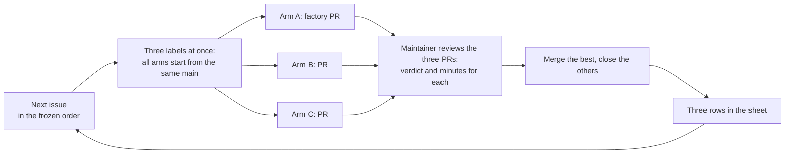

# v2 step 1: the hard-task cohort

**Date:** 2026-10-12 · **Status:** approved by the maintainer 2026-10-12 ·
**Part of:** the v2 roadmap on the
[status page](../../../website/content/docs/platform/ai-platform/status.md#v2-roadmap), argued in the
[v1 review](2026-10-12-agent-factory-v1-review.md#32-the-cohort-and-the-minimum-measurement)

## Outcome

Fifteen real `scripts`, `tests` and `dashboards` issues each go through three arms. The result is
one measured row per issue and arm, and a decision written before the first run: does the factory's
governance pay for operating it, and which v2 rows does the evidence open?

| Arm | Harness | Model | Trigger |
|---|---|---|---|
| **A** | The factory, `pair` template, v1 as it is | GLM-5.3 through Agent Router | `factory/ready` + `class:<class>` |
| **B** | Claude Code Action | Claude, the action's default | `cohort/arm-b` |
| **C** | Claude Code Action | GLM-5.3, Z.ai's Anthropic-compatible endpoint | `cohort/arm-c` |

A against B compares the products. C shares B's harness and A's model, so it says whether a gap
between A and B comes from the model or from the harness and governance.

Not in scope: changing the factory (the cohort runs v1 as it is), the continuation loop, the
reviewer on another model. The cohort produces the evidence that gates them.

## 1. Flow per issue

- **One issue at a time.** The next issue starts only after the previous one's three verdicts, so
  every arm works on the same `main` and none benefits from another's fix.
- **The arm ends where it ends.** A task-arm that escalates, times out or exhausts its budget
  share is recorded as it stopped. Nothing is re-run.
- **Verdicts**, one per PR: *merged as-is*, *merged after my edits*, *rejected, fixable*,
  *rejected, wrong*. *Accepted* means one of the first two. Only one PR per issue can merge; a
  second PR that would also have been accepted gets the verdict it earned, then is closed.
- **Review minutes** are logged by hand per PR: timestamps measure latency, not effort.
- **Live-only issues** (#2277, #2291, #2292) are judged correct on review; the live check is noted
  as owed and is not part of the verdict.

## 2. The frozen list

Order is fixed here, before the first run.

| # | Issue | Class | Source |
|---|---|---|---|
| 1 | #2279: CI enforces the ZITADEL version floor | scripts | backlog |
| 2 | #2277: the teardown sweeps the gateway NLBs | scripts | backlog |
| 3 | #2278: `zitadel-idp.sh` gets a rotation path and a shape check | scripts | backlog |
| 4 | #2269: an admin `link-github` subcommand for Google-only users | scripts | backlog |
| 5 | #2291: CNPG seed: a second teardown on the same day keeps the old lineage | scripts | backlog |
| 6 | #2292: CNPG seed: an idle database never archives its end WAL | scripts | backlog |
| 7 | #2314: Tests for `sweep-lb-orphans.sh` | tests | new |
| 8 | #2315: Tests for `reclaim-csi-volumes.sh` | tests | new |
| 9 | #2316: Tests for `purge-dns-records.sh` | tests | new |
| 10 | #2317: Tests for `sweep-controller-orphans.sh` | tests | new |
| 11 | #2318: Tests for `helm-release-present.sh` | tests | new |
| 12 | #2319: A Crossplane dashboard | dashboards | new |
| 13 | #2320: A cert-manager dashboard | dashboards | new |
| 14 | #2321: An OpenBao dashboard | dashboards | new |
| 15 | #2322: An External Secrets dashboard | dashboards | new |

Reserves, used in order only if an issue is closed by other work before its turn: #1589 (RunLore
CiliumNetworkPolicy), #2275 (Crossplane core Configuration pin).

Gate paths change nothing here: every cohort PR is merged by the maintainer, and #2279's CI wiring
under `.github/` is one more file to review. The nine new issues are written with acceptance criteria the maintainer can check
alone: a test suite runs in `scripts/ci/tests/run.sh` without a cloud account, with the CLI calls
stubbed; a dashboard's panels query only metrics VictoriaMetrics holds on `aws-0` today, checked by
the maintainer before the issue is labelled.

## 3. The arms

### A · the factory

v1 unchanged, except three settings in `tooling/base/agent-factory/helm-values-configmap.yaml`, a
gate path the maintainer changes before the first run:

- A `scripts` class beside `tests` and `dashboards`, and its `class:scripts` issue label. v0.8.0
  takes class names from config: triage predicts the class from a `class:<name>` label naming a
  configured class (`internal/factory/triage/classify.go:84-110`); only `docs-links` and `revert`
  are literals.
- `triage.controlPercent: 0` for the cohort's duration, restored to 10 at the end. The control
  group runs on the frontier tier, whose template is `trio`, not `pair` (`classify.go:24-35`).
- Every class `shadow: true` for the cohort's duration, restored to `{}` at the end: arm A runs with
  the merge gate in shadow, so no arm merges before the maintainer's verdict.

### B and C · Claude Code Action

One workflow, `.github/workflows/cohort-arms.yaml`, with one job per arm, each on `issues: labeled` for its own label:

| Setting | Value |
|---|---|
| Action | `anthropics/claude-code-action`, pinned by digest |
| Permissions | `contents: write`, `pull-requests: write`, `issues: write`; nothing else. `main` stays protected by its ruleset, so neither arm can merge |
| Concurrency | One run per arm |
| Prompt | Names the issue; the agent reads the body with `gh issue view` (the body is never interpolated). Plus: open a PR from a `cohort/arm-<x>/<issue>` branch that closes the issue, and run `task check` before pushing |
| Arm C | `ANTHROPIC_BASE_URL` set to Z.ai's Anthropic-compatible endpoint, with the model set to `glm-5.3` |
| Arm C model slots | `ANTHROPIC_DEFAULT_{HAIKU,SONNET,OPUS}_MODEL` all `glm-5.3`, so subagents run on A's model too |
| Time limit | The agent step stops at 75 minutes, inside the job's 90, so the execution log still uploads |
| Keys | One dedicated key per arm. B's carries an Anthropic workspace spend limit of its share; Z.ai has no per-key limit, so C's key caps nothing (§4). Stored in OpenBao under the platform mount for the record; set by the maintainer as repository secrets. No literal in the workflow |

The workflow sits under `.github/`, a gate path: the maintainer adds it. It is deleted when the
cohort ends.

A PR opened with `GITHUB_TOKEN` starts no `pull_request` CI, so the maintainer closes and reopens
each B and C PR once it opens; `createdAt` is unchanged, so the timings hold.

Arm C bills the Z.ai open-platform API wallet, not the GLM coding plan. The wallet belongs to the
account, and C's key shares that account with the platform key arm A uses: one wallet pays both,
topped up $100 for their combined shares. Error 1113 means that wallet is empty, for A and C at once.

## 4. Budget

$150 in total, $50 per arm, about $3.30 per task-arm. Arm A's share is enforced by its existing
task budget (`standard`: 3 M tokens) and watched on the run dashboard.

| Arm | Share enforced by |
|---|---|
| A | The factory's task budget |
| B | The Anthropic workspace spend limit on its key |
| C | The maintainer: Z.ai has no per-key limit, so C's spend is read from Z.ai's per-key usage page after each issue, and C stops at $50 |

An arm that runs dry ends its remaining tasks as *budget-exhausted*, which is a result, not an
error. Error 1113 during the cohort is the shared A + C wallet running dry: record both arms'
remaining tasks as *budget-exhausted*, not as a factory failure.

## 5. The sheet

`docs/superpowers/specs/2026-10-12-v2-hard-task-cohort-results.csv`, one row per task-arm, 45 rows.

| Column | Source |
|---|---|
| `issue`, `arm`, `pr` | `gh` |
| `tokens_in`, `tokens_cached`, `tokens_out` | A: the gateway meter, which records `cached_input` apart. B and C: the action's execution log (`modelUsage`, subagents included); after a timeout, the provider console |
| `usd` | Tokens at list price: Claude for B, GLM-5.3 for A and C (C's log prices it as Claude, so it is recomputed) |
| `label_to_pr_min`, `label_to_verdict_min` | `gh` timestamps |
| `review_rounds`, `fix_runs` | A: the Task status. B, C: commits pushed after the PR opened, excluding the maintainer's and merges |
| `ended` | `pr`, `escalated`, `timeout`, `budget-exhausted`, `no-pr` |
| `counter_exhausted`, `still_fixable` | A only: which of the three counters ran out, and the maintainer's judgement whether the PR could still have been fixed |
| `verdict`, `review_min` | The maintainer, by hand |

## 6. Decision rules, fixed before the first run

| Question | Rule |
|---|---|
| Does the factory pay for operating it? | Yes if arm A's accepted outcomes are within one of arm B's **and** A's cost per accepted outcome is lower. Cost per accepted outcome: every task-arm's USD, failures included, divided by accepted outcomes |
| Is a gap the model or the harness? | B ≫ C ≈ A: the model; route harder tasks to a stronger model before touching the harness. B ≈ C ≫ A: the harness or the governance |
| Build the continuation loop? | Only if at least 3 of arm A's escalations ran out a counter on a PR the maintainer marks still fixable |
| Reviewer on another model? | Worth an ADR if arm A's accepted outcomes trail arm B's while A's reviewer approved PRs the maintainer then rejected |
| Human time | Reported per accepted outcome per arm; no threshold, it informs the operator-burden question the review left unpriced |

Fifteen issues tell apart only large differences; the results say so rather than claim more.

## 7. Before the first run, and the pilot

| Step | Done when |
|---|---|
| The nine new issues written, the metrics behind each dashboard issue checked | Each issue has acceptance criteria |
| `scripts` class and label | The factory admits a `scripts` task (checked on the pilot) |
| Arm B and C workflows and keys, arm B's spend limit | Each arm opens a PR on the pilot |
| The `agent-branches` ruleset excludes `refs/heads/cohort/**` and `refs/heads/cohort/*/*` (a ruleset `**` matches one segment) for the cohort's duration | The arms' `GITHUB_TOKEN` pushes `cohort/arm-<x>/<issue>` |
| The repository setting "Allow GitHub Actions to create and approve pull requests" is on for the cohort's duration (enabled 2026-10-14) | The arms' `GITHUB_TOKEN` opens their PRs |
| Z.ai API wallet topped up $100 (A + C) | Arm C's pilot run answers |
| A pilot on a throwaway issue (fix a typo in a comment of a file under `scripts/`, so the `scripts` class is exercised), all three arms | Three PRs, three rows that fill every column; the pilot rows are discarded |

## 8. Done

All 15 issues have three rows; the decisions of §6 are written in a results section appended to
this design; the status page's cohort row records the outcome and links it; the arms workflow and
its secrets are deleted; `controlPercent` is back at 10.

## Risks

| Risk | Mitigation |
|---|---|
| Hosted arms run with a repository write token | Least permissions above; `main`'s ruleset blocks a merge; workflows deleted at the end |
| The maintainer favours an arm when choosing what to merge | Verdicts are per PR on a fixed scale, recorded before the merge choice |
| A dashboard issue turns out to have no metrics | Checked before labelling; a failing one is swapped for the next reserve |
| An issue is fixed by other work mid-cohort | Reserves, in order |
