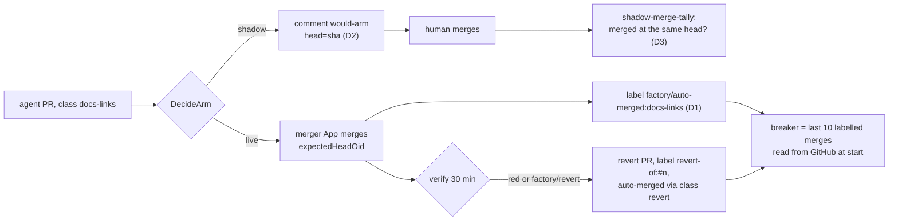

# v2: live auto-merge of `docs-links` and `revert`

**Date:** 2026-10-16 · **Status:** draft, owner review pending ·
**Part of:** the v2 roadmap on the
[status page](../../../website/content/docs/platform/ai-platform/status.md#v2-roadmap), row "Live auto-merge"

## Outcome

The two classes leave shadow mode only once the gate's evidence exists:

1. the merge breaker's state survives a cluster rebuild;
2. a head-pinned merge and its revert were drilled on a live cluster;
3. 20 `docs-links` shadow "would merge" decisions, each merged unchanged by a human afterwards.

`revert` stays tied to the drill: a revert exists only after a real auto-merge.

Read against agent-platform `main` at 83891e1. Cited as `AP/<path>:<line>`.

## What exists

The merge path is built and tested, and has never run live:

| Built | Where |
|---|---|
| `DecideArm`: secret scan, CI, policy-bot creator and state, agent-authored, no maintainer approval, reviewer approve, run-reported head (`head_unreported`), every verifier on that head (`verdict_stale`), `LinksOnly`, breaker, daily cap; in shadow `shadow_would_arm` | `AP/internal/factory/reconciler/arm.go:69-154` |
| Head-pinned merge: GraphQL `mergePullRequest` with `expectedHeadOid` through the merger App; 409 → back to the gate, 405 → human | `forge/github.go:596-628`, `merge.go:145-160` |
| Verifying for 30 min, revert PR through the merger App on red or `factory/revert`, native auto-merge on the revert only, a stalled revert disarmed | `merge.go:578-670` |
| Breaker (window 10, 1 revert) and the daily cap of 10, **derived from Task CRs** | `merge.go:672-716` |
| A hand-off returns to the gate after `policy_*`, `head_unreported`, `ci_cancelled` (≤ 3 times, same head, no maintainer engaged); `verdict_stale` goes back to review (#73, v0.10.0) | `implement.go:585-603`, `merge.go:129-232` |
| Rulesets: only the merger App may merge to `main` or create `revert-*`; policy-bot's `low-risk` rules for both classes already post success | `.github/rulesets/agent-merge*.json`, `.policy.yml:35,83` |

The status page's proposed fix ("a PR handed to a human can return to the gate; today none does")
is **already built** by #73. This design drops it from the gate and re-checks it live (G5).

## The gap

| Missing | Why it matters |
|---|---|
| Breaker state outside etcd | Task CRs die with the cluster, so a demoted class comes back **undemoted** after a rebuild. That is the gate's first condition |
| A durable count of shadow decisions | Recorded only in Task status (lost on rebuild) and PR comments; no metric. The 20-decision count cannot be computed today |
| "Merged unchanged" is not provable | The `would-arm` comment does not carry the head it judged, so a later human merge cannot be compared with it |
| A live drill | Neither the pinned merge nor the revert has ever run |

## Decisions

| # | Decision | Recommended | Rejected, and why |
|---|---|---|---|
| D1 | Where the breaker's state lives | **GitHub, the system of record.** At arm time the factory labels the PR `factory/auto-merged:<class>`; a merger revert PR carries `factory/revert-of:#<n>`. The breaker's window is the last 10 merged PRs with the class label, a revert counts when its `revert-of` PR merged. The daily cap counts today's labelled merges. The factory reads it at start and keeps Task CRs as a cache | A ConfigMap or object-store file: one more thing to restore and to forget at teardown. Task CRs as today: lost on rebuild, the gate's own failure |
| D2 | Shadow decisions, durably | The `would-arm` comment's marker gains the head: `event=would-arm-<n> head=<sha>`. A metric `agent_factory_merge_decisions_total{class,verdict,reason}` for the dashboard | A metric only: VictoriaMetrics restarts with the cluster too. The comment is already posted and survives |
| D3 | "Merged unchanged" | The PR merged, by a human, with merge head = the `head=` of its last `would-arm` comment. A script tallies it from GitHub: `scripts/ops/github/shadow-merge-tally.sh --class docs-links` | Human judgement per PR: not replayable. Design §5.2 already asks for a replayable count |
| D4 | The drill | **A drill window on aws-0** with `docs-links` and `revert` set `live` in one commit, one planted broken-link issue, the merge observed, then `factory/revert` on it and the revert PR merged, then the commit reverted to shadow. Owner go required, because it merges to `main` unattended | Drill on a fork or a scratch repo: the rulesets, policy-bot and the merger App's installation are exactly what is under test |
| D5 | Flip order after the gate | `docs-links` live first; `revert` live in the same commit, because a live class with a shadow revert cannot undo itself | `revert` later: an auto-merge that needs reverting would wait for a human, defeating the verifier |
| D6 | Design drift | Update the dark-factory design: S7 (native auto-merge) and S8 (live at v1) as superseded by R16/R52 and R32; §5.2's revert author is `ogenki-agent-merger[bot]`; §6.4's breaker is the outcome window (R41) | — |

## Changes

| Repo | Change |
|---|---|
| agent-platform | Label at arm (D1) and on revert PRs; breaker and daily cap read from GitHub at start and on a cache miss; `would-arm` marker carries `head=` (D2); `agent_factory_merge_decisions_total`; a test that a rebuilt factory (no Tasks) reads a demoted class as demoted |
| cloud-native-ref | `shadow-merge-tally.sh` and its test; the two labels created by the ruleset script; the drill commit and its revert (D4); the status row; the dark-factory design notes (D6) |

The merger App needs `issues: write` for labels if `pull_requests: write` does not cover them
(GitHub applies PR labels through the issues API). Verify on the App before the drill.

## The gate's proof

| # | Check | Expected |
|---|---|---|
| G1 | Demote `docs-links` in a drill (one auto-merge, its revert), then delete every Task and restart the factory | `class_paused` on the next docs-links PR: the state came from GitHub |
| G2 | The drill's merge | merged by `ogenki-agent-merger[bot]` at the head the run reported; label present |
| G3 | The drill's revert | a merger revert PR, `revert-of` label, auto-merged through `revert`; `ClassDemoted` on the control issue |
| G4 | `shadow-merge-tally.sh --class docs-links` | ≥ 20 merged-unchanged, 0 reverted |
| G5 | One CI-fixed docs-links PR in shadow | returns to the gate and ends `shadow_would_arm`, not `verdict_stale` with a human |

## What only the owner can decide

1. **Go for the D4 drill window**: the factory merges to `main` unattended for its duration.
2. Whether the 20-decision bar can count shadow decisions from before D2 shipped. *Recommended:*
   no. Without `head=` they cannot be proven unchanged.
3. The pace: the weekly `link-rot` schedule yields at most one docs-links task a week, so G4 takes
   months unless docs-links issues are filed deliberately. *Recommended:* keep the bar and the
   pace; the class is low-value enough that waiting costs little.
