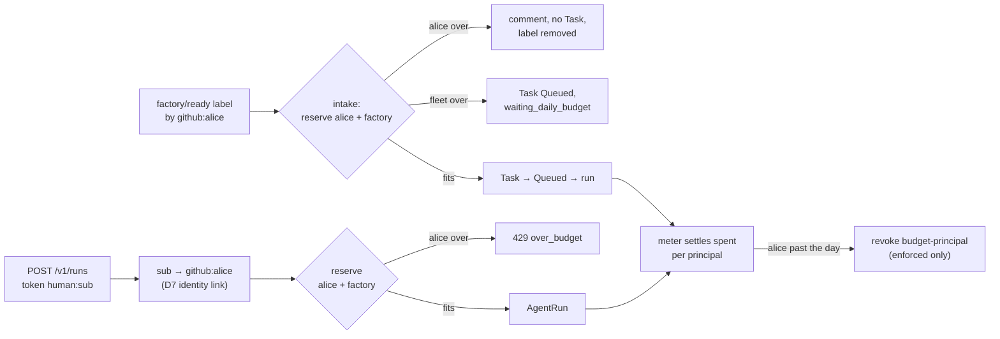

# v2: per-person spend caps

**Date:** 2026-10-16 · **Status:** draft, owner review pending ·
**Part of:** the v2 roadmap on the
[status page](../../../website/content/docs/platform/ai-platform/status.md#v2-roadmap), row "Per-person spend caps"

## Outcome

The gate: *label-triggered and API admission share one reservation, and an exhausted ledger refuses
both.* After this design:

- each person has **one** ledger key, whether they start a run from a room, `task agent:run`, or a
  `factory/ready` label;
- every run reserves against **both** that person and the factory's fleet day, atomically;
- a person past their day is refused at the door on either path: HTTP 429 on the API, a comment
  and no Task on a label.

Read against agent-platform `main` at 83891e1 (v0.11.0+). Cited as `AP/<path>:<line>`.

## What exists, and the gap

Most of the machinery exists. One ledger, one admission function, both paths already call it:

| Built | Where |
|---|---|
| One ConfigMap per UTC day (`agent-factory-ledger-YYYYMMDD`): `spent` per principal (meter-owned), `reserved.<runId>` (admission-owned), resourceVersion-atomic, pruned at 35 d | `AP/internal/factory/api/server.go:94-120` |
| `api.Reserve`: refuses `spent + Σreserved + maxTokens > limit`, refuses while the meter is blind; in shadow it reserves and counts `budget-principal-shadow` | `server.go:470-584`, `ledger.go:56-116` |
| API runs reserve as `human:<ZITADEL sub>` against `humanDaily` (5 M) | `server.go:434-460` |
| Factory task runs reserve as `system:factory` against `factoryDaily` (25 M), in Queued | `reconciler/implement.go:140-153` |
| The meter revokes `budget-principal` past the day, when `enforcePrincipal` is on (it is off) | `meter/meter.go:557-558` |

The gap is **attribution**, not mechanism:

| Missing | Effect today |
|---|---|
| A labelled task runs as `system:factory`; the labeller (`spec.source.requestedBy: github:<login>`) is recorded and never charged | a person can spend the whole fleet day through labels while their own key reads 0 |
| `human:` (API) and `github:<login>` (labels) are two id spaces | one person, two ledgers: the gate's "share one reservation" fails |
| Intake never reads the ledger; Queued **waits** (`waiting_daily_budget`) instead of refusing | an exhausted ledger queues label work until midnight rather than refusing it |
| `narrate` says "the factory's daily token budget is spent" | a refused person is not told it is *their* cap |

## Decisions

| # | Decision | Recommended | Rejected, and why |
|---|---|---|---|
| D1 | The canonical principal of a person | **`github:<login>`**. The API resolves `human:` to the login through the identity link rooms already use (D7, room access follows GitHub); a sub with no link keeps `human:` and cannot label anyway | ZITADEL sub as canonical: intake sees only a GitHub login and would need the reverse lookup on every label. Keeping two keys: fails the gate by construction |
| D2 | Who is charged for a run of a labelled task | **The person who caused that run**: the labeller for the first run and auto-resumes, the maintainer who typed `/factory retry` for a retry. Every run is *also* reserved against `system:factory` | Charging only the fleet: today's gap. Charging the issue author: they did not spend anything; a maintainer chose to |
| D3 | Two reservations, one write | `Reserve` takes a list of `(principal, limit)` and writes all keys in **one** ConfigMap update, so no run holds one reservation without the other | Two sequential `Reserve` calls: a conflict between them leaks a half-reservation the orphan sweep only clears 2 min later |
| D4 | A person over their day, on a label | **Refuse at intake**: no Task, a comment naming the person, the cap and the reset time; the label is removed so re-labelling tomorrow retries | Queue until midnight (`waiting_daily_budget`): work starts unattended at 00:00 UTC on yesterday's decision. The fleet day keeps today's waiting behaviour: it is nobody's fault |
| D5 | A person over their day mid-task | The next run of the task escalates `budget-principal` with the person named; the running run is revoked by the meter as today | Letting a started task finish on the fleet budget: re-opens D2's gap |
| D6 | Unit | **Tokens**, as the ledger is today; the per-person cap is checked on the same reference tokens as `factoryDaily` | USD per person: the ledger, the gauges and the 80 % alert are token-based; the run and task caps are already USD (v0.11.0), which bounds the money. A USD day is a later ledger change, not this gate |
| D7 | Cap values | **One `humanDaily` for every person** (5 M today), no per-person override | An override map: YAGNI with one maintainer; add it when a second person exists |
| D8 | Rollout | Shadow first (`enforcePrincipal: false`, counted as `budget-principal-shadow` with the person), then enforce after 7 days with no false refusal, per OD-10 | Enforce at merge: the attribution change itself needs a week of evidence |

Retries and resumes reserve at Queued as today, with the principal from D2 instead of
`system:factory` alone. The Task records it in a new `status.chargedTo` per run, so the run page and
the closing comment name who paid.

## Changes

| Repo | Change |
|---|---|
| agent-platform | `api.Reserve` takes several `(principal, limit)` (D3); `reserveFactoryDay` reserves the D2 person and the fleet; the API maps `human:` → `github:<login>` through the broker's identity link (D1); intake calls `Reserve` before creating a Task and refuses per D4; the retry path records the retrier; `narrate` names the person and the cap; `status.chargedTo` on run records; `budget-principal-shadow` gains a `principal` label |
| cloud-native-ref | `meter`/`budgets` config unchanged until D8's flip; the status page row; runbook 04 (budgets) gains "a person is refused" |

No change to crossplane-configuration: the run's `agents.ogenki.io/principal` label stays the
gateway-side principal (`system:factory` for task runs). Per-person is an admission-side concept.

## The gate's proof

On aws-0, with `humanDaily` lowered to 1 token in a drill commit and `enforcePrincipal: true`:

| # | Step | Expected |
|---|---|---|
| G1 | The owner labels a trivial issue `factory/ready` | refused at intake: a comment naming `github:<owner>`, no Task, the label removed |
| G2 | The owner runs `task agent:run` the same day | 429 `over_budget`, and the ledger shows **one** key for the owner |
| G3 | Revert the drill commit; label again | a Task, and its first run reserved under both `github:<owner>` and `system:factory` in one ConfigMap revision |
| G4 | After a run ends | the meter settled its tokens to both keys; `agent_factory_budget_remaining_tokens{principal="github:<owner>"}` fell by them |

## What only the owner can decide

1. **Is this worth building now?** With one maintainer the person cap is the fleet cap with extra
   steps. It pays off with the second repository or a second maintainer. *Recommended:* build it
   after the second-repository gate, not before.
2. D1's identity: is the GitHub-login link rooms use acceptable as the money key?
3. The `humanDaily` value once enforced (5 M reference tokens ≈ $8.50 at $1.70/M).
