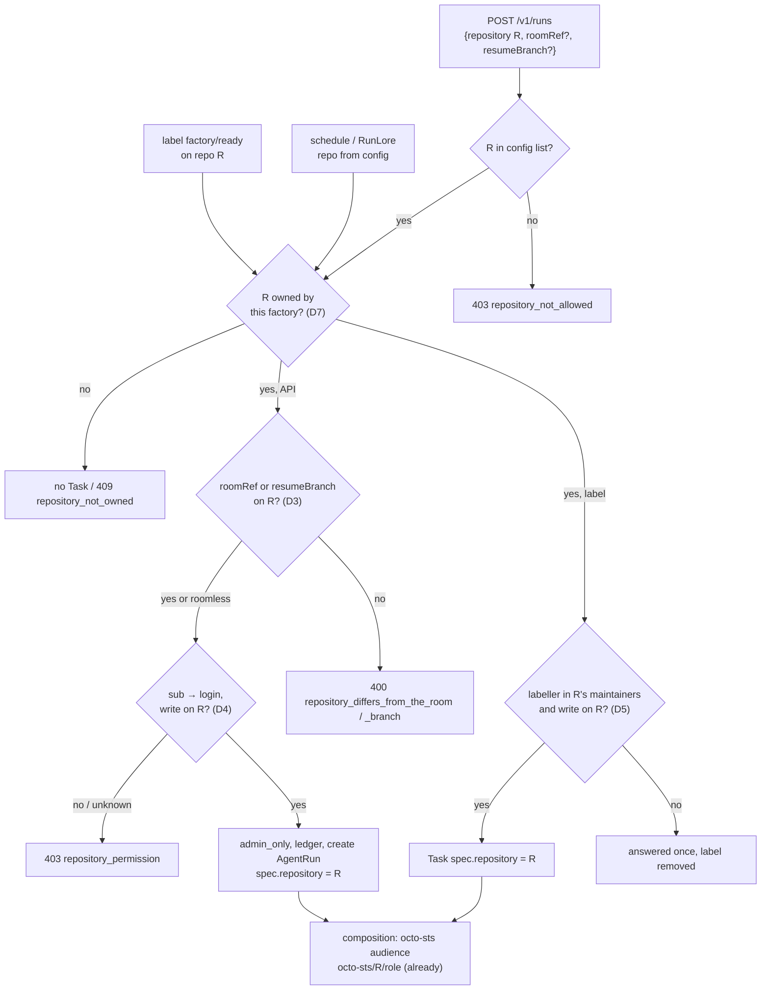
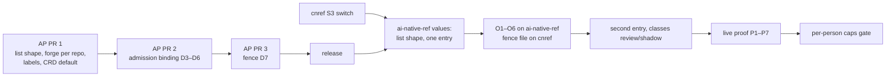

# v2: a second repository

**Date:** 2026-10-16 · **Status:** draft, owner review pending ·
**Part of:** the v2 roadmap on the
[status page](../../../website/content/docs/platform/ai-platform/status.md#v2-roadmap), row "A second repository"

## Outcome

The gate: *the factory takes issues from several repositories; every admission path binds the
request's repository to its room and checks the caller's GitHub permission on it, roomless and
resumed runs included; one fenced factory owns each repository.* After this design:

- the factory config holds a **list of repositories**, each with its own maintainers, trigger
  label, classes, merge checks and schedules; caps, tiers, budgets and the kill switch stay global;
- **every** admission path resolves one repository from the config, refuses a request whose
  room belongs to another, and checks that the caller has **write** on that repository on GitHub;
- a repository is acted on only by the factory its default branch names (`.github/agent-factory.yaml`),
  so two clusters never take the same issue;
- the second repository is **`Smana/ai-native-ref`**, once the S3 switch has landed.

Token scoping needs no change: the AgentRun composition already binds the run's octo-sts audience
to `spec.repository` (crossplane-configuration `apis/agentrun/kcl/main.k:665`), and each repository's
trust policies accept only their own audience.

Read against agent-platform `main` at 205d9e9. Cited as `AP/<path>:<line>`.

## What exists, and the gap

| Single-repository literal (v1 review [N5](2026-10-12-agent-factory-v1-review.md#n5)) | Where |
|---|---|
| `config.repository`, one string; `api.repositories` a separate allowlist | `AP/internal/factory/config/config.go:315,437,690` |
| Both GitHub connections (factory App, merger App) bound to that repository | `AP/internal/app/factory.go:125,298`, `AP/internal/factory/forge/github.go:59-63` |
| Label, RunLore and schedule intake stamp every Task with it | `AP/internal/factory/intake/issues.go:247,273-275`, `runlore.go:220`, `schedule.go:141` |
| The Room CRD defaults `repository` to `Smana/cloud-native-ref` | `AP/api/v1alpha1/room_types.go:69` |
| Maintainers, `triggerLabel`, `controlIssue`, classes, `merge.*`, `schedules` are top-level, so per repository by accident | `config.go` |

The admission gap is the security half of the gate. Today it is harmless because
`api.repositories` has one entry; with two it is open:

| Path | Checks today | Missing |
|---|---|---|
| `POST /v1/runs` with `roomRef` (broker `start_run`, `fork`, `roomctl`) | repository in `api.repositories`; the room's driver or owner (`admitRoom`, `AP/internal/factory/api/server.go:378-406`) | `in.Repository == room.Spec.Repository`: a driver of a room on A can start a run on **B**, with A's brief, on branch `agent/<roomRef>` of B. No GitHub permission check at all |
| `POST /v1/runs` without `roomRef` (roomless) | group membership and the allowlist | any `agents` member can make the agents' App push to any allowed repository |
| `resumeBranch` | not a Task branch; the room's driver if a room exists (`server.go:408-433`) | the branch's previous run's repository; the caller's permission |
| Label intake | labeller in `maintainers` | `maintainers` is one list for every repository |
| Schedules, RunLore | none needed: the repository is the config's | one repository each, chosen by config |

Room *visibility* already follows GitHub (`internal/repoaccess`, read permission, cached 5 min,
fails closed). Starting a run is a **write** through the agents' App, so it needs a stronger check.

## Decisions

| # | Decision | Recommended | Rejected, and why |
|---|---|---|---|
| D1 | Config shape | **`repositories: [{name, maintainers, triggerLabel, classes, merge, schedules}]`**, at most 8 entries; `api.repositories` is derived from it and removed. A config with the legacy top-level `repository` is read as a one-entry list for one minor release, then refused | Keeping `api.repositories` beside the list: two sources of the same truth, which is how N5 happened. Breaking the shape at once: forces the chart and the values to move in lockstep across two repositories during S3 |
| D2 | Global vs per repository | **Global:** `caps`, `tiers`, `templates`, `budgets`, `resume`, `meter`, the Apps' logins, the kill switch (`control: {repository, issue}`, one issue stops everything). **Per repository:** the rest of D1 | A control issue per repository: a stop must stop the fleet; a per-repository pause is YAGNI until asked |
| D3 | Repository ↔ room binding | **The room's repository wins.** `POST /v1/runs` with `roomRef` refuses `400 repository_differs_from_the_room` when `in.Repository` differs; a fork inherits it (as today); `resumeBranch` refuses `400 repository_differs_from_the_branch` when the branch's last run (or room) names another | Overwriting `in.Repository` with the room's silently: a caller learns nothing, and the idempotency fingerprint would hash a body it never sent |
| D4 | The caller's GitHub permission | **`write` or higher** (`GET /repos/{r}/collaborators/{login}/permission`) for **every** human run admission, room or not, all roles. The factory resolves `sub → login` itself with `ghidentity` (the broker forwards the token, never a login), cached 5 min, failing closed: `403 repository_permission`. `agents-admin` gets no bypass: GitHub stays the one answer to "who may change this repository" | `read`: every GitHub user can read a public repository, so it would gate nothing. Per role (read for reviewer/triager): one rule is testable in one table; a read-only run still spends the budget and posts as the App |
| D5 | Label intake | The labeller is in **that repository's** `maintainers` **and** has `write` on it (D4's check). Each repository is polled for its own `triggerLabel` | The maintainers list alone: it drifts from GitHub silently |
| D6 | System callers | `systemPrincipals` gains a repository list per principal; schedules and RunLore take the repository from their config entry (`runlore.repository`, default the first entry) | Letting a system principal name any allowed repository: RunLore files issues, it should not choose where |
| D7 | The single-owner fence | **`.github/agent-factory.yaml` on the default branch: `factory: aws-0`.** The factory reads it with its App at start and every 5 min; a repository whose file is absent or names another factory gets no intake, no schedules, no API runs (`409 repository_not_owned`) and no merges (gate step `not_owned` → human). A gate path in that repository's `.policy.yml` | A repository Actions variable: outside review and GitOps, and needs a new App permission. A Kubernetes Lease: two clusters do not share an API server. A CI check that no two clusters list the same repository: static, it cannot stop a rebuilt cluster on a stale pin |
| D8 | GitHub connections | **One forge client per repository**, both Apps, built from the list; a repository whose installation is missing fails readiness, never silently skips | One client re-targeted per call: every call site would carry the repository, and a missed one acts on the wrong repository |
| D9 | The second repository | **`Smana/ai-native-ref`** after the S3 switch, all classes `review` or `shadow` (no live auto-merge until its own 20 shadow decisions) | `agent-platform`: code with tests, a good cohort source, but the factory would PR its own admission code, and its CI and release signing are heavier to gate. A throwaway sandbox repository: proves the plumbing, not the work |
| D10 | Metrics | A `repository` label on the task, outcome, intake, intervention and time-to-PR series; values only from the config list (≤ 8), anything else `other` | A label from request input: unbounded, and a refused request would mint series |

`Smana/ai-native-ref` is the factory's own configuration repository after S3, so an agent could
open a PR on what governs it. That is acceptable only with these controls, all in that repository:

| Path in `ai-native-ref` | Control |
|---|---|
| `tooling/*/agent-factory/`, `security/`, `infrastructure/*/agent-gateway/`, `flux/`, `clusters/` | policy-bot gate path: the owner's approval; the merge gate classifies them `review`, never `live` |
| `.github/chainguard/`, `.github/agent-factory.yaml`, `.github/workflows/`, `.policy.yml` | gate paths, and the composition's rule 3 ("never modify `.github/workflows/` or `.github/chainguard/`") extended to the fence file |
| `main`, tags | `agent-branches` and `agent-tags` rulesets: the agents' App writes `agent/**` only |

## Admission, after

## Security analysis

| Threat | Today (one repository) | After |
|---|---|---|
| A room on A used to push to B | Impossible only because the allowlist has one entry | D3 refuses it; a test per path (`roomRef`, `resumeBranch`, fork → `start_run`) |
| A member with no right on B starts a run on B (roomless) | Any `agents` member, on the one repository | D4: `write` on B, from GitHub, fail closed |
| A run of A obtains a token for B | The projected token's audience is `octo-sts/A/<role>`, fixed at pod creation; Kyverno reserves `octo-sts/*` audiences to `agents` and blocks TokenRequest for them elsewhere (`security/base/agent-policies/validatingpolicies.yaml`) | Unchanged. B's trust policy accepts any `xplane-run-*` subject **with B's audience**, so the integrity of the scope is the integrity of `AgentRun.spec.repository`, which only the factory writes (one-creator policy) after D3/D4 |
| A clone of B from a run of A | The `github` egress profile allows github.com; a public B is readable anyway | Unchanged for public repositories. Private repositories are their own gate |
| Two clusters take the same issue | One active cloud | D7 fence, read from GitHub by both |
| Labels or `/factory retry` on B by A's maintainer | One list | D5: per-repository list plus GitHub `write` |
| The agent edits B's fence or trust policies | — | Gate paths (owner approval), rulesets confine the App to `agent/**` |
| The gateway's `sts` listener | 4 audiences of 8 | 8 of 8 with two repositories: a third needs a second listener or a pattern; recorded, not solved here |

No new credential: the factory already mounts both App keys, and `ghidentity` needs the read-only
ZITADEL viewer PAT the broker uses, mounted into the factory too (one ExternalSecret).

## Changes

| Repo | Change |
|---|---|
| agent-platform | D1 config list and legacy read; D8 forge client per repository; intake polls each repository (D5); `admitRoom`/`admitResume` bind the repository (D3); the factory gains `ghidentity` + a `repoaccess.Permission` (D4); `systemPrincipals` per repository (D6); the fence reader and merge-gate step (D7); `repository` label (D10); the Room CRD default removed (`room_types.go:69`); `docs/factory.md`, `docs/api.md` (three new codes), `docs/security.md` |
| ai-native-ref (after S3; the AI paths are frozen in cnref until then) | Factory values in the list shape, then the second entry; the ZITADEL viewer secret mounted in the factory; the `sts` listener's four new audiences (`policies-identity.yaml`); its own `.policy.yml`, `.github/chainguard/agent-*.sts.yaml` and `.github/agent-factory.yaml`; a runbook page "add a repository" |
| cloud-native-ref | `.github/agent-factory.yaml` (`factory: aws-0`) as a gate path; the status row; nothing else: the ruleset scripts already take `<owner/repo>` |
| crossplane-configuration | None: audience, task URL and PR pattern already derive from `spec.repository` |

### Owner steps on the second repository, in order

Rulesets **before** the App installs: until they exist nothing stops the agents' App from merging
its own PR (ADR-0043).

| # | Step | Command / where |
|---|---|---|
| O1 | Fold `ai-native-ref`'s `main` ruleset (no bypass, any merge method, checks `validate` and `lint`) into the agent-merge shape: squash only, admin bypass, the merger App | `MERGER_APP_SLUG=… task ops:github:agent-merge-ruleset -- Smana/ai-native-ref` |
| O2 | Agents' branch and tag rulesets | `task ops:github:agent-branch-ruleset -- Smana/ai-native-ref` |
| O3 | policy-bot: install `ogenki-merge-gate` on the repository, merge its `.policy.yml`, then the merge-gate ruleset | GitHub App settings; `POLICY_BOT_APP_SLUG=… task ops:github:agent-merge-gate-ruleset -- Smana/ai-native-ref` |
| O4 | Merge the four trust policies and the fence file | PR on `ai-native-ref` |
| O5 | Install the agents' App, the factory App and the merger App on the repository (selected repositories) | GitHub App settings |
| O6 | Create the labels (`factory/*`, `class:*`) | `gh label create` per [factory labels](https://github.com/Smana/agent-platform/blob/main/docs/factory.md) |

## Observability

| Series | Change |
|---|---|
| `agent_factory_tasks`, `_pr_outcomes_total`, `_time_to_pr_seconds`, `_intake_errors_total`, `_human_interventions_total`, `_task_tokens` | `+repository` (D10) |
| `agent_factory_repository_owned{repository}` | new: 1 when D7's file names this factory; an alert when 0 for 15 min on a listed repository |
| `agent_factory_admission_refusals_total{repository, reason}` | new: `repository_differs_*`, `repository_permission`, `repository_not_owned` |
| Budget series | unchanged: per principal, not per repository |

The factory dashboard gains a `repository` variable; `_github_rate_remaining` is per App
installation, already shared.

## Rollout

PR 1 changes no behaviour with one entry; PR 2 adds refusals that one repository never meets
except `repository_permission`, which the owner passes. Each rollout is checked by one label run on
cloud-native-ref before the next.

## The gate's proof

On aws-0, with both repositories listed:

| # | Step | Expected |
|---|---|---|
| P1 | The owner labels a trivial `ai-native-ref` issue `factory/ready` | A Task with `spec.repository: Smana/ai-native-ref`; implementer and reviewer runs; a PR from `agent/<id>` by the agents' App, narrated, policy-bot pending, merged by the owner |
| P2 | Same hour, a cloud-native-ref label | Its own Task and PR: the two repositories run side by side |
| P3 | `POST /v1/runs` with a cloud-native-ref room and `repository: Smana/ai-native-ref` | `400 repository_differs_from_the_room`; no AgentRun |
| P4 | `resumeBranch` of a cloud-native-ref roomless run, `repository: Smana/ai-native-ref` | `400 repository_differs_from_the_branch` |
| P5 | A second GitHub account, `agents` member, read-only on `ai-native-ref`, roomless run | `403 repository_permission`; the same account's room still visible (read) |
| P6 | Fence file set to `gcp-0` on `ai-native-ref`, then a label | No Task; `agent_factory_repository_owned{repository="Smana/ai-native-ref"} 0`; revert, then a Task |
| P7 | A run pod's projected token presented to octo-sts for the other repository's audience | `403` from the trust policy (runbook 05 step 5, cross-repository) |

## Acceptance criteria

1. `config.go` refuses a list over 8, a duplicate name, and a legacy `repository` after the
   deprecation release; `grep -rn 'Smana/cloud-native-ref' internal api` returns test fixtures only.
2. A table test per admission path (label, schedule, RunLore, roomless, room, resume, fork) asserts
   the repository bound and the D4 check, including a permission lookup that errors (refused).
3. P1–P7 pass live, recorded in the runbook with links.
4. Every new metric label value comes from the config list (a test with an unlisted repository
   yields `other`).
5. The status page row moves to proven, and the agents page's "One repository at first" becomes
   "Adding a repository".

## Decisions to confirm (owner-only)

| # | Question | Recommended default |
|---|---|---|
| 1 | Is `ai-native-ref` the second repository (the factory working on its own config repository, behind gate paths), rather than `agent-platform` or a sandbox? | `ai-native-ref`, after S3 |
| 2 | Is `write` the right bar for every run, with no `agents-admin` bypass? | Yes |
| 3 | A second GitHub account for P5 (also unblocks runbook 11's four open checks) | Create one, read-only collaborator on `ai-native-ref` |
| 4 | Order against per-person caps | This gate first: caps' D1 identity link is D4's lookup, built here |

No ADR: no technology is chosen over another; the fence, the shape and the permission bar are
recorded above.
