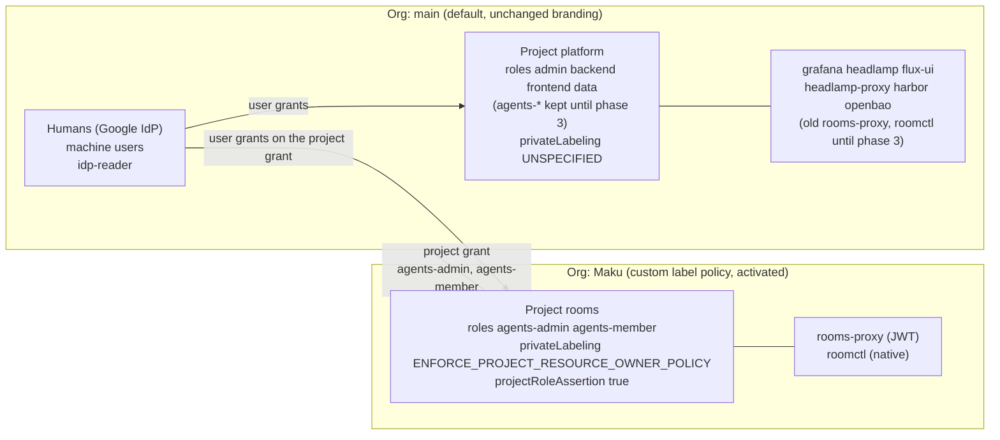

# Rooms-only login branding with ZITADEL private labeling

**Date**: 2026-10-29
**Status**: Design, draft for the owner. Not implemented
**Depends on**: the Maku rebrand phase 1 (agent-platform `feat/maku-phase1`, merged or merging), which
ships the marks under agent-platform `docs/assets/brand/`
**Related**: [ADR-0034](../../../website/content/docs/decisions/0034-openbao-oidc-via-zitadel-project-roles.md)
(project roles flattened into `groups`),
[ADR-0036](../../../website/content/docs/decisions/0036-per-app-secret-ownership-via-zitadel-groups.md)
(the `groups` claim as the authorisation source),
[ZITADEL bootstrap and reconciliation](2026-08-29-zitadel-bootstrap-and-reconciliation-design.md),
[GCP parity](2026-09-29-gcp-parity-design.md) (GP-4, the project id published per build)

## Summary

- **Goal.** A user who signs in to the rooms UI (`rooms-proxy`) or to `roomctl` sees the Maku logo and
  colours on the ZITADEL login. Grafana, Headlamp, the Flux UI, Harbor and OpenBao keep the instance's
  current look.
- **Mechanism.** ZITADEL private labeling. A new organisation, `Maku`, owns a new project, `rooms`. That
  organisation carries a custom, activated label policy. The project's `privateLabelingSetting` is
  `PRIVATE_LABELING_SETTING_ENFORCE_PROJECT_RESOURCE_OWNER_POLICY`, so its login always shows its owner's
  branding.
- **Users do not move.** Every human and machine user stays in the main organisation. The `rooms` project
  is granted to the main organisation with `agents-admin` and `agents-member`, and the owners' roles are
  granted as user grants on that project grant.
- **What changes.** 5 ids change: the project id, the audience scope derived from it, and the
  `rooms-proxy` client id, its secret and the `roomctl` client id. They reach **9 consumers**. Every
  consumer already reads these ids from the OpenBao `agents` mount, so ai-native-ref needs **no manifest
  change**. The work is in `scripts/provision/zitadel-oidc-clients.sh`.
- **Cutover is a hard switch.** The broker accepts one project id and one web client (`internal/authn`
  `Humans`), so old and new apps cannot both be live for rooms. The old apps stay in `platform` until the
  new ones are proven. Rollback is one sync with a flag.
- **Prove it on a throwaway cluster first**, with both a fresh build and a migration from main's layout.
  Then apply it to gcp-0, and to aws-0 if aws-0 still hosts a directory.

Facts marked **to verify on the test cluster** come from ZITADEL's docs or from inference. Nothing was
called against a live ZITADEL while this was written.

## 1. Today's layout and the target layout

### Today

One organisation (the instance's default, `/management/v1/orgs/me`), one project, `platform`
(`ZITADEL_PROJECT_NAME`), with `projectRoleAssertion: true` and
`privateLabelingSetting: PRIVATE_LABELING_SETTING_UNSPECIFIED`, restated by
`ensure_project_role_assertion` on every PUT.

| Object | Where | Source |
|---|---|---|
| Roles `admin backend frontend data agents-admin agents-member` | project `platform` | `ZITADEL_PROJECT_ROLES` |
| Apps `grafana headlamp flux-ui headlamp-proxy harbor openbao` | project `platform` | `CONSUMERS` |
| Apps `rooms-proxy` (JWT), `roomctl` (native, device flow) | project `platform` | `CONSUMERS` |
| Machine users `factory-slack-app`, `runlore` (no role) | main org | `MACHINE_USERS` |
| Machine user `room-broker-idp-reader` (`ORG_OWNER_VIEWER`) | main org | `zitadel-idp.sh` step 6 |
| Google IdP (instance), GitHub link-only IdP (instance) | instance login policy | `zitadel-idp.sh` |
| Action `groupsFromRoles`, flow 2, triggers 4 and 5 | main org (`/management/v1/actions`) | `zitadel-idp.sh` |
| Owner grants (`admin agents-admin agents-member`) | user grants on `platform` | `zitadel-owners.yaml`, `apply_owner_grants` |
| Branding | instance default label policy | none customised |

The login is ZITADEL's **embedded v1 login** (`login.enabled: false`, `LoginV2.Required: false` in
`security/base/zitadel/helmrelease.yaml`, ZITADEL v4.19.4).

### Target

| Object | Target |
|---|---|
| Org `Maku` | new; owns only the `rooms` project and its label policy. No users |
| Project `rooms` | in `Maku`; roles `agents-admin`, `agents-member`; `projectRoleAssertion: true`, `projectRoleCheck: false`, `hasProjectCheck: false`, `privateLabelingSetting: ENFORCE_PROJECT_RESOURCE_OWNER_POLICY` |
| Apps `rooms-proxy`, `roomctl` | new, in `rooms`, same names, redirect URIs and OIDC config as today (`app_oidc_config`) |
| Project grant | `rooms` granted to the main org, `roleKeys: [agents-admin, agents-member]` |
| User grants | owners' `agents-*` roles on the project grant (main org context); `admin` stays on `platform` |
| Machine users | unchanged ids, stay in main org. Their stored `project-id` becomes `rooms`'s |
| Project `platform` | unchanged. Its `agents-*` roles and the old rooms apps stay until phase 3 |
| `zitadel_project_id` (cluster vars), `zitadel-project-id` (Secret Manager), the workforce audience | stay `platform`'s. They feed Headlamp and the workforce pool, never rooms |

### Label policy of `Maku`

| Field | Value | Origin |
|---|---|---|
| `primaryColor` | `#6D28D9` | the UI's light primary |
| `backgroundColor` | `#F3F2FA` | Paper |
| `fontColor` | `#0A0A0F` | Ink |
| `primaryColorDark` | `#A78BFA` | the UI's dark primary |
| `backgroundColorDark` | `#0A0A0F` | Ink |
| `fontColorDark` | `#F3F2FA` | Paper |
| `warnColor`, `warnColorDark` | the instance's current values, read and restated | unchanged |
| `themeMode` | `THEME_MODE_AUTO` | follows the browser |
| `hideLoginNameSuffix` | `true` | the suffix would show the main org's domain |
| `disableWatermark` | open question Q2 | |
| logo (light) | `svg/maku-mark-light.svg` | mark on Paper |
| logo (dark) | `svg/maku-mark-dark.svg` | mark on Ink |
| icon (light and dark) | `svg/maku-icon.svg` | rounded app icon |

Core `#8B5CF6` stays inside the mark only. The brand rules keep Core off normal text on Paper, so the
buttons use the UI's primaries above. If the login cannot render SVG, the fallbacks are
`png/maku-mark-{light,dark}-256.png` and `png/maku-icon-192.png` (**to verify on the test cluster**:
SVG acceptance and the size cap of the assets API).

## 2. The ZITADEL calls

Use the v2 API where it has the call, and management v1 where v2 has none. v1 is what the script
already speaks. Every v1 call to the `Maku` org carries `x-zitadel-orgid: <maku org id>`. The iam-admin
PAT is `IAM_OWNER`: `zitadel-idp.sh` already requires `/admin/v1`, so it can act in any org.

| Step | Call | Idempotency |
|---|---|---|
| 1. Org | `POST /v2/organizations` `{name: "Maku"}`; find it first with `POST /v2/organizations/_search` (name equals) | search by name, create only on a miss. A 409 means it exists, so search again (the machine-user pattern) |
| 2. Project | `POST /zitadel.project.v2.ProjectService/CreateProject` `{organizationId, name: "rooms", projectRoleAssertion: true, privateLabelingSetting: "PRIVATE_LABELING_SETTING_ENFORCE_PROJECT_RESOURCE_OWNER_POLICY"}`, or v1 `POST /management/v1/projects` under the org header | search by name **in the Maku org**. Today's `ensure_project` searches without an org header and would not see it |
| 3. Setting on an existing project | `UpdateProject` (v2), or v1 `PUT /management/v1/projects/{id}`. **The v1 PUT is a full replace**: it must restate `privateLabelingSetting`, or it resets to `UNSPECIFIED` | read, compare, write on drift |
| 4. Roles | `POST /management/v1/projects/{id}/roles` (as today, under the org header) | as `ensure_project_roles` |
| 5. Label policy | `GET /management/v1/policies/label` (`isDefault` true means none yet), then `POST` (add) or `PUT` (update) `/management/v1/policies/label` with the table above | compare fields, write on drift |
| 6. Assets | `POST /assets/v1/org/policy/label/logo`, `/logo/dark`, `/icon`, `/icon/dark`, multipart field `file` (**to verify on the test cluster**: the field name and the content types) | compare a stored sha256 of each source file with the one recorded on the last upload, because ZITADEL returns a URL and no hash |
| 7. Activate | `POST /management/v1/policies/label/_activate` | after any write in 5 or 6. Until it runs, only the console preview shows the branding |
| 8. Project grant | `POST /zitadel.project.v2.ProjectService/CreateProjectGrant` `{projectId, grantedOrganizationId: <main>, roleKeys}` (v1: `POST /management/v1/projects/{id}/grants` `{grantedOrgId, roleKeys}`) | search the grants of the project. Update the role keys on drift |
| 9. Apps | `POST /management/v1/projects/{rooms}/apps/oidc` (under the Maku header), with the existing `app_oidc_config` payload | `app_id_by_name` in `rooms` |
| 10. User grants | v1 `POST /management/v1/users/{uid}/grants` `{projectId: <rooms>, projectGrantId, roleKeys}` with `x-zitadel-orgid: <main>`; or v2 `AuthorizationService` `CreateAuthorization` (**to verify on the test cluster**: the v2 field names on v4.19.4) | `grant_user_role`'s add-to-existing-grant rule, keyed on `projectId == rooms` |

Steps 1 to 8 run before the consumer loop. Step 10 runs where `apply_owner_grants` runs today. The role
decides the project: `agents-*` goes to `rooms`, and everything else to `platform`.

## 3. Ids that change, and the consumers that move

### The ids

| # | Id | Today | After |
|---|---|---|---|
| 1 | project id the rooms side pins | `platform`'s | `rooms`'s |
| 2 | audience scope | `urn:zitadel:iam:org:project:id:<platform>:aud` | `urn:zitadel:iam:org:project:id:<rooms>:aud` |
| 3 | `rooms-proxy` client id | app in `platform` | new app in `rooms` |
| 4 | `rooms-proxy` client secret | same | new (the `cookie-secret` is kept: `merge_secret` preserves it) |
| 5 | `roomctl` client id | app in `platform` | new app in `rooms` |

These do **not** change: the machine users' client ids (`factory-slack-app`, `runlore`, the
idp-reader), the issuer, the JWKS, `platform`'s project id, and every non-rooms app.

### The consumers

All paths are in ai-native-ref unless marked. Each one reads an OpenBao `agents/*` key that
`zitadel-oidc-clients.sh --mirror-openbao` writes, so the change is the value under the key, not the
manifest.

| # | Consumer | Reads | Ids |
|---|---|---|---|
| C1 | oauth2-proxy `rooms-oauth2-proxy` (`infrastructure/base/room-broker/oauth2-proxy.yaml`) | Secret `rooms-proxy` (ES `externalsecret-rooms-proxy.yaml`, key `agents/rooms-proxy`): `client-id`, `client-secret`, `project-id` into `OAUTH2_PROXY_SCOPE` | 1-4 |
| C2 | oauth2-proxy extra issuer | Secret `rooms-proxy-extra-issuers` (key `agents/roomctl`): `EXTRA_JWT_ISSUERS=<issuer>=<roomctl id>` | 5 |
| C3 | broker `human` (`config.yaml`) | `clientIDFile` and `projectIDFile` (`room-broker-oidc`, from `agents/rooms-proxy`); `roomctlClientIDFile` (`room-broker-roomctl`, from `agents/roomctl`). Read at use | 1, 3, 5 |
| C4 | `GET /.well-known/roomctl` and the room list's CLI setup view | the broker's files, so it follows C3 by itself | 1, 5 |
| C5 | every developer's saved `roomctl` (or `maku`) config, `<user config dir>/roomctl` | `clientID`, `projectID`, the scope built from it (`internal/roomctl/auth.go`) | 1, 2, 5. **Manual**: re-run `configure`, then log in |
| C6 | factory `api.clientIDFiles` (`tooling/base/agent-factory/externalsecret-oidc.yaml`) | `agents/rooms-proxy` and `agents/roomctl` `client-id` | 3, 5 |
| C7 | factory `api.projectIDFile` for `api.sponsored` and `api.internalPrincipals` (`tooling/gcp-0/agent-factory/helm-values-sponsored.yaml`, ES `agent-factory-sponsored`) | `agents/factory-slack-principal` `project-id` | 1 |
| C8 | the Slack App (`tooling/*/agent-factory/slack-app/config.yaml` `projectIDFile`) and RunLore (`platform/runlore/factory-principal`, `agents/runlore-principal`) | the machine users' `project-id`, which sets the audience they request | 1 |
| C9 | cloud-native-ref `zitadel-owners.yaml` grants | `apply_owner_grants`: `agents-*` move to the `rooms` project grant | none; the grants move |

**One invariant to keep.** C3 (broker `projectIDFile`) and C7 (factory `projectIDFile`) must hold the
same id, or a sponsored token passes one and fails the other. Today both come from the script's one
`$project_id`. After the change, both must come from the rooms project id, which the script passes to
`merge_secret`/`converge_secret` for `rooms-proxy` and `roomctl`, and to `ensure_machine_user` and
`write_public`. `platform`'s id keeps feeding `publish_project_id`, `reconcile_consumer_audience` and
`reconcile_workforce_audience`. Swapping either one breaks Headlamp on GKE.

### The order inside one sync

1. Converge the Maku org, the `rooms` project and its setting, the roles, the label policy, the assets,
   the activation and the project grant (steps 1-8).
2. Apply the owners' grants: `agents-*` on `rooms`, the rest on `platform` (step 10).
3. Create or converge the `rooms-proxy` and `roomctl` apps in `rooms`, and write `agents/rooms-proxy`
   and `agents/roomctl` with the new ids and the rooms project id.
4. Converge the machine users' `project-id` to the rooms id (`agents/factory-slack-principal`,
   `agents/runlore-principal`).
5. Run `force_sync_mirrored`. Then `restart_rooms_proxy`, which already fires when the client id changes.
   The broker and the factory re-read their files at use and need no restart.
6. Leave `platform`'s id where it is today: the cluster vars, Secret Manager and the workforce pool.

### gcp-0's fresh-directory bootstrap

gcp-0 builds against a fresh directory, or one restored from a seed that predates every current id, so
every id is new on every build already. Nothing new is needed in `opentofu/gcp/gke/init/workflows.tm.hcl`:
`zitadel-idp.sh sync`, then `zitadel-oidc-clients.sh sync --owners`, then `link-owners`. Steps 1-8 sit
inside the clients sync, before any app exists. A first build therefore creates the org, the policy and
the project in one pass, and the ExternalSecrets pick the ids up within their 20 min `refreshInterval`
(or a force sync). The idempotent searches cover aws-0's frozen-seed restore (`zitadel-20260719`) the
same way: the seed has no Maku org, and every rebuild creates it again.

The owner's first login still has to come before their grant. That is unchanged: the deploy's next sync
grants them.

## 4. Migration: an existing cluster against a fresh build

The sync gains one switch: `--rooms-project rooms|platform`, or `ROOMS_PROJECT` in the deploy. It names
the project whose rooms apps and id get written to the `agents/*` keys. Steps 1-8 always run once the
code lands, because they are harmless: an org, a policy and a project with no app change nothing anyone
sees.

| Phase | Fresh build (gcp-0, throwaway) | Existing cluster |
|---|---|---|
| 0. Code lands, switch `platform` | Maku org, branded `rooms` project, project grant and new apps are created. The keys still hold `platform`'s apps. No visible change | same. The new apps now exist beside the old ones |
| 1. Switch to `rooms` | the keys hold the new ids from the first sync | one sync rewrites the 4 keys. oauth2-proxy restarts. Every rooms web session ends (the old client's tokens fail the broker's audience). Each roomctl user re-runs `configure` and `login` |
| 2. Proven (see section 5) | | the old `rooms-proxy` and `roomctl` apps and `platform`'s `agents-*` grants stay, for rollback |
| 3. Cleanup, a separate PR after one full gcp-0 rebuild on `rooms` | | delete the old apps, then drop `agents-*` from `platform`'s roles and from `ZITADEL_PROJECT_ROLES`'s platform list. Removing a role from a project removes the user grants of that role |

**Rollback** (phase 1 or 2): re-run the sync with `--rooms-project platform`. It rewrites the keys from
the old apps. The old `rooms-proxy` secret was overwritten in the store, so `probe_client_secret` rejects
it and the existing rotation path mints a fresh one. `restart_rooms_proxy` rolls the proxy. Sessions end
once more, and roomctl users configure again. Nothing in ZITADEL is deleted in either direction.

A dual-run, with both projects accepted at once, would need agent-platform changes: `projectIDFile` as a
list in `internal/authn`, a second web client, and a second oauth2-proxy. This design does not do that
(open question Q5).

## 5. Testing

### Feature-branch cluster

1. Branches: cloud-native-ref `feat/rooms-login-branding` (the script, its tests and the vendored
   assets). ai-native-ref needs no branch: no manifest changes.
2. CI first: extend `scripts/ci/tests/test-zitadel-oidc-clients-rooms.sh` with the new calls on its
   fake API. Cover: the org and project created once; the setting restated on every project PUT; the
   label policy activated after a write; `agents-*` user grants carrying `projectGrantId`; `platform`'s
   id still published; and the rooms id in `rooms-proxy`, `roomctl` and both machine users' keys.
   `task check` must pass.
3. A throwaway GCP cluster that hosts its own ZITADEL, deployed with
   `TF_VAR_flux_git_ref=refs/heads/main`. This is today's layout. Log in to rooms and to Grafana, and
   create a room, so a session and a roomctl token exist. (**To verify on the test cluster**: the name
   and topology a throwaway cluster may take under `validate-idp-topology.sh`, which allows exactly one
   hosting cloud.)
4. **Migration path.** Move the ref to the branch with the switch at `platform`, then flip it to
   `rooms`. Check each phase-1 effect in section 4.
5. **Rollback path.** Flip the switch back to `platform`. Rooms works again with the old apps.
6. **Fresh path.** Destroy and rebuild the cluster from the branch with the switch at `rooms`. Rooms
   works with no manual step except the owner's first login and the next sync.

### Checks on each path

- `GET /v2/settings/branding?ctx.orgId=<maku>` returns the colours and four asset URLs.
  `ctx.orgId=<main>` still returns the instance default.
- `GET` the `rooms` project: `privateLabelingSetting` is `ENFORCE_PROJECT_RESOURCE_OWNER_POLICY` after a
  **second** sync, which proves the full-replace PUT restates it.
- A rooms ID token and access token, decoded: `aud` holds the rooms project id and the rooms client;
  `groups` holds `agents-admin`. The broker admits the session, and `roomctl rooms` lists rooms.
- A Grafana login still lands as Admin, and its userinfo `roles` still holds `admin`.
- The Slack App's and RunLore's client-credentials tokens carry the rooms project in `aud`, and the
  factory accepts a sponsored request.
- A **new** Google user's first login, through rooms: note which org ZITADEL creates them in (risk R2).

### Screenshots

Use a fresh browser profile, so no ZITADEL session skips the login page. Capture each in light and in
dark (DevTools `prefers-color-scheme` emulation):

| Shot | URL | Expected |
|---|---|---|
| 1 | `https://rooms.<private domain>` (redirects to `auth.<domain>/ui/login/...`) | Maku mark, violet primary button, Paper or Ink background |
| 2 | `https://grafana.<private domain>` | the instance's current branding, unchanged |
| 3 | the `roomctl login` device-code page | Maku branding (it is the `rooms` project's native app) |
| 4 | the account-select page, signed in through Grafana first, then rooms | Maku branding on the rooms prompt |

Attach shots 1 and 2 side by side to the implementation PR, as proof that the logins differ.

## 6. Risks

| # | Risk | Effect | Mitigation |
|---|---|---|---|
| R1 | **The `groupsFromRoles` Action is org-scoped** (flow 2 in the main org). If ZITADEL picks the flow from the project's org instead of the user's (**to verify on the test cluster**), rooms tokens carry no `groups` | oauth2-proxy's `allowed-group` refuses everyone. The broker sees no `agents-*` | check token claims on the test cluster before the flip. If confirmed, the sync registers the same Action and flow in `Maku` too |
| R2 | **First-login registration lands in `Maku`.** A brand-new user whose first login is the rooms one may be created in the project's org | `resolve_owner_user_id` searches the main org only (`zitadel_org_id`), and the idp-reader is `ORG_OWNER_VIEWER` there only. The user gets no grant and sees no rooms (fails closed) | verify on the test cluster. If confirmed, disable registration in Maku's login policy, so a first login goes through a platform app, or widen the reader. This is open question Q6 |
| R3 | **Hard cutover.** The broker accepts one project id and one web client | every rooms session and every roomctl refresh token dies at the flip, and again on rollback | announce a window. `roomctl doctor` names the fix. A dual-run needs Q5 |
| R4 | The v1 project PUT is a full replace (`ensure_project_role_assertion`'s comment) | a later sync silently resets branding to `UNSPECIFIED` | one payload builder per project that always carries the setting, plus a CI test |
| R5 | The label policy is written but not activated, or SVG is refused | the login stays unbranded, and nothing fails | activate after every write. Check the branding endpoint in the deploy's verify step. Keep PNG fallbacks |
| R6 | C3 and C7 project ids disagree | sponsored principals pass one check and fail the other | one variable feeds both. The CI test asserts they are equal |
| R7 | Project-grant user grants are a different object from today's grants | `grant_user_role`'s search matches by `projectId` and misses the `projectGrantId` | key the search on `projectId == rooms`, and send `projectGrantId` on create |

## 7. Open questions for the owner

| # | Question | Default if unanswered |
|---|---|---|
| Q1 | Names: org `Maku` and project `rooms`? The org name can appear on the login | `Maku`, `rooms` |
| Q2 | Disable the "Powered by ZITADEL" watermark? Upload Space Grotesk as the login font? | keep the watermark, no font |
| Q3 | Asset source: vendor copies of the agent-platform marks into cloud-native-ref (`scripts/provision/zitadel-branding/`, sha-pinned), or fetch them at a pinned agent-platform tag during the sync? | vendor: the sync must not need GitHub |
| Q4 | Machine users (`factory-slack-app`, `runlore`): stay in the main org (only their `project-id` moves), or move to `Maku`? | stay |
| Q5 | Is a hard cutover with forced re-logins acceptable, or should agent-platform first accept a list of project ids and clients for a dual-run? | hard cutover, announced |
| Q6 | If R2 holds: block self-registration through rooms, or let a first login create the user in `Maku` and widen the reader and owner lookups to both orgs? | block registration in `Maku` |
| Q7 | aws-0: apply too, or gcp-0 only? | both: the sync is the same script |
| Q8 | Phase 3 timing: after one full gcp-0 rebuild on `rooms`, or a fixed date? | after one rebuild |
