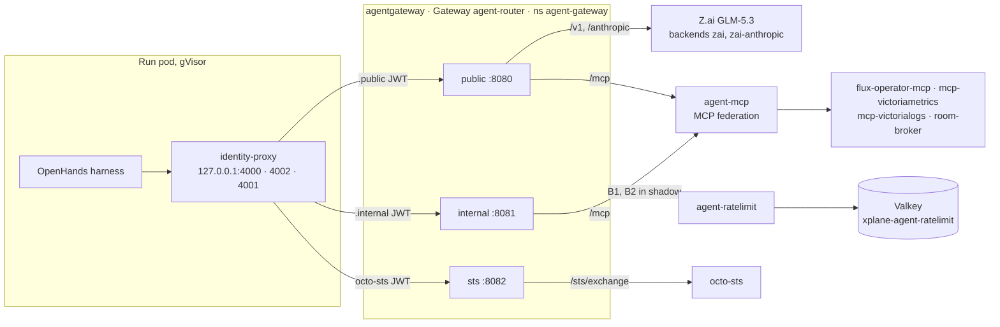

Every model call on this platform crosses one of two gateways, chosen by who is calling. Both speak
the OpenAI API; they differ in how they know the caller and in what they let it do. What runs
today is on the
[status page]().

| | `ai-gateway` | Agent gateway |
|---|---|---|
| **Callers** | Humans and coding clients: OpenCode, Continue, OpenWebUI, the nightly Promptfoo eval | Agent runs, through each run's identity-proxy sidecar |
| **Identity** | An API key per client, from AWS Secrets Manager | A projected token per run (JWT), verified on every call |
| **Model choice** | Named by the client, or picked from the prompt by the Semantic Router (`model: MoM`) | An alias, mapped statically to one backend; nothing selects per request |
| **Also carries** | — | MCP tool calls, the room tools, and the token exchange (`sts`) with octo-sts |
| **Software** | Envoy Gateway + Envoy AI Gateway (Agent Router) `1.1.0` | [agentgateway](https://agentgateway.dev) `v1.6.0` ([ADR-0053]()) |

![The two gateways side by side. Top: humans and coding clients reach ai-gateway over the tailnet with an API key; the Semantic Router may pick the model, and the request lands on a vLLM model in the serving fleet. Bottom: an agent run's identity-proxy sidecar attaches the run's own token; the agent gateway verifies it, meters the run's tokens and routes the model alias to a frontier provider (Z.ai GLM, Claude), the MCP tools, or octo-sts for a GitHub token. Both gateways write access logs and gen_ai metrics to the Victoria stack](/images/diagrams/ai-platform-2.svg)

*Source: [`docs/architecture/ai-platform.drawio`](https://github.com/Smana/cloud-native-ref/blob/main/docs/architecture/ai-platform.drawio), page 2.*

## `ai-gateway`: humans and coding clients

The platform speaks the OpenAI API. A client points at one endpoint, names a
model — or asks the platform to choose one — and never learns which pod
answered.

### Sending a request

```bash
# What's available
curl -sS https://llm.priv.aws.ogenki.io/v1/models \
  -H "Authorization: Bearer $LLM_API_KEY" | jq '.data[].id'

# Name a model explicitly — skips classification entirely
curl -sS https://llm.priv.aws.ogenki.io/v1/chat/completions \
  -H "Authorization: Bearer $LLM_API_KEY" \
  -H 'Content-Type: application/json' \
  -d '{
        "model": "xplane-qwen-coder",
        "messages": [{"role": "user", "content": "Write a Go worker pool."}]
      }'

# Let the Semantic Router choose from the prompt
curl -sS https://llm.priv.aws.ogenki.io/v1/chat/completions \
  -H "Authorization: Bearer $LLM_API_KEY" \
  -H 'Content-Type: application/json' \
  -d '{
        "model": "MoM",
        "messages": [{"role": "user", "content": "Write a Go worker pool."}]
      }'
```

The two calls reach the same pod. The difference is roughly **250–300 ms** of
classification on the `MoM` path — worth it when the client cannot know which
model suits the prompt, wasted when it can. See
[Coding Clients]()
for which client pins which model, and why.

### The request path

The [hop-by-hop request path](/images/diagrams/llm-platform-1.svg) shows each stage below in
one picture.

**Ingress.** External clients arrive over Tailscale at the Cilium Gateway
`platform-tailscale-general` and are forwarded to the Envoy AI Gateway data
plane Service. In-cluster clients — OpenWebUI, the nightly Promptfoo eval —
address that Service directly. Nothing is reachable from the public internet;
see [Private access]().

**Authentication.** A `SecurityPolicy` (`apiKeyAuth`) targets the Gateway, so
every route inherits it rather than each declaring its own. Keys come from AWS
Secrets Manager through External Secrets, and the gateway strips the
`Authorization` header before forwarding — vLLM never sees a credential.

**Prompt classification (`ext_proc`, filter index 0).** The Semantic Router is
wired in as an Envoy `ext_proc` gRPC filter, inserted **ahead of** the AI
Gateway's own extproc by an `EnvoyPatchPolicy` — a raw xDS JSONPatch. The
ordering is not optional and an `EnvoyExtensionPolicy` cannot express it,
because that API can only *append* filters. The router rewrites `body.model`
only when the client sent `model: MoM` (or the literal `auto`); an explicit
`xplane-*` name passes through untouched.

**Routing.** The AI Gateway extproc derives the `x-ai-eg-model` header from the
(possibly rewritten) body and emits `gen_ai_*` telemetry. An `AIGatewayRoute`
matches that header and forwards through an `AIServiceBackend` → `Backend` →
the model's Service on port 8000.

Not every claim routes this way yet: three of the four still use a hand-written route, listed
under [known gaps]().

### Semantic routing — `model: MoM`

Sending `model: MoM` lets the Semantic Router pick from the prompt. Its
decision list, highest priority first
(`infrastructure/base/vllm-semantic-router/helmrelease.yaml`):

| Priority | Decision | Target |
|---|---|---|
| 110 | code + reasoning | `xplane-qwen-coder` (`use_reasoning: true`) |
| 100 | code | `xplane-qwen-coder` |
| 90 | reasoning (math / physics) | `xplane-qwen3-8b` (`use_reasoning: true`) |
| 80 | multilingual | `xplane-qwen3-8b` |
| 50 | general (the default) | `xplane-qwen3-8b` |


`xplane-llamaguard3-1b` and the two LoRA adapters on `xplane-qwen-coder`
appear in **no** rule above. They hold serving capacity and are reachable only
by naming them directly. The router's own in-pod `prompt_guard` classifier
blocks jailbreak attempts, but that is a filter, not a routing decision —
there is no automatic guardrail dispatch (see
[known gaps]()).


### LoRA canaries

`xplane-qwen-coder` carries two LoRA adapters, each addressable as a model name
of its own, and sends 10% of its traffic to one of them:

```yaml
  gateway:
    enabled: true
    canaries:
      - adapter: xplane-qwen-coder-sql-dpo
        weightPercent: 10
```

The adapter name is matched **verbatim** against `loraAdapters[].name` — it is
not derived from the base model's name, so a typo produces a route to nothing
rather than a validation error.

Canaries are mutually exclusive with the Gateway API Inference Extension's
endpoint picker. See the
[roadmap]() for where the
endpoint picker stands and what turning it on would take.

### Frontier models and token budgets

`tier-frontier` is served by GLM-5.3 through Z.ai with the **platform** key, which only the gateway
holds. It needs no GPU, so it answers with `llm-platform` suspended: the `ai-gateway` umbrella is
live on aws-0 (suspended on gcp-0).

```bash
curl -s https://llm.priv.aws.ogenki.io/v1/chat/completions \
  -H "Authorization: Bearer $LLM_API_KEY" -H "Content-Type: application/json" \
  -d '{"model": "tier-frontier", "messages": [{"role": "user", "content": "Say hi"}]}'
```

The gateway strips `x-ar-agent`, `x-ar-human` and `x-ai-gateway-client-id` from every request before
authentication runs, so a client-forged value never survives to be charged. Today only
`x-ai-gateway-client-id` is then set — from the API key that matched. `x-ar-agent` exists only on
the separate `agent-router` Gateway; `x-ar-human` arrives with `ai-gateway`'s `oidc` listener. A
client cannot choose whose budget it spends.

Daily token budgets per API-key client (5M), per human (10M) and on all frontier spend (20M) are
counted in **shadow mode**: nothing is rejected yet
([ADR-0050]()).

## The agent gateway: agent runs

Every call an agent makes, to a model, a tool or the token exchange, crosses
[agentgateway](https://agentgateway.dev)'s Gateway `agent-router` in namespace `agent-gateway` under
the run's own identity. Runs moved to it on 2026-10-16 (#2408), Envoy's agent router was removed the
same day (#2429), and the human `ai-gateway` stays on Envoy Gateway
([ADR-0053]()). The harness
never sees the run's token: its identity-proxy sidecar attaches it (see
[Agent runtime]()). Manifests:
`infrastructure/base/agent-gateway/`.



### Listeners and data classes

| Listener | Port | Audiences | Routes |
|---|---|---|---|
| `public` | 8080 | `agent-router.<role>.public` | `/v1` and `/anthropic` to Z.ai; `/v1/models` answers a 404 body, not a model list; `/mcp` with documentation and room tools |
| `internal` | 8081 | `agent-router.<role>.internal` | `/mcp` with cluster, metric and log reads per role. No model route yet: `internal` runs will reach Claude through the Anthropic API (Bedrock or Vertex optional per cloud; ADR-0054), with the tier routes |
| `sts` | 8082 | `octo-sts/Smana/cloud-native-ref/<role>` | `/sts/exchange` to octo-sts, with the bearer forwarded (`preserveToken`) |

### Identity

| Check | Where | A failure answers |
|---|---|---|
| Signature, issuer, the listener's own audiences, `exp` and `sub` present | `jwtAuthentication`, `mode: Strict`, one policy per listener | 401 |
| `sub` starts with `system:serviceaccount:agents:` | the listener's `authorization` rule | 403 |
| No client-set `x-ar-agent`, `x-ar-human`, `x-ai-gateway-client-id` or `agent-session-id` | `strip-identity-headers`, before routing | — (removed) |

Each listener then sets `x-ar-agent` from the verified `jwt.sub`, and the same `sub` labels every
signal: `x_ar_agent` in the access log, `ar_agent` on metrics, `agent.principal` on spans
(`policies-identity.yaml`, `policy-frontend.yaml`).

### MCP federation

One `AgentgatewayBackend`, `agent-mcp` (`mcp.yaml`), federates the four servers with stateless
sessions and names every tool `<target>_<tool>`: `flux-operator-mcp_search_flux_docs`,
`mcp-victoriametrics_query`, `room-broker_room_read`. Each listener's route carries an `Allow` list,
one expression per role and target, so a role sees only its tools in `tools/list` and a denied call
answers `Unknown tool`. A target that fails is dropped from the list rather than failing the session
(`failureMode: FailOpen`). No run bearer reaches a server; the room-broker gets its own key in
`x-room-mcp-key`.

| Role | `public` | `internal` adds |
|---|---|---|
| implementer | documentation tools; `room_read`, `room_post`, `room_progress`, `room_handoff` | Flux instance, API versions and metrics; every VictoriaMetrics read tool |
| reviewer, tester, triager | documentation tools; their `room_*` tools (`room_verdict` for reviewer and tester) | also `get_kubernetes_resources`, `get_kubernetes_logs` and the VictoriaLogs query tools |

### Budgets

ADR-0050's agent budgets, on a rate-limit server of their own so they never share a bucket with the
human ones (`policy-budgets.yaml`, `ratelimit.yaml`, `kvstore.yaml`):

| Budget | Bucket | Limit per day |
|---|---|---|
| B1 | per run (the verified `sub`) | 5M reference tokens |
| B2 | the whole fleet | 40M reference tokens |

Both run in **shadow mode**: every descriptor sets `shadow_mode` and the server runs with
`SHADOW_MODE=true`, so nothing answers 429 yet. The server is `envoyproxy/ratelimit`
(`agent-ratelimit`) on the Valkey `KVStore` `xplane-agent-ratelimit`; if it is down the router fails
open and `AgentRateLimitDown` fires. Only a per-replica backstop of 30M raw tokens per hour per `sub`
enforces, sized so that only a runaway the run meter failed to revoke reaches it. The run's exact
cap is still the factory's run meter.

The token-exchange listener names each repository's audiences, at most eight per listener; adding
a repository is described on the [agents overview]().

## What the two share, and what they keep apart

From the [model routing and budgets design](https://github.com/Smana/cloud-native-ref/blob/main/docs/superpowers/specs/2026-09-23-llm-complexity-routing-design.md)
(SP4):

| Concern | Decision | Why |
|---|---|---|
| Semantic Router | On `ai-gateway` only; agents use their own Gateway | The router can be neither a single point of failure nor a prompt reader for agents |
| Agent model choice | Every agent alias maps to one backend: no weights, canaries or fallback | Nothing re-routes a trajectory mid-run; escalation is a new run at the next tier |
| Backends | One set per gateway, each with its own provider key | Revoking the agents' key never breaks chat or RunLore, and provider spend splits by key |
| Budgets | Token budgets at both gateways, in token units, each through its own `envoyproxy/ratelimit` and Valkey (ADR-0053) | One mechanism for every principal, no shared bucket; the factory still revokes a run at its exact cap |
